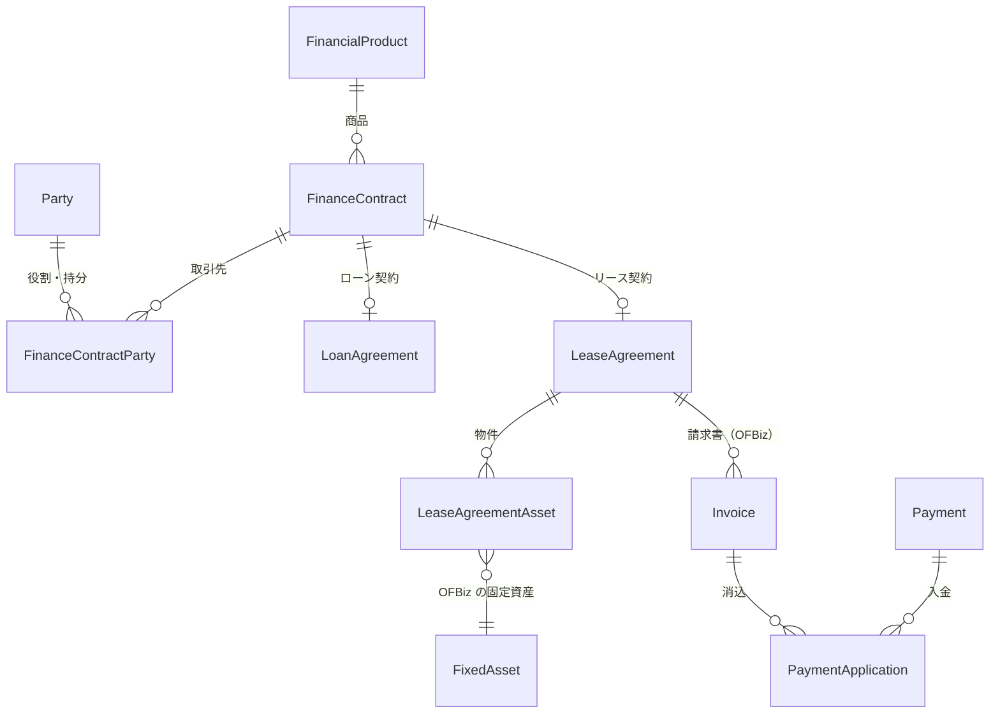
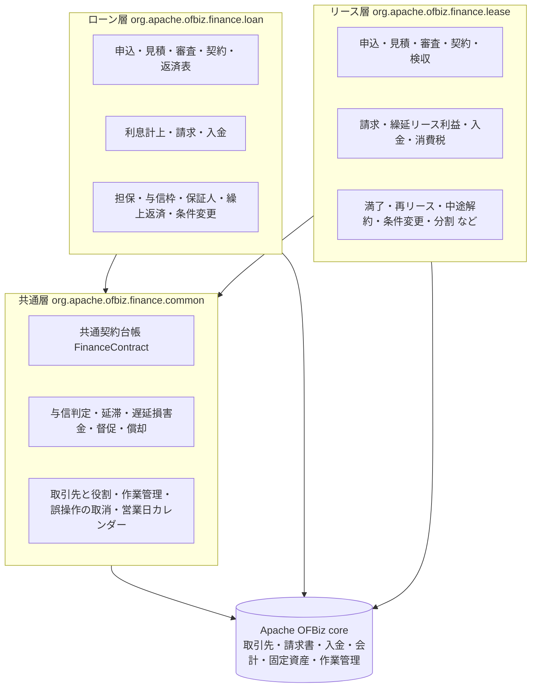
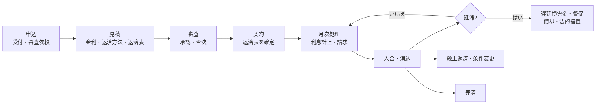
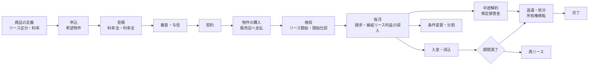
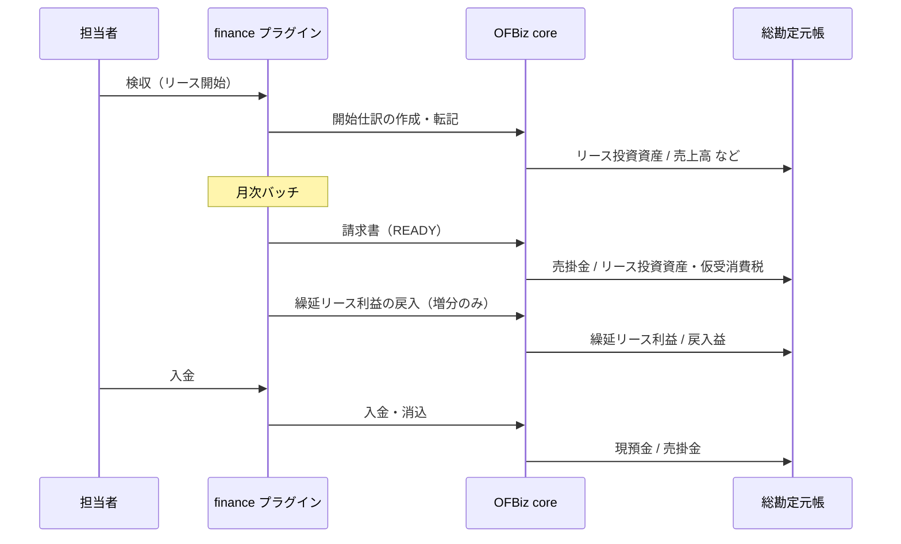
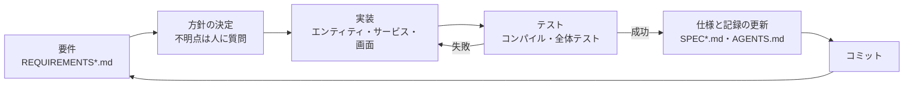

# ofbiz-plugins-finance

**Apache OFBiz の金融（ローン・リース）業界向けプラグイン**です。貸手（ローン会社・リース会社）の業務を、申込から契約・請求・入金・延滞・満了まで一通り動かすことができます。

> この README は、ローン・リース業務やシステム開発に詳しくない方にも全体像がつかめるように、用語の説明を交えながら書いています。詳しい仕様は「[9. 文書の案内](#9-文書の案内)」の各文書を参照してください。

---

## 目次

1. [はじめに（目的と対象読者）](#1-はじめに目的と対象読者)
2. [Apache OFBiz とは](#2-apache-ofbiz-とは)
3. [ユニバーサルデータモデルとは](#3-ユニバーサルデータモデルとは)
4. [本システム（OFBiz finance）の機能と特徴](#4-本システムofbiz-financeの機能と特徴)
5. [AI 駆動開発の評価用事例として](#5-ai-駆動開発の評価用事例として)
6. [プラグインの使い方](#6-プラグインの使い方)
7. [テストの実行と実行時間](#7-テストの実行と実行時間)
8. [ライセンス](#8-ライセンス)
9. [文書の案内](#9-文書の案内)
10. [注意書き（免責事項）](#10-注意書き免責事項)

---

## 1. はじめに（目的と対象読者）

### 1.1 このプロジェクトの目的

| 目的 | 内容 |
|------|------|
| **金融業界（貸手）向けのテンプレート** | Apache OFBiz の上に、ローン・リースの業務と会計をひと通り載せた「ひな形」です。自社の業務に合わせて直して使う出発点になります |
| **システム企画時のプロトタイプ** | ローン・リースシステムを企画するときに、実際に動く画面・データ・仕訳を見ながら要件を話し合うための試作品として使えます |
| **新規参画者向けの研修システム** | ローン・リース業務に初めて関わる人が、申込から完了までの流れと、そのときに起きる会計処理（仕訳）を手を動かして学べます |
| **AI 駆動開発の評価用事例** | 要件定義・仕様・実装・テストを AI（コーディングエージェント）と進めた実例です。規模や進め方は「[5.](#5-ai-駆動開発の評価用事例として)」にまとめています |

### 1.2 読者別の読み方

| あなたが… | おすすめの読み方 |
|------------|------------------|
| **ローン・リースシステムを企画する人** | 「[4. 機能と特徴](#4-本システムofbiz-financeの機能と特徴)」で範囲をつかみ、「[6. 使い方](#6-プラグインの使い方)」で動かして画面を確認してください。業務ごとの詳細は SPEC 文書にあります |
| **ローン・リース業務の入門者** | 「[4.2 ローン](#42-ローン業務)」「[4.3 リース](#43-リース業務一般リースの全ライフサイクル)」の流れ図と用語説明から読んでください。デモデータで画面を触ると理解が早まります |
| **AI 駆動開発について知りたい人** | 「[5. AI 駆動開発の評価用事例として](#5-ai-駆動開発の評価用事例として)」と、`AGENTS.md`・`REQUIREMENTS*.md`・`SPEC*.md` を見てください |
| **効率的・高速にシステム開発したい人** | 「[2.](#2-apache-ofbiz-とは)」「[3.](#3-ユニバーサルデータモデルとは)」で既存部品とデータモデルを再利用する考え方を、「[4.6](#46-カスタマイズと拡張性)」で拡張のしかたを確認してください |

---

## 2. Apache OFBiz とは

**Apache OFBiz（オフビズ。Open For Business の略）** は、Apache ソフトウェア財団が開発しているオープンソースの **ERP（統合業務システム）** です。会計・受発注・在庫・製造・顧客管理・作業管理などの機能と、それらを作るための開発基盤（フレームワーク）を持っています。Java・Groovy・XML で作られ、Apache License 2.0 で公開されています。

### 2.1 OFBiz の仕組み（ざっくり）

OFBiz のアプリケーションは、次の 4 つの部品を XML の定義と Java / Groovy のコードで組み合わせて作ります。

| 部品 | 役割 | 本システムでの例 |
|------|------|------------------|
| **エンティティ（Entity）** | データベースの表の定義 | `entitydef/*.xml`（`LoanAgreement`、`LeaseAgreement` など） |
| **サービス（Service）** | 業務処理の単位（入力・出力・権限・トランザクション） | `servicedef/*.xml` と `src/main/java`・`groovyScripts`（`createLeaseAgreement` など） |
| **画面（Screen / Form）** | 画面の部品の定義 | `widget/*.xml` |
| **コントローラー（Controller）** | URL と画面・サービスの対応 | `webapp/finance/WEB-INF/controller.xml` |

これらをまとめた単位が **コンポーネント** で、`plugins` ディレクトリーに置くと **プラグイン** として読み込まれます。本システムもこの形のプラグイン（`finance`）です。


### 2.2 OFBiz を使うメリット

- **作らなくてよい部分が多い**：取引先（Party）、請求書（Invoice）、入金（Payment）、消込（PaymentApplication）、会計仕訳（AcctgTrans）、勘定科目、固定資産（FixedAsset）、作業管理（WorkEffort）、税率、為替レート、営業日カレンダー、ユーザー・権限などが最初から使えます。本システムは **金融業務に特有の部分だけ** を追加しています。
- **会計まで一気通貫**：業務の処理（請求・入金など）から、OFBiz の会計（総勘定元帳）まで自然につながります。業務と会計が別々のシステムにならないので、つじつまが合わせやすくなります。
- **定義が中心で変更しやすい**：表・サービス・画面の多くが XML の定義なので、項目の追加や画面の変更が比較的簡単です。
- **トランザクション・権限・多言語・多通貨の仕組みがある**：業務システムに必要な土台が揃っています。
- **オープンソース**：ライセンス費用がかからず、ソースコードをすべて読んで直せます。

---

## 3. ユニバーサルデータモデルとは

**ユニバーサルデータモデル（Universal Data Model）** は、Len Silverston 氏の書籍 *The Data Model Resource Book*（全 3 巻）で示された、**業種をまたいで使える標準的なデータモデル** の考え方です。OFBiz のデータモデルはこれをもとに作られています。本システムは、その第 2 巻にある **Financial Services（金融サービス）** のモデルに準拠しています。

### 3.1 考え方の要点

| 考え方 | 説明 | 本システムでの例 |
|--------|------|------------------|
| **取引先（Party）と役割（Role）を分ける** | 「人・会社」という実体と、「借手」「貸手」「保証人」といった立場を分けて持つ。同じ会社が、ある契約では借手、別の契約では販売店になれる | `Party` と `RoleType`。契約の取引先は `FinanceContractParty`（役割・持分・期間） |
| **商品（Product）を汎用に表す** | 個別の商品ごとに表を作らず、商品の種類と属性で表す | 金融商品 `FinancialProduct`（種類 `FinancialProductType`）、リース条件 `FinancialProductLease` |
| **契約（Agreement）を共通の形で持つ** | ローン・リースなど契約の種類が違っても、共通の台帳で扱う | 共通契約台帳 `FinanceContract`（ローン契約・リース契約が 1 件ずつ対応） |
| **状態（Status）と区分（Enumeration・Type）を表で持つ** | 状態や区分をコードにせず、データとして定義する。状態の変わり方（遷移）もデータで決める | `StatusItem` / `StatusValidChange`（例：`LEASEAGR_CONTRACTED` → `LEASEAGR_ACTIVE`） |

### 3.2 ユニバーサルデータモデルを使うメリット

- **設計で迷わない**：多くの業界で使われてきた型に沿うので、表の設計を一から考える必要が減ります。
- **新しい業務を少ない追加で表せる**：例えば「保証人」「シンジケート（複数の貸手）」のような新しい立場も、役割を 1 つ増やすだけで表せます。
- **他の業務とつながる**：取引先・商品・会計が OFBiz 全体で共通なので、販売・購買・会計などの既存機能とデータを共有できます。
- **知識が再利用できる**：書籍や OFBiz の資料がそのまま理解の助けになり、研修にも使えます。



---

## 4. 本システム（OFBiz finance）の機能と特徴

### 4.1 全体の構成（3 つの層）

プラグインの中は **共通層・ローン層・リース層** の 3 つに分かれています。ローン層とリース層はお互いを参照せず、どちらも共通層だけを使います。こうしておくと、片方の変更がもう片方に影響せず、新しい種類の契約（例：割賦）も同じ形で追加できます。



| 層 | 主な役割 |
|----|----------|
| **共通層** | ローン・リースに共通の台帳（`FinanceContract`）、同じ顧客のローン・リースを合わせた与信判定、延滞の判定・遅延損害金・督促・償却、取引先と役割、作業（タスク）管理、誤操作の取消、営業日カレンダー |
| **ローン層** | 金銭を貸し、利息を付けて返してもらう業務（金銭消費貸借） |
| **リース層** | リース会社が物件を買い、借手に一定期間貸してリース料を受け取る業務 |

契約の種類ごとの違い（延滞額の内訳、償却するときの勘定科目など）は、`FinanceContractAdapter` という部品が吸収します。共通層はこの部品を通して、ローンかリースかを意識せずに処理します。

### 4.2 ローン業務

**ローン** は、お金を貸して、決められた返済表（いつ・いくら返すか）に沿って元本と利息を返してもらう取引です。



| 機能 | 内容 |
|------|------|
| 申込・見積・審査・契約 | 申込の状態管理、見積は作成後に変更しない（条件を変えるときは新しい見積を作る）、承認済みの申込・見積・審査がそろって初めて契約できる、契約時に返済表を確定 |
| 利息計上・請求・入金 | 日割り基準（既定 Actual/365）で残元本に応じた利息を月次で計上、期日ごとに請求書を作成、入金を利息→元本の順に充当 |
| 担保（Collateral） | 担保の登録・評価、担保掛目（LTV）による審査、担保付き契約での担保設定 |
| 事業者向けローン | 与信枠（Credit Line）、保証人、同じ顧客のローン・リースを合わせた与信枠チェック |
| 延滞管理 | 延滞の判定と区分、遅延損害金の計上、督促状、償却、法的措置の記録 |
| 繰上返済・条件変更 | 一部繰上返済（返済額軽減型・期間短縮型）、全額繰上返済、条件変更で返済表を作り直す |

### 4.3 リース業務（一般リースの全ライフサイクル）

**リース** は、借手が使いたい物件（機械・事務機器・車両など）を **リース会社が買い**、借手に一定期間貸して、毎月 **リース料** を受け取る取引です。物件の持ち主はリース会社なので、期間の終わりには物件の返還・処分（売却・廃棄）、または借手への所有権の移転があります。本システムは、この **一般的なリースの始まりから終わりまで** をすべて扱えます。



#### リースの主な用語

| 用語 | 意味 |
|------|------|
| **取得価額** | リース会社が物件を買う金額 |
| **残価** | リース期間が終わったときに見込む物件の価値 |
| **料率法・利率法** | リース料の決め方。取得価額に月額料率を掛ける方法と、計算利子率から求める方法 |
| **検収** | 借手が物件を受け取って確認すること。検収日がリース開始日になる |
| **ファイナンスリース** | 実質的に物件の購入代金を分割で払うのに近いリース（所有権移転・移転外） |
| **オペレーティングリース** | ファイナンスリース以外のリース。物件はリース会社の資産として減価償却する |
| **第 1 法** | ファイナンスリースの収益計上方法の一つ。開始時に売上高・売上原価を計上し、利息相当額を「繰延リース利益」として期間に応じて戻し入れる |
| **再リース** | 期間満了の後、同じ物件を 1 年単位などで低い料金で貸し続けること |
| **規定損害金** | 中途解約のときに借手が払う金額（未経過のリース料の現在価値など） |

#### リースの機能一覧

| 分野 | 機能 |
|------|------|
| 商品 | リース商品（リース区分・支払時期・料率・残価率・収益計上方法・対象物件の種類） |
| 申込・見積・審査・契約 | 希望物件つきの申込、見積（作成後は変えない）、共通の審査、与信枠チェック、契約時に確定リース料表を作成 |
| 物件の購入・検収 | 販売店への発注と仕入請求書・支払、OFBiz の固定資産の登録、検収でリース開始・開始仕訳 |
| 毎月の会計 | 請求（回ごとに 1 件）、繰延リース利益の利息法による戻入、入金の充当（消費税→利息相当額→元本） |
| 消費税 | 検収日の税率で固定、各回に計上／開始時に一括計上、通貨ごとの端数処理 |
| 延滞 | 延滞の判定、遅延損害金、督促、償却、法的措置（共通層の仕組みをローンと共用） |
| 満了 | 満了通知、返還・引取り、処分（売却・廃棄）、所有権移転、契約の完了。人の作業はタスクとして管理 |
| 帳票・照会 | 見積書・契約書・検収証などの帳票、回収状況・未回収元本・物件台帳の照会 |
| リース料の構成要素 | 固定資産税・保険料・保守料など、元本と利息以外の費用をリース料に含める（収益を区分するかどうかも選べる） |
| 公租公課 | 償却資産税・自動車税・重量税など、税目ごとの規則（計算方法・課税団体・賦課期日・免税点）で計算と申告 |
| メンテナンスリース | 保守料の区分計上、保守計画・保守予定・実績、保守業者の請求による原価計上 |
| オペレーティングリース | 物件を賃貸資産として計上し、リース期間定額法で月次に減価償却 |
| 再リース | 再リース契約、前受した再リース料の月次の按分、残存簿価の償却 |
| 中途解約 | 規定損害金の計算と請求、リース投資資産の精算、物件の引揚げ |
| 条件変更 | 期間・リース料・計算利子率の変更（未請求の回からリース料表を作り直す） |
| 誤操作の取消 | 検収・中途解約・条件変更を、後続の処理がない場合に限り、逆仕訳で取り消す（管理者のみ） |
| 営業日カレンダー | 祝日を考慮した期日の調整（国ごとのカレンダーを商品に複数指定できる） |
| 前受リース料・保証金 | 前受金の自動充当（古い回から／最終回から）、保証金の精算と返還 |
| 物件分割・契約分割 | 数量のある物件の分割、物件のグループごとに新しい契約へ分割（部分解約・部分返還に使える） |

### 4.4 リアルタイムと日次（月次）の計上

本システムでは、**業務の操作と会計の仕訳がずれない** ことを重視しています。

| タイミング | 処理 | 例 |
|------------|------|----|
| **リアルタイム（操作したとき）** | 操作と同じトランザクションで、OFBiz の会計仕訳を作って転記する | 検収したら開始仕訳、請求したら売掛金、入金したら現預金と消込、中途解約したら精算仕訳 |
| **日次・月次（バッチ）** | 期日の来た回の請求と、時間の経過で発生する収益の計上をまとめて行う | ローンの利息計上、リースの繰延リース利益の戻入、オペレーティングリースの減価償却、再リース料の按分 |

バッチは **何度実行しても二重に計上しません**。「計上日までの累計額 − すでに計上した累計額」を増分として計上するため、月の途中で実行しても、あとで再実行しても正しい金額になります。同じ契約を同時に処理しないように、契約ごとのロック（`FinanceContract.processingLockVersion`）で直列化しています。



### 4.5 多言語・多通貨

- **多言語**：画面の文言はラベルファイル（`config/FinanceUiLabels.xml`）にまとめてあり、**英語と日本語** を用意しています。OFBiz の言語切替の仕組みで表示言語が変わり、ラベルを追加すればほかの言語にも対応できます。
- **多通貨**：契約ごとに通貨を持てます。金額の端数処理は通貨ごとに設定でき（例：円は小数なし・切捨て、ドルは小数 2 桁・四捨五入）、契約の通貨と会社の基準通貨が違う場合は、仕訳のときに OFBiz の為替レートで基準通貨に換算します。

### 4.6 カスタマイズと拡張性

| 拡張のしかた | 内容 |
|--------------|------|
| **設定ファイル** | `config/finance.properties` で、日割り基準、期日の休日調整、営業日カレンダー、消費税率と計上時期、遅延損害金の計算基礎、満了通知の時期、再リースの料率、解約時の残価の扱いなどを変えられる |
| **商品の設定** | 金融商品ごとに、期間の範囲、料率、残価率、支払時期、収益計上方法、カレンダー、延滞の規則などを持てる |
| **差し替えられる部品** | リースの収益計上方法（`LeaseRevenueStrategy`）、公租公課の計算方式（`LeasePublicChargeCalculator`）、契約種別ごとの部品（`FinanceContractAdapter`。`finance.properties` の `contract.adapter.<種別>` で登録）、審査承認時の検証サービス |
| **データで増やせるもの** | 状態・区分・税目・物件の種類・勘定科目の対応・取引先の役割は seed データで追加できる |
| **土台の用意** | 取引先と役割・持分（`FinanceContractParty`）、基本契約と個別契約の親子関係、作業管理（WorkEffort）を共通層に用意しており、シンジケートリース・転貸リース・オートリースなどの後続の業務を追加しやすくしている |

### 4.7 画面

OFBiz にログインし、`/finance` を開くと次のメニューが使えます。

| メニュー | 内容 |
|----------|------|
| ローン申込・ローン契約 | 申込の登録と審査、見積、契約、返済表、請求・入金、繰上返済 |
| 担保・与信枠 | 担保の登録と評価、事業者の与信枠 |
| 延滞・顧客 | 延滞一覧、遅延損害金、督促、顧客ごとのローン・リースの状況 |
| 商品 | ローン商品・リース商品の定義 |
| リース申込・リース契約 | 申込と希望物件、見積、契約、購入・検収、請求・入金、前受金・保証金、条件変更、中途解約、再リース、分割、保守 |
| 満了 | 満了予定の一覧と満了作業 |
| 照会 | 回収状況、未回収元本、物件台帳 |
| 公租公課 | 税率表、申告の作成、納付 |

### 4.8 規模

| 項目 | 数 |
|------|----|
| エンティティ（表）の定義 | 77 |
| サービスの定義 | 123 |
| 画面の定義 | 28 |
| Java のコード | 約 14,000 行 |
| Groovy のコード（業務処理・画面の準備・テスト） | 約 10,700 行 |
| テストクラス／テストケース | 26 クラス／217 件（すべて成功） |

---

## 5. AI 駆動開発の評価用事例として

このプラグインは、**AI（コーディングエージェント）と人が対話しながら** 要件定義から実装・テストまでを進めて作りました。

### 5.1 進め方

業務を小さな **STEP** に分け、STEP ごとに次の流れを繰り返しました。



- ローンは STEP 1〜7、リースは STEP L0〜L15d（共通層の切り出し、商品、見積、検収、会計、消費税、延滞、満了、帳票、構成要素、公租公課、メンテナンス、オペレーティング、再リース、中途解約、条件変更、取消、カレンダー、前受金、分割）の順に作りました。
- 判断が必要なところ（会計の扱い・按分の基準・データベースの変更など）は、AI が選択肢を示して人が決めました。決めたことは仕様書の「決定事項」に残しています。
- 毎回の STEP で全体テストを実行し、**それまでの機能が壊れていないこと** を確かめてから次へ進みました。

### 5.2 文書の役割

| 文書 | 役割 |
|------|------|
| `AGENTS.md` | AI が守るルール（層の分け方、状態を変えてよいサービス、会計のルール、データの区分、検証の手順など） |
| `REQUIREMENTS.md` / `REQUIREMENTS_LEASE.md` | 要件定義と STEP の計画・状態 |
| `SPEC_COMMON.md` / `SPEC.md` / `SPEC_LEASE.md` | 詳細仕様、決定事項、テストの内容、検証結果、運用メモ（**正本**） |

文書を「正本」として先に整えておくことで、AI が作業を中断・再開しても、前の決定と矛盾しないように進められました。

### 5.3 規模と期間

- 期間：約 1 週間（2026-10-09 〜 2026-10-16）、コミット 49 件（README 作成前の時点）
- 成果物：「[4.8 規模](#48-規模)」のとおり（テストケース 217 件はすべて成功）

---

## 6. プラグインの使い方

### 6.1 前提

| 項目 | 内容 |
|------|------|
| Apache OFBiz | 24.09 系（開発・テストは **24.09.07** で実施） |
| Java | OFBiz 24.09 が対応する JDK（17 以上。開発は JDK 21 で実施） |
| データベース | 既定の Derby で動作を確認（ほかの DB は未確認） |
| OS | Windows では `gradlew.bat`、Linux / macOS では `./gradlew` を使う |

### 6.2 配置

OFBiz の `plugins` ディレクトリーに、このリポジトリを `finance` という名前で置きます。

```bash
cd apache-ofbiz-24.09.07/plugins
git clone https://github.com/naofum/ofbiz-plugins-finance.git finance
```

配置後のディレクトリー構成は次のとおりです。

```
apache-ofbiz-24.09.07/
└── plugins/
    └── finance/
        ├── ofbiz-component.xml   … コンポーネントの定義
        ├── config/               … 設定（finance.properties）・ラベル
        ├── data/                 … seed / demo データ
        ├── entitydef/            … エンティティの定義
        ├── servicedef/           … サービスの定義
        ├── src/main/java/        … 業務処理（Java）
        ├── src/main/groovy/      … テスト
        ├── groovyScripts/        … 業務処理・画面の準備（Groovy）
        ├── widget/               … 画面・フォーム・メニュー
        ├── webapp/               … Web アプリケーション（/finance）
        └── testdef/              … テストの定義・テスト用データ
```

### 6.3 OFBiz core の修正（必須）

消込の解除を正しく動かすため、OFBiz core の次のファイルに修正が必要です。プラグインには含まれないので、**OFBiz 側に同じ修正を加えてください**。

```text
applications/accounting/src/main/groovy/org/apache/ofbiz/accounting/payment/PaymentServices.groovy
```

`removePaymentApplication()`（消込の削除）は、支払済み（PAID）の請求書を READY に戻すときに、`setInvoiceStatus` への入力名を `statustId` と誤記しているため、請求書が PAID のまま残ることがあります。次の 3 点を直します。

1. 入力名の誤記 `statustId` を `statusId` に直す。
2. `paidDate: null` を渡して、支払日を空にする。
3. `setInvoiceStatus` の結果を確認し、エラーなら呼び出し元に返す（消込の削除も同じトランザクションでロールバックされる）。

修正前（OFBiz 24.09.07、990 行付近）：

```groovy
        // if the invoice is already PAID, then set it back to READY and clear out the paidDate
        GenericValue invoice = from('Invoice').where(invoiceId: paymentApplication.invoiceId).queryOne()
        if (invoice.statusId == 'INVOICE_PAID') {
            run service: 'setInvoiceStatus', with: [invoiceId: paymentApplication.invoiceId,
                                                    statustId: 'INVOICE_READY']
        }
```

修正後：

```groovy
        // if the invoice is already PAID, then set it back to READY and clear out the paidDate
        GenericValue invoice = from('Invoice').where(invoiceId: paymentApplication.invoiceId).queryOne()
        if (invoice.statusId == 'INVOICE_PAID') {
            Map statusResult = run service: 'setInvoiceStatus', with: [
                    invoiceId: paymentApplication.invoiceId,
                    statusId: 'INVOICE_READY',
                    paidDate: null]
            if (ServiceUtil.isError(statusResult)) {
                return statusResult
            }
        }
```

差分（`git apply` などで当てる場合）：

```diff
--- a/applications/accounting/src/main/groovy/org/apache/ofbiz/accounting/payment/PaymentServices.groovy
+++ b/applications/accounting/src/main/groovy/org/apache/ofbiz/accounting/payment/PaymentServices.groovy
@@ -990,8 +990,13 @@ Map removePaymentApplication() {
         // if the invoice is already PAID, then set it back to READY and clear out the paidDate
         GenericValue invoice = from('Invoice').where(invoiceId: paymentApplication.invoiceId).queryOne()
         if (invoice.statusId == 'INVOICE_PAID') {
-            run service: 'setInvoiceStatus', with: [invoiceId: paymentApplication.invoiceId,
-                                                    statustId: 'INVOICE_READY']
+            Map statusResult = run service: 'setInvoiceStatus', with: [
+                    invoiceId: paymentApplication.invoiceId,
+                    statusId: 'INVOICE_READY',
+                    paidDate: null]
+            if (ServiceUtil.isError(statusResult)) {
+                return statusResult
+            }
         }
         toMessage = label('AccountingUiLabels', 'AccountingPaymentApplToInvoice', paymentApplicationFields)
     }
```

`ServiceUtil` は元のファイルですでに import されているので、import の追加は不要です。この修正はファイル内のこの箇所だけです（OFBiz 24.09.07 の元のファイルとの差分で確認）。

### 6.4 データの投入と起動

OFBiz のディレクトリーで次を実行します（Windows の例）。

```powershell
# 初めて使う場合：DB を作り直して、seed と demo を含むすべてのデータを読み込む
.\gradlew.bat cleanAll loadAll

# 既存の環境に追加する場合：finance の seed（と必要なら demo）だけを読み込む
.\gradlew.bat "ofbiz --load-data readers=seed --load-data component=finance"
.\gradlew.bat "ofbiz --load-data readers=demo --load-data component=finance"

# 起動
.\gradlew.bat ofbiz
```

> `cleanAll` はデータベースの中身をすべて消します。必要なデータがある環境では実行しないでください。

起動したら、ブラウザーで次を開きます。

```
https://localhost:8443/finance
```

demo データを読み込んだ環境では、OFBiz の管理者ユーザー（`admin` / `ofbiz`）でログインできます。画面を使うには `OFBTOOLS` と `FINANCE` の権限が必要です。

### 6.5 データの種類

| 種類 | 場所 | 用途 |
|------|------|------|
| **seed** | `data/*TypeData.xml` など | 状態・区分・勘定科目の種類・権限など、本番でも必要な基本データ |
| **demo** | `data/*DemoData.xml` | 画面を試すためのサンプル（商品・顧客・申込・完了済みの業務の例・為替レート） |
| **テスト用** | `testdef/data/*` | 自動テスト専用のデータ |

> **注意**：`FinanceExchangeRateDemoData.xml` の USD/JPY 固定レートは、OFBiz 全体で共有される為替レート（`UomConversionDated`）に登録されます。**本番環境に demo データを投入しないでください。**

### 6.6 主な設定（`config/finance.properties`）

| 設定 | 既定値 | 意味 |
|------|--------|------|
| `interest.daycount.convention` | `DAY_COUNT_ACT_365` | 利息の日割り基準 |
| `currency.scale.<通貨>` / `currency.rounding.<通貨>` | JPY=0・DOWN、USD=2・HALF_UP | 通貨ごとの小数桁数と端数処理 |
| `duedate.convention` | `DUEDATE_NONE` | 期日が休日のときの調整 |
| `business.calendar.ids` | `FIN_JP` | 既定の営業日カレンダー |
| `lease.tax.rate` / `lease.tax.timing` | `0.10` / `LEASE_TAX_INSTALL` | リースの消費税率（税率表がないときの既定）と計上時期 |
| `lease.latefee.base` | `TAX_INCLUDED` | リースの遅延損害金の計算基礎（税込／税抜） |
| `lease.expiry.notice.months` | `3` | 満了通知のタスクを作る時期（満了の何か月前か） |
| `lease.release.months` / `lease.release.annual.factor` | `12` / `1.0` | 再リースの期間と料率 |
| `lease.termination.include.residual` | `false` | 中途解約の規定損害金に残価を含めるか |
| `contract.adapter.LOAN` / `contract.adapter.LEASE` | 各層の Adapter クラス | 契約種別ごとの部品の登録 |

---

## 7. テストの実行と実行時間

### 7.1 テストの実行

```powershell
# 実行前に、通常起動している OFBiz を停止しておく
.\gradlew.bat compileJava compileGroovy
.\gradlew.bat "ofbiz --test component=finance"
```

結果は `runtime/logs/test-results/financetests.xml` に出力されます。先頭の `<testsuite ...>` で **`errors="0"` と `failures="0"`** になっていれば成功です。

- テストは既定のデータベースを共有し、実行のたびにテスト用の契約・請求・仕訳が残ります。
- テストを途中で止めると、データが中途半端に残り、次回のテストが失敗することがあります。その場合は `SPEC_COMMON.md` の運用メモを参照してください。

### 7.2 実行時間を短くするには

全体のテストには **時間がかかります**（開発時の実績で 25〜45 分程度。データベースが大きくなるほど遅くなります）。次の方法で少し改善できます。

1. **Derby のページキャッシュを増やす**：`runtime/data/derby.properties` の `derby.storage.pageCacheSize` の値を増やします。

   ```properties
   # 既定値は 1000。例えば 10000 に増やす
   derby.storage.pageCacheSize=10000
   ```

2. **開発用のデータベースを作り直す**：テストを繰り返して遅くなったら、`.\gradlew.bat cleanAll loadAll` で作り直すと速くなります（データはすべて消えます）。

---

## 8. ライセンス

このプラグインは **Apache License 2.0** で提供します。全文は [`LICENSE`](LICENSE) を参照してください。

土台の Apache OFBiz も Apache License 2.0 で公開されています。

---

## 9. 文書の案内

| 文書 | 内容 |
|------|------|
| [`REQUIREMENTS.md`](REQUIREMENTS.md) | ローンの要件定義（STEP 1〜7） |
| [`REQUIREMENTS_LEASE.md`](REQUIREMENTS_LEASE.md) | 共通層・リースの要件定義（STEP L0〜）、後続 STEP の計画 |
| [`SPEC_COMMON.md`](SPEC_COMMON.md) | 共通層の詳細仕様・運用メモ |
| [`SPEC.md`](SPEC.md) | ローン層の詳細仕様 |
| [`SPEC_LEASE.md`](SPEC_LEASE.md) | リース層の詳細仕様（STEP ごとの決定事項・仕訳・テスト・検証） |
| [`AGENTS.md`](AGENTS.md) | 開発のルール（AI エージェント向けだが、設計方針の要約としても読める） |

---

## 10. 注意書き（免責事項）

- 本システムは、テンプレート・プロトタイプ・研修・評価を目的として作成したものです。
- **本番の業務で利用する場合は**、次のことが必要です。
  - 会計仕訳・消費税・公租公課などの処理内容を、**経理担当者・税理士・公認会計士などの専門家に確認してもらうこと**。会計基準や税制の改正、各社の会計方針によって、必要な処理は変わります。
  - 自社の業務・データ・運用に合わせて、**システムを十分にテストすること**。
- 本製品は **現状のまま（AS IS）** 提供されます。作成者（naofum）は、本製品の動作上の問題、および本製品の利用によって生じたいかなる損害についても責任を負いません。
