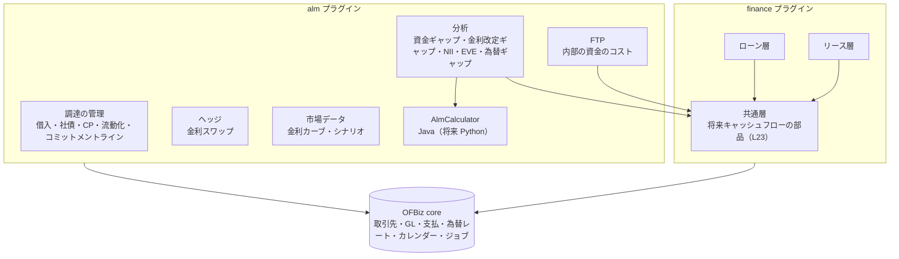
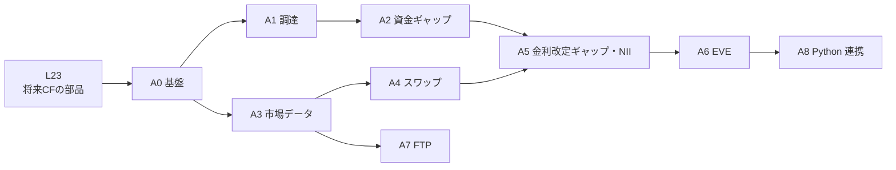

# Apache OFBiz ALM（資産負債管理）

ローン・リース会社（貸手）の **ALM（Asset Liability Management、資産負債管理）** を、Apache OFBiz の新しいプラグイン `alm` として作るための要件定義。詳細な設計は `SPEC_ALM.md` を正とする。

> **状態：設計（未着手）**。2026-10-17 に方針を決定した。本書と `SPEC_ALM.md` は、alm プラグインを作るまで `plugins/finance/` に置き、作るときに `plugins/alm/` へ移す。

---

## 1. 全体方針

### 1.1 目的

| 項目 | 内容 |
|------|------|
| 目的 | **社内の管理（経営判断・ALM 委員会）**。資金繰り・金利・為替のリスクを測り、調達の計画と、ローン・リースの価格（計算利子率・料率）の判断に使う |
| 対象外（当面） | 金融当局・金融機関・格付け会社への報告の様式、会計基準の開示（金融商品の時価の注記 等）。必要になったら帳票を追加する |

### 1.2 確定事項（2026-10-17）

| 項目 | 決定 |
|------|------|
| 置き場所 | **新しいプラグイン `alm`**（`plugins/alm`）。finance の層（共通・ローン・リース）とは別のプラグインにする |
| finance との依存 | **alm → finance の共通層だけ**。alm はローン層・リース層のクラスを参照しない。資産の将来キャッシュフローは、finance の共通層に追加する部品（finance の STEP L23、`SPEC_COMMON.md` 14 章）から受け取る。finance は alm を参照しない |
| 調達の手段 | **借入（証書借入・当座貸越）、社債、CP、流動化（リース債権・ローン債権）、コミットメントライン、金利スワップ** |
| 作る順番 | **資金ギャップと調達の管理から始め**、市場データ・金利スワップ → 金利感応度（NII・EVE）→ FTP → 高度なシミュレーションの順に作る（4 章の STEP） |
| 計算の方式 | **まず Java**。計算部分は差し替えられる部品（`AlmCalculator`）にし、高度なシミュレーション（モンテカルロ等）が必要になったら **Python をバッチからファイル連携で呼ぶ**（STEP A8） |
| 範囲の考え方 | finance の要件の「**貸手側のみ**」（`REQUIREMENTS_LEASE.md` 1.1）は変えない。自社が借り手になる取引（調達）は alm で扱う |

### 1.3 構成

### 1.4 開発の進め方

- finance と同じく、STEP ごとに「要件 → 仕様 → 実装 → 全体テスト → 仕様・記録の更新」を繰り返す。
- alm のテストは alm プラグインのテストスイート（`almtests`）とし、finance の全体テストも毎回通す（L23 の部品を使うため）。
- 業務の状態（調達の契約・スワップ・分析の実行）は、finance と同じく **専用の状態遷移サービスだけ** で変える。分析の結果（スナップショット）は、作成後に変更しない。

---

## 2. 用語

| 用語 | 意味 |
|------|------|
| **ALM** | 資産（貸付・リース）と負債（借入・社債 等）を一緒に管理し、資金繰り・金利・為替のリスクを測って調整すること |
| **基準日** | 分析の時点。その日の残高・予定・市場データで計算する |
| **期間の帯（バケット）** | 将来を区切った期間（例：1 か月以内、1〜3 か月、3〜6 か月、6 か月〜1 年、1〜2 年、…） |
| **資金ギャップ** | 期間の帯ごとの「資金の入り（回収・調達）− 資金の出（返済・新しい実行）」と、その累計。累計がマイナスになる時期は資金が足りない |
| **金利改定ギャップ** | 金利が見直される時期（固定なら満期、変動なら次の改定日）ごとの「資産 − 負債」 |
| **NII（期間損益）** | Net Interest Income。一定期間（例：1 年）の受取利息（リースは利息相当額）− 支払利息。金利シナリオごとに見積もる |
| **EVE（経済価値）** | Economic Value of Equity。資産の将来キャッシュフローの現在価値 − 負債の将来キャッシュフローの現在価値 |
| **デュレーション・BPV** | 金利の変化に対する価値の変化の大きさ。BPV は金利が 1bp（0.01%）動いたときの価値の変化額 |
| **FTP** | Funds Transfer Pricing（仲値）。調達のコストを期間に応じて貸付・リースに割り当てる、社内の資金の価格 |
| **コミットメントライン** | 金融機関があらかじめ約束した借入の枠。使っていない枠は、いざというときの資金の手当てになる |
| **流動化** | リース債権・ローン債権を譲渡して資金を得ること。譲渡後の回収金の受け渡し（サービサー）も含む |
| **金利スワップ** | 固定金利と変動金利の利息を交換する契約。変動金利の借入を実質的に固定にする（またはその逆）ために使う |
| **シナリオ** | 金利・為替の変化の仮定（例：全期間 +100bp、短期だけ +200bp） |
| **行動の前提** | 繰上返済の比率、中途解約の比率、再リースの比率、コミットメントラインの利用の比率など、契約どおりに動かない分の仮定 |

---

## 3. 共通の設計方針

### 3.1 データの流れ

1. 基準日を決めて **分析の実行** を作る（状態：作成中 → 計算中 → 完了／エラー → 確定）。
2. 資産：finance の共通層の部品（L23）で、対象の契約（有効・分割済・中途解約で回収中）の **将来キャッシュフロー** を取得し、実行の明細として保存する（スナップショット）。
3. 負債・ヘッジ：alm の調達の契約・スワップの予定を、同じ形で保存する。
4. 市場データ：基準日の金利カーブ・為替レート・シナリオを、実行に紐付けて保存する（後から市場データを直しても、過去の結果は変わらない）。
5. 計算：`AlmCalculator` が明細から分析の結果を作り、結果の表に保存する。
6. 確定：ALM 委員会で使った実行を「確定」にし、以後は変えない（取り消すときは新しい実行を作る）。

### 3.2 キャッシュフローの形（共通）

すべての資産・負債・ヘッジのキャッシュフローを、次の項目に揃える。

| 項目 | 内容 |
|------|------|
| 区分 | 資産（ローン・リース）／負債（借入・社債・CP・流動化）／オフバランス（コミットメントライン・スワップ） |
| 発生源 | 契約の種別と ID（finance の `FinanceContract`、alm の調達の契約・スワップ） |
| 日付 | 期日（営業日調整済み） |
| 種類 | 元本、利息（リースは利息相当額）、消費税、残価、手数料、前受金・保証金、スワップの受払い |
| 金額・通貨 | 契約の通貨。基準通貨への換算は分析の時に行う |
| 金利の情報 | 固定／変動、次の改定日、基準金利とスプレッド（変動のとき） |
| 確実性 | 確定（請求済み・約定済み）／予定（契約上の予定）／想定（行動の前提・新しい実行の仮定） |

### 3.3 会計との関係

- 調達の取引（借入の実行・返済・利払い、社債の発行・償還、CP、流動化の譲渡と回収金の受け渡し、スワップの受払い）は、OFBiz の支払・仕訳と finance の `FinanceGlHelper` で仕訳を作る（finance と同じく、操作したときにすぐ転記する）。
- 未払利息の計上（日割り）は、finance の利息計上（増分で計上し、二重に計上しない）と同じ考え方で行う。
- 分析の結果は仕訳を作らない。基準日の GL の残高と、分析に使った残高を突き合わせる照合表を作る。

### 3.4 権限・監査

- 権限：`ALM_VIEW`（照会）、`ALM_ADMIN`（設定・市場データ）、`ALM_FUNDING_CREATE`（調達の登録）、`ALM_RUN`（分析の実行・確定）。
- 分析の実行には、使った前提（期間の帯・シナリオ・行動の前提・計算の版）を記録し、同じ入力から同じ結果を出せるようにする。

---

## 4. STEP の計画

| STEP | 内容 | 状態 |
|------|------|------|
| L23（finance） | 将来キャッシュフローの部品：finance の共通層に、契約の将来キャッシュフローを返す部品を追加する（`SPEC_COMMON.md` 14 章） | 設計（未着手） |
| A0 | 基盤：alm プラグインの土台、分析の実行とスナップショット、期間の帯の定義、資産のキャッシュフローの取込み（L23 を使う） | 設計（未着手） |
| A1 | 調達の管理：借入・社債・CP・コミットメントライン・流動化の契約と予定、実行・返済・利払い・未払利息の仕訳 | 設計（未着手） |
| A2 | 資金ギャップ：期間の帯ごとの資金の差と累計、通貨別、コミットメントラインの未使用枠、限度額と警告、ALM 委員会向けの帳票 | 設計（未着手） |
| A3 | 市場データ：金利カーブ（通貨・期間別、基準日ごと）、為替レート（OFBiz のものを使う）、シナリオの定義 | 設計（未着手） |
| A4 | 金利スワップ：契約、受払いの予定、変動側の金利改定、仕訳 | 設計（未着手） |
| A5 | 金利改定ギャップと NII のシミュレーション（新しい実行の想定を含む） | 設計（未着手） |
| A6 | EVE の感応度：現在価値、デュレーション、BPV、金利ショックのシナリオ | 設計（未着手） |
| A7 | FTP：期間別の資金のコスト、見積の計算利子率・料率の下限、案件ごとの採算 | 設計（未着手） |
| A8 | Python 連携：高度なシミュレーション（モンテカルロ、行動の前提の推定）をバッチからファイル連携で行う | 設計（未着手） |

---

## STEP L23（finance）— 将来キャッシュフローの部品

finance の共通層に、契約の種別に依存しない「将来キャッシュフローの取得」を追加する。alm は finance の共通層の部品だけを使う。

- 対象：ローン（有効）、リース（有効、分割済の請求済みの回、中途解約後の未回収）。
- 内容：基準日以降の期日ごとの元本・利息（利息相当額）・消費税・構成要素・残価、請求済みで未回収の額、前受金・保証金の残高、契約の通貨、金利の種類（今は固定のみ）。
- 確定リース料表・返済表は **現在の revision** を使う。請求済みの回は請求書の未回収の額、未請求の回は表の額とする（finance の延滞計算・回収状況と同じ考え方）。
- 業務の処理は変えない（読み取りのみの追加）。
- 詳細は `SPEC_COMMON.md` 14 章。

---

## STEP A0 — 基盤

- alm プラグインの土台（`ofbiz-component.xml`、エンティティ・サービス・画面・権限・ラベル（英語・日本語）、テストスイート）。
- **分析の実行**（`AlmRun`）：基準日、対象の組織、基準通貨、期間の帯の定義、シナリオ、行動の前提、計算の版、状態（作成中・計算中・完了・エラー・確定）。
- **期間の帯の定義**（`AlmBucketSet` / `AlmBucket`）：既定の帯（翌日、1 週間、1 か月、3 か月、6 か月、1 年、2 年、3 年、5 年、7 年、10 年、10 年超）。帯は設定データで追加・変更できる。
- **キャッシュフローのスナップショット**（`AlmCashFlow`）：3.2 の形。資産は L23 の部品から、負債・ヘッジは alm の契約から取り込む。
- 実行はバッチ（ジョブスケジューラ）と画面の両方から行える。1 回の実行は 1 つのトランザクションにせず、契約のまとまりごとに確定する（finance の月次バッチと同じ考え方）。

---

## STEP A1 — 調達の管理

| 調達の手段 | 管理する内容 |
|------------|--------------|
| 証書借入 | 貸し手（金融機関）、借入日、元本、通貨、金利（固定／変動：基準金利・スプレッド・改定の間隔）、返済の方法（元金均等・元利均等・期日一括）と返済表、利払いの間隔、日割り基準、担保・保証、コベナンツ（財務制限条項）の記録 |
| 当座貸越 | 極度額、借入・返済の明細、金利 |
| コミットメントライン | 極度額、期間、未使用の枠の手数料（コミットメントフィー）、借入の実行（実行すると借入として管理）、未使用の枠 |
| 社債 | 発行日、額面、発行価額、利率（固定／変動）、利払い日、償還日（満期一括・定時償還）、発行費用 |
| CP | 発行日、額面、割引率、満期日（短期）、発行の繰り返し（借換え） |
| 流動化 | 譲渡する債権（finance の契約の一覧）、譲渡日、譲渡価額、劣後部分（自社が持つ分）、回収金の受け渡しの予定（サービサーとして）、買戻しの条件。**会計上オフバランスかどうか**（譲渡の要件を満たすか）を記録する |

- 業務の状態：契約中 → 実行済み（残高あり）→ 完済／償還済み、取消。
- 予定表（返済・利払い）は契約時に作り、変動金利は改定日ごとに次の期間の利息を決める（金利は A3 の市場データまたは手入力）。
- 仕訳：実行（借 現預金 ／ 貸 借入金）、返済、利払い、未払利息の月次計上、社債発行費・コミットメントフィー。勘定科目は seed（`GlAccountType`）で定義し、組織ごとに割り当てる。
- 流動化した債権は、finance 側では回収を続ける（借手への請求・入金は変わらない）。alm 側で、回収金を受け渡す予定（負債）として扱う。finance の契約に「流動化済み」の印を付ける方法は `SPEC_ALM.md` で決める（finance の変更が要る場合は別の STEP として記録する）。

---

## STEP A2 — 資金ギャップ

- 基準日の実行から、期間の帯ごとに **資金の入り**（資産の回収予定、調達の実行予定）と **資金の出**（調達の返済・利払い、新しい貸付・リースの実行の予定、経費の見込み（任意入力））を集計し、差と累計を出す。
- 通貨別と、基準通貨に換算した合計。
- **コミットメントラインの未使用の枠** と手元資金を「使える資金」として別に示し、累計の不足と比べる。
- **行動の前提**：繰上返済・中途解約の比率（期間の帯ごと）、延滞の回収遅れ。初期値は「前提なし（契約どおり）」。
- **限度額と警告**：累計の不足の上限、特定の期間の帯の不足、特定の調達先への集中（残高の割合）。超えたら警告を出し、作業管理のタスクを作る（L21 の承認ワークフローと組み合わせられる）。
- 帳票：資金ギャップ表、前回の実行との比較、調達の満期の一覧（PDF は jasperreports、CSV）。

---

## STEP A3 — 市場データ

- **金利カーブ**：通貨 × カーブの種類（例：TONA、TORF、TIBOR、スワップレート、自社の調達カーブ）× 基準日 × 期間（1 か月〜30 年）→ 金利。間の期間は補間する（既定は線形）。
- **基準金利の値**（変動金利の改定に使う）：基準金利 × 日付 → 値。
- **為替レート**：OFBiz の `UomConversionDated` を使う（finance と同じ）。
- **シナリオ**：平行移動（±100bp・±200bp）、傾きの変化（短期上昇・長期上昇）、利用者の定義。シナリオはカーブの変化として保存する。
- 市場データの取込みは、CSV の取込み（手入力の代わり）を用意する。外部の配信サービスとの自動連携は対象外（将来の拡張）。

---

## STEP A4 — 金利スワップ

- 契約：相手先、約定日、開始日、満期日、想定元本（一定／逓減）、固定側の金利、変動側の基準金利とスプレッド、受払いの方向（固定払い・変動受け 等）、利払いの間隔、日割り基準。
- 予定：固定側・変動側の受払いの予定。変動側は改定日に金利を決める。
- 仕訳：受払いの差額の計上。時価評価・ヘッジ会計の扱いは `SPEC_ALM.md` の要確認とする（会計の専門家の確認が必要）。
- 分析：金利改定ギャップ・NII・EVE に、スワップのキャッシュフローを含める。

---

## STEP A5 — 金利改定ギャップと NII

- **金利改定ギャップ**：期間の帯ごとに、金利が見直される資産・負債・スワップの残高と差。資産（今は固定のみ）は満期まで、変動の負債は次の改定日までを、その帯に入れる。
- **NII のシミュレーション**：今後 1〜3 年（月次）の受取利息（リースは利息相当額の期間配分、finance の戻入と同じ考え方）と支払利息を、シナリオごとに見積もる。
  - 残高の前提：静的（満期の分は補充しない）と動的（新しい実行の計画を入力する）。
  - 新しい実行の金利：FTP（A7）または入力した利ざや。
- 結果：シナリオごとの NII と基準シナリオとの差。

---

## STEP A6 — EVE の感応度

- 資産・負債・スワップの将来キャッシュフローを、基準日の金利カーブ（＋シナリオ）で割り引いた現在価値と、その差（EVE）。
- 金利ショック（±100bp・±200bp 等）による EVE の変化、デュレーション、BPV、期間の帯ごとの感応度（キーレート・デュレーション）。
- 割引に使うカーブ・行動の前提・残価の扱い（リースの残価をキャッシュフローに含めるか）を、実行の前提として記録する。

---

## STEP A7 — FTP

- **FTP カーブ**：調達のコスト（自社の調達カーブ、または市場カーブ＋スプレッド）を期間別に定める。
- 貸付・リースの期間（とキャッシュフローの形）に応じた FTP 金利を求める（キャッシュフローに合わせた加重平均）。
- **使い方**：
  - 見積の計算利子率・料率の**下限**として示す（finance の見積画面に参考値を出す。finance の見積の計算は変えない。表示の追加は finance の別の STEP として記録する）。
  - 案件・商品・営業部門ごとの採算（利ざや ＝ 利率 − FTP 金利）。
- FTP の金利は契約時に固定して記録し、後から変えない（採算の比較のため）。

---

## STEP A8 — Python 連携（高度なシミュレーション）

- 対象：金利の確率的なシナリオ（モンテカルロ）、行動の前提（繰上返済・中途解約・再リース）の過去データからの推定、最適な調達の組合せの探索など。
- 方式：**バッチからのファイル連携**。Java のバッチが入力（キャッシュフロー・市場データ・前提・パラメーター）をファイルに書き出し、Python を外部プロセスとして起動し、結果のファイルを読み込んで保存する。
- 条件：Python の実行中に DB のトランザクションを開いたままにしない。Python の版とライブラリを固定する。入力・パラメーター・乱数の種・プログラムの版を実行に記録し、同じ結果を再現できるようにする。
- 計算部分は `AlmCalculator` の実装の 1 つ（`PythonAlmCalculator`）とし、Java の実装と結果を比べるテストを用意する。

---

## 5. 範囲外・将来の拡張

- 規制・当局向けの報告様式、格付け会社向けの資料の様式。
- 信用リスク（貸倒れの見込み）の計量、資本の配賦。
- 市場データの自動配信の連携、リアルタイムの分析。
- 変動金利のローン・リース（finance の商品の追加が必要。追加すれば A5・A6 の資産側に反映する）。
- 外貨の調達とクロスカレンシースワップ（為替ギャップは A2 で見る）。
- 有価証券の運用（余剰資金の運用）。
