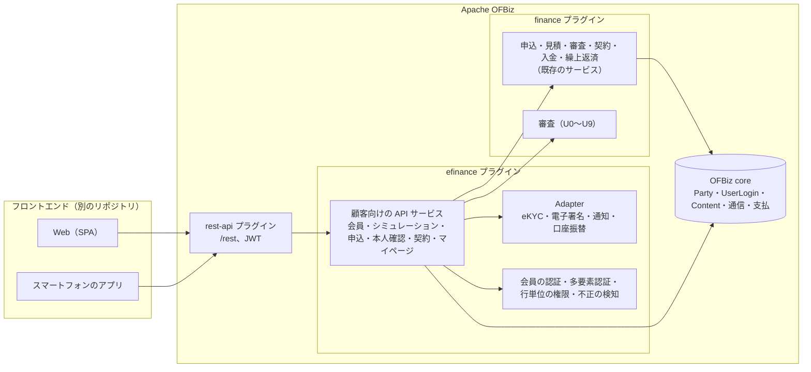
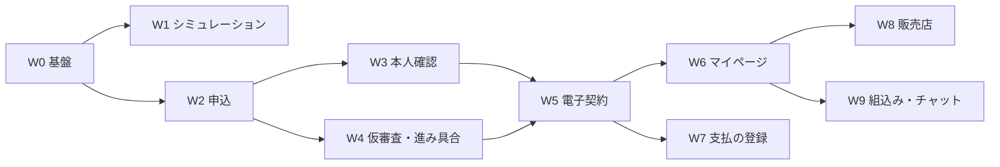

# Apache OFBiz eFinance（Web 申込・顧客ポータル）

ローン・リースを **Web で申込から契約・契約後の手続きまで完結** できるようにする、顧客向けのプラグイン `efinance` の要件定義。OFBiz の ecommerce（order・product の上に乗る顧客向けの店舗）と同じ考え方で、finance の上に乗る顧客向けの仕組みとする。詳細な設計は `SPEC_EFINANCE.md` を正とする。

> **状態：設計（未着手）**。2026-10-17 に方針を決定した。本書と `SPEC_EFINANCE.md` は、efinance プラグインを作るまで `plugins/finance/` に置き、作るときに `plugins/efinance/` へ移す。

---

## 1. 全体方針

### 1.1 目的

| 目的 | 内容 |
|------|------|
| 申込の完結 | 商品を調べてから、申込・本人確認・審査・契約・初回の支払の登録までを、来店・郵送なしで行える |
| 契約後の利便 | 契約・返済・入金の照会、繰上返済・条件変更・満了時の選択・住所の変更などを、顧客自身が行える |
| 業務の効率 | 入力・書類の確認・郵送の手間を減らし、finance の審査（`REQUIREMENTS_UNDERWRITING.md`）と担当者の作業に、整った情報をつなぐ |
| 広く使われる | スマートフォンで使いやすく、費用が分かりやすく、安心できるサービスにする |

### 1.2 確定事項（2026-10-17）

| 項目 | 決定 |
|------|------|
| 主な利用者 | **個人の直接の申込**と**法人の直接の申込**を最初の重点とする。販売店のポータル（W8）・提携先への組込み（W9）は後の STEP |
| 画面の作り方 | **rest-api（OFBiz の rest-api プラグイン）の API と、別のフロントエンド（SPA・スマートフォンのアプリ）に分ける**。efinance プラグインは API（サービス）とその設定・データだけを持ち、顧客向けの画面は持たない（担当者向けの管理画面は efinance の中に小さな Web アプリとして持ち、finance は変えない） |
| 外部のサービス | **eKYC・電子契約・SMS・口座振替は、差し替えられる口（Adapter）と簡単な実装（手動・テスト用）を先に作り、製品別の実装は将来**（審査の `CreditInfoAdapter` と同じ考え方） |
| 依存 | **efinance → finance**（finance の共通層・ローン層・リース層の公開サービスを呼ぶ）と OFBiz core・rest-api。**ecommerce には依存しない**（会員の登録・ログイン・プロフィール等、必要な部品の考え方とコードだけを写して独立させる）。finance は efinance を参照しない |
| 業務の規則 | efinance はローン・リースの業務を自分では持たない。申込・見積・審査・契約・入金・繰上返済などは **finance の既存のサービス** を呼んで行い、業務の状態は finance の状態遷移サービスだけが変える（AGENTS.md の規則） |
| 権限 | 顧客は **自分の申込・契約だけ** を見て操作できる（行単位の権限）。担当者の操作は finance の権限のまま |

### 1.3 構成

### 1.4 開発の進め方

- finance と同じく STEP ごとに「要件 → 仕様 → 実装 → 全体テスト → 仕様・記録の更新」を繰り返す。テストスイートは `efinancetests`（API サービスの単体テストと、REST 経由の結合テスト）。finance の全体テストも毎回通す。
- フロントエンドは API の仕様（OpenAPI、rest-api の `/docs`）に従って別に作る。efinance のリポジトリには、API の動作を確かめる簡単な画面（任意）と、API の利用例だけを置く。

---

## 2. 一般的な Web ファイナンスの課題と対策

| 課題 | 対策（STEP） |
|------|-------------|
| 入力が長く、途中でやめてしまう | 何段階かに分けた入力・途中保存と再開・入力の補助（郵便番号 → 住所、法人番号 → 会社の情報）・書類の写真からの読み取り（審査 U8）（W2） |
| 結果が出るまで分からない | 仮審査の即時の回答（審査 U3・U4）、進み具合の表示と通知（W4） |
| 本人確認が面倒 | オンラインの本人確認（eKYC）、法人は代表者の確認と登記の情報（W3） |
| 紙の契約・郵送 | 電子契約、書面の電子交付（事前の承諾）、書類のダウンロード（W5） |
| 費用・条件が分かりにくい | シミュレーション（総支払額・実質年率・消費税・手数料の内訳）、比較、重要事項の分かりやすい表示（W1） |
| 契約後の手続きが不便 | マイページ（照会・各種の手続き・通知）（W6） |
| 支払の登録が面倒 | 口座振替のオンラインの登録、カード（W7） |
| なりすまし・不正 | 多要素認証、不審な操作の検知、上限の額、ロック（W0・W3・W4） |
| スマートフォンで使いにくい | API を前提に、スマートフォン優先の画面をフロントエンドで作る。アクセシビリティ（JIS X 8341-3 / WCAG 2.1 AA）を画面の要件にする |
| 問合せの窓口が分かりにくい | 案件に紐付くメッセージ、よくある質問、チャット（AI）と担当者への引継ぎ（W6・W9） |

---

## 3. 用語

| 用語 | 意味 |
|------|------|
| **会員** | efinance に登録した顧客（個人、または法人の担当者）。OFBiz の `Party`・`UserLogin` |
| **法人アカウント** | 法人（`Party`、PARTY_GROUP）と、その担当者（会員）の組。担当者ごとに権限（申込・照会・支払の手続き）を持つ |
| **仮審査** | 申込の主要な項目から、その場で出す目安の結果（審査の規則・スコア）。本審査の結果を約束しない |
| **本審査** | 書類・本人確認・信用情報の照会を経た finance の審査（`LoanUnderwriting`） |
| **eKYC** | オンラインの本人確認。犯罪収益移転防止法の本人確認の方法（本人確認書類の画像と容貌の画像、IC チップの読み取り 等）に合わせる |
| **電子交付** | 法令で交付が必要な書面を、顧客の承諾を得て電磁的な方法で交付すること |
| **申込の下書き** | 申込を送る前の、途中保存の状態 |

---

## 4. 共通の設計方針

### 4.1 API

- 顧客向けの操作は、efinance のサービス（`export="true"`、rest-api の `api/efinance.rest.xml` で公開）として作る。サービスは入力を検証し、本人の申込・契約かを確かめてから、finance のサービスを呼ぶ。
- 顧客は finance のサービスを直接呼べない（finance のサービスは `export` しない）。
- 応答には、顧客に見せてよい項目だけを返す（内部の審査の情報・スコア・担当者のコメントは返さない）。
- 多言語（日本語・英語、ラベルとメッセージ）、多通貨（商品の通貨）。

### 4.2 認証・権限

- 会員の登録（メールアドレスの確認）、ログイン（rest-api の JWT。アクセストークンは短い有効期間、更新トークン）、パスワードの規則、**多要素認証**（SMS またはメールのワンタイムパスワード、将来は認証アプリ・パスキー）、一定回数の失敗でロック。
- 行単位の権限：会員は、自分（と自分が担当する法人）が申込者・借手・借主の申込・契約だけを扱える（`FinanceContractParty` と申込の申込者で判定）。
- 重要な操作（契約の締結、口座の登録、繰上返済の申込、住所・連絡先の変更）は、直前の再認証（多要素認証）を必須にする。

### 4.3 外部のサービス

| 口 | 簡単な実装（最初） | 将来 |
|----|--------------------|------|
| `EkycAdapter`（本人確認） | 画像のアップロードを受け付け、担当者が efinance の管理画面で目視で確認する（手動） | eKYC サービスの API |
| `ESignatureAdapter`（電子契約） | 契約書の PDF に同意のチェックと日時・IP・端末の記録をして確定する（クリックによる同意。電子署名法の電子署名ではない） | 電子署名サービスの API（署名・タイムスタンプ） |
| `NotificationAdapter`（通知） | メール（OFBiz の通信の仕組み）。SMS はログに出すだけのテスト用 | SMS・プッシュ通知のサービス |
| `DirectDebitAdapter`（口座振替） | 口座の情報の受付と、担当者による登録（書面の口座振替の依頼の代わり） | 金融機関の口座振替の受付サービス（オンラインの登録） |
| `AddressLookupAdapter`・`CorporateLookupAdapter`（入力の補助） | 郵便番号の表（任意の取込み）、法人番号の手入力 | 郵便番号の API、国税庁の法人番号の API |

どの口も、テスト用の実装（決めた結果を返す）を持つ。

### 4.4 法令・記録

- 犯罪収益移転防止法（本人確認の方法・記録の保存）、貸金業法・割賦販売法（広告の表示、契約前・契約時の書面と電子交付の承諾、信用情報の照会の同意）、個人情報保護法（利用目的の通知・同意、第三者提供）、電子署名法、電子帳簿保存法（電子の書類の保存）、消費者契約法、特定商取引法（該当する場合）。法務の確認を前提とする。
- 同意の記録：何に（利用規約・個人情報の取扱い・信用情報の照会・電子交付・電子契約）、いつ、どの版の文面に、どの端末・IP から同意したかを残す。
- 操作の記録：ログイン、申込の送信、本人確認、契約の締結、重要な変更の操作の記録（監査用）。

### 4.5 セキュリティ

- HTTPS、CORS の設定（フロントエンドの出所だけ）、入力の検証、アップロードの制限（種類・大きさ・ウイルスの検査の口）、レート制限、CSRF（トークンの方式）、秘密の情報は DB に置かない。
- 不正の検知：同じ端末・IP・電話番号・住所・口座からの複数の申込、短時間の連続の申込、仮審査の繰返し（条件を変えた試行）、海外の IP（設定）。疑わしい申込は担当者の確認に回す（審査 U3 の規則に渡す）。

---

## 5. STEP の計画

| STEP | 内容 | 状態 |
|------|------|------|
| W0 | 基盤：efinance プラグイン、rest-api の公開、会員の登録・ログイン・多要素認証、法人アカウントと担当者、行単位の権限、同意・操作の記録 | 設計（未着手） |
| W1 | 商品の紹介とシミュレーション（ログイン不要。返済・リース料の予定、総支払額・実質年率・消費税・手数料の内訳） | 設計（未着手） |
| W2 | Web での申込：分割した入力・途中保存と再開・入力の補助・書類のアップロード・申込の送信（finance の申込の作成） | 設計（未着手） |
| W3 | 本人確認（eKYC）と同意（`EkycAdapter`、手動の確認から） | 設計（未着手） |
| W4 | 仮審査と進み具合の表示・通知（審査の U3・U4 と連携、`NotificationAdapter`） | 設計（未着手） |
| W5 | 電子契約と書面の電子交付（`ESignatureAdapter`、見積の受理と契約の作成） | 設計（未着手） |
| W6 | マイページ：契約・返済・入金の照会、各種の手続き（繰上返済・条件変更・満了時の選択・住所の変更・証明書）、メッセージ | 設計（未着手） |
| W7 | 支払：口座振替の登録（`DirectDebitAdapter`）、カード・振込の案内 | 設計（未着手） |
| W8 | 販売店のポータル（代理の申込・見積・審査の結果・検収の連絡） | 設計（未着手） |
| W9 | 提携先への組込み（埋め込みの画面・提携先の API の鍵）、チャット・AI の窓口 | 設計（未着手） |

最初の範囲は W0〜W7（個人・法人の直接の申込から契約後の手続きまで）。審査の U0〜U5（判定・スコア）と U7（個人の法令の確認）は W4・W5 の前提になる。

---

## STEP W0 — 基盤

- プラグインの土台（`ofbiz-component.xml`、`api/efinance.rest.xml`、サービス、エンティティ、ラベル、テストスイート）。
- 会員の登録：メールアドレス・パスワード・氏名（個人）／会社名と担当者（法人）・電話番号。メールの確認のリンクで有効にする。ecommerce の `createcustomer` の考え方を写す（ecommerce のコードには依存しない）。
- ログイン：rest-api の JWT（アクセストークン・更新トークン）。多要素認証（メール・SMS のワンタイムパスワード）。パスワードの再設定。一定回数の失敗でロック。ログアウトと全端末のログアウト。
- 法人アカウント：法人（`Party`）と担当者（会員）。管理者の担当者が、他の担当者を招待し、権限（申込・照会・支払の手続き）を付ける。
- 同意・操作の記録（4.4）。

## STEP W1 — 商品の紹介とシミュレーション

- 公開してよい商品（finance の `FinancialProduct` に「Web で公開」の設定を追加）の一覧・説明・条件（期間・金額の範囲・金利または料率の目安・必要な書類）。
- シミュレーション（ログイン不要）：ローンは金額・期間・返済方法から返済予定（finance の見積の計算と同じ部品を使う。保存しない）。リースは物件の金額・期間からリース料の目安。総支払額・利息（利息相当額）・消費税・手数料・実質年率（貸金業法の表示の考え方）を出す。
- 表示の規則：広告の表示の要件（金利の幅・返済の例 等）に合わせた表示の項目を商品に持つ（法務の確認）。

## STEP W2 — Web での申込

- 申込の下書き（`EfApplicationDraft`）：商品・入力の段階ごとの値・アップロードした書類。送信までは何度でも保存・再開でき、一定期間（設定）で消える。
- 入力の段階：①商品と金額・期間（シミュレーションから引き継ぐ）②申込者の情報（個人：氏名・生年月日・住所・勤務先・年収・住居・他社の借入、法人：会社の情報・代表者・決算の概要）③リースは希望物件（物件・販売店・見積書）④書類のアップロード ⑤確認と同意 ⑥送信。
- 入力の補助：郵便番号から住所、法人番号から会社名と所在地（口の簡単な実装は手入力）。書類の写真から AI で項目を読み取る（審査 U8、任意）。
- 送信：finance の申込の作成（`createLoanApplication` / `createLeaseApplication`、希望物件 `createLeaseApplicationAsset`）を呼び、審査の情報（審査 U1 の項目）と書類を finance の審査の側へ渡す。下書きは送信済みにする。
- 重複の防止：同じ会員・同じ商品の送信中の申込があれば警告する。

## STEP W3 — 本人確認（eKYC）と同意

- 個人：本人確認書類の画像（表・裏・厚み）と容貌の画像、または IC チップの読み取りの結果を `EkycAdapter` に渡す。最初は担当者が efinance の管理画面で目視で確認し、結果（確認済み・再提出・不可）を記録する。
- 法人：法人の確認（登記の情報、法人番号）と、取引の担当者・代表者の本人確認。
- 同意：利用規約・個人情報の取扱い・信用情報の照会（個人）・電子交付・電子契約の同意を、それぞれの文面の版と一緒に記録する。
- 本人確認の結果は審査（審査 U6 の外部の情報）に記録し、本人確認が済んでいない申込は契約できない。

## STEP W4 — 仮審査と進み具合

- 仮審査：送信のとき（または ②の入力の後）に、審査の規則（U3）とスコア（U4）を、仮の情報で評価し、目安の結果（お申込みいただけます／ご相談ください／お受けできません）を返す。結果の詳細（スコア・規則）は顧客に見せない。仮審査の繰返しを検知する。
- 進み具合：申込の状態を顧客向けの段階（受付・書類の確認中・追加の書類のお願い・審査中・結果のご連絡・ご契約の手続き・ご契約済み）に対応づけて表示する（finance の申込・審査・見積・契約の状態から決める）。
- 追加の書類のお願い：担当者が efinance の管理画面から依頼し、顧客がマイページから提出する。
- 通知：状態が変わったとき、追加の書類のお願い、結果のご連絡を `NotificationAdapter` で知らせる（メール。SMS は将来）。

## STEP W5 — 電子契約と書面の電子交付

- 審査が承認され、担当者が見積を提示した後、顧客がマイページで見積・契約の内容・重要事項を確認する。
- 顧客の操作：見積の受理（finance の `setLoanQuoteStatus` / `setLeaseQuoteStatus`）→ 契約の締結（`ESignatureAdapter`。最初はクリックによる同意と記録）→ finance の契約の作成（`createLoanAgreement` / `createLeaseAgreement`）。契約の作成は、審査の条件（審査 U5）を満たしていることを finance が確かめる。
- 書面の交付：契約前の書面・契約書・重要事項の説明を、電子交付の承諾がある場合は PDF（finance の帳票、jasperreports）でマイページに置き、交付の日時を記録する。承諾がない場合は郵送の手配を担当者のタスクにする。
- L21（承認ワークフロー）で契約の作成に承認が必要な商品は、顧客の締結の後に承認を依頼し、承認されたら契約を作る。

## STEP W6 — マイページ

| 機能 | 内容 |
|------|------|
| 一覧 | 申込（進み具合）・契約（状態・残高・次の支払） |
| 契約の詳細 | 返済予定・リース料の予定、支払の履歴、未払・延滞（あれば）、前受金・保証金の残高（リース）、物件（リース） |
| 手続き | 繰上返済のシミュレーションと申込（ローン、finance の繰上返済のサービス。申込は担当者の確認の後に実行）、条件変更の相談、満了時の選択（返還・再リース・買取りの希望。リース）、住所・連絡先・勤務先の変更（再認証、変更は担当者の確認の後に finance の取引先の情報へ反映）、残高の証明書・支払の証明書の発行 |
| メッセージ | 申込・契約に紐付くメッセージのやり取り（OFBiz の `CommunicationEvent`）、よくある質問 |
| 通知の設定 | 通知の種類（支払日の前・入金の確認・延滞・満了の 3 か月前・お知らせ）ごとのメール・SMS の選択 |

## STEP W7 — 支払

- 口座振替の登録：`DirectDebitAdapter`。最初は顧客が口座の情報を入力し、担当者が金融機関の手続きを行って登録の状態（申込中・登録済み・不備）を記録する。口座の番号は一部だけを表示し、保存は暗号化する（要確認）。
- カード・振込：振込先（顧客ごとの振込の口座、または契約番号つきの振込の案内）と、カード決済の口（将来）。入金の消込は finance の入金のサービスで行う（efinance は入金の予定と案内だけを持つ）。

## STEP W8 — 販売店のポータル

販売店（`DEMO_LS_SUPPLIER1` 等、finance の販売店）の担当者のアカウント、顧客の代わりの見積・申込（顧客の同意の取得の手順つき）、審査の結果の確認、検収の連絡（finance の検収の手続きの依頼）、手数料の照会（L20 のベンダーリースの土台）。

## STEP W9 — 提携先への組込み・チャット

- 組込み：提携先のサイトに埋め込める申込の画面（フロントエンドの部品）と、提携先ごとの API の鍵・利用の範囲・申込の流入元の記録（紹介の手数料の計算の土台）。
- チャット：よくある質問の自動の回答（AI）、申込・契約の状態の照会（本人の確認の後）、担当者への引継ぎ。AI に送る情報は審査の U8 と同じ規則（送る項目を最小にし、記録する）。

---

## 6. 範囲外・将来の拡張

- フロントエンド（SPA・スマートフォンのアプリ）そのもの（別のリポジトリで作る。API の仕様は efinance が持つ）。
- 製品別の外部サービスの実装（eKYC・電子署名・SMS・口座振替・郵便番号・法人番号の API）。
- 決済代行（カード）の組込み、オンラインの即時の入金（API による振込の確認）。
- 顧客の行動の分析・マーケティングの自動化（ecommerce の機能の考え方を参考に将来）。
