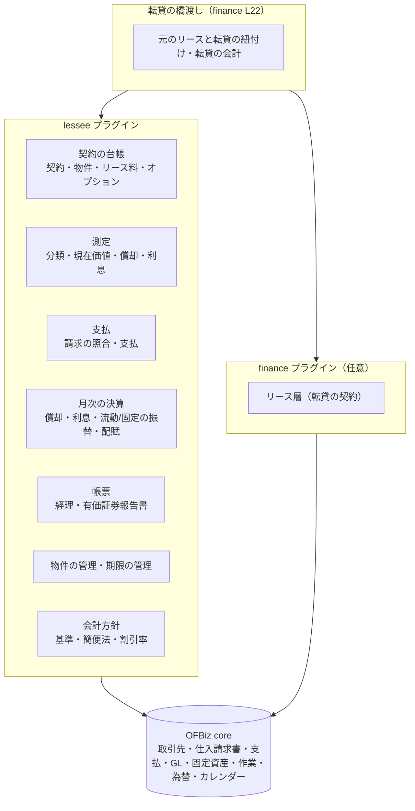
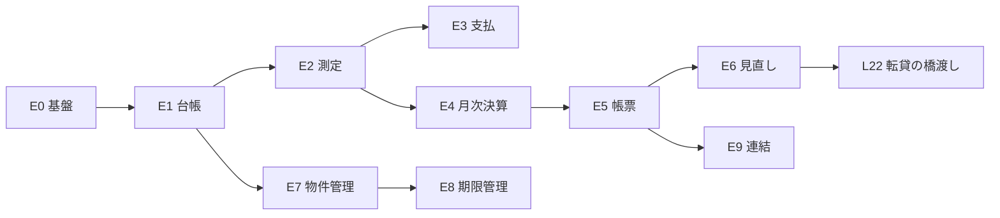

# Apache OFBiz Lessee（リース借手）

一般の事業会社が **リースの借手（lessee）** として、リース契約・リース物件・リース料の支払と、経理・有価証券報告書のための会計（リース資産・使用権資産、リース債務・リース負債、費用）を管理するための要件定義。新しいプラグイン `lessee` として作る。詳細な設計は `SPEC_LESSEE.md` を正とする。

> **状態：設計（未着手）**。2026-10-17 に方針を決定した。本書と `SPEC_LESSEE.md` は、lessee プラグインを作るまで `plugins/finance/` に置き、作るときに `plugins/lessee/` へ移す。

---

## 1. 全体方針

### 1.1 目的と利用者

| 項目 | 内容 |
|------|------|
| 利用者 | **一般の事業会社が単独で使う**（リース会社の finance プラグインを入れない環境でも動く） |
| 目的 | ①リース契約と物件の台帳 ②リース料の支払 ③月次の決算（償却・利息・流動／固定の振替）④経理・有価証券報告書の集計と開示資料 ⑤満了・解約・延長の期限の管理 |
| 会計基準 | **現行の日本基準（企業会計基準第 13 号）、新しいリース会計基準（企業会計基準第 34 号）、IFRS 第 16 号の 3 つ**。会社ごとに適用する基準を選び、移行期は並行して計算できる |
| 連結 | **段階的に作る**。最初は会社ごとの集計、次に連結の合算、最後に会社間のリースの消去 |

### 1.2 確定事項（2026-10-17）

| 項目 | 決定 |
|------|------|
| 置き場所 | **新しいプラグイン `lessee`**（`plugins/lessee`） |
| finance との依存 | **依存しない**（lessee だけで動く）。利息法の計算・端数処理・営業日・仕訳の作成など、finance と同じ考え方の部品は lessee の中に持つ（必要な分だけを写す。共通のプラグインへの切り出しは将来の検討事項） |
| 転貸リース | **lessee と finance の橋渡し**として作る（finance の STEP L22、`REQUIREMENTS_LEASE.md`）。元のリース（自社が借手）は lessee、転貸（自社が貸手）は finance のリース契約で管理し、紐付けと転貸特有の会計だけを橋渡しの部品が受け持つ |
| 最初の範囲 | **契約の台帳・当初の測定・支払・月次の決算・有価証券報告書の帳票**から始め、見直し → 物件管理の詳細 → 連結 → 転貸 の順に作る（4 章） |
| 会計の確定 | 仕訳・開示の内容は、経理担当者・公認会計士の確認を前提とする（各 STEP の「要確認」に記録する） |

### 1.3 構成

### 1.4 開発の進め方

- finance と同じく、STEP ごとに「要件 → 仕様 → 実装 → 全体テスト → 仕様・記録の更新」を繰り返す。テストスイートは `lesseetests`。
- 業務の状態（契約・測定・決算）は **専用の状態遷移サービスだけ** で変える。確定した決算・帳票の数字は変えない（直すときは修正の記録を足す）。
- 会計基準ごとの違いは、差し替えられる部品（`LesseeAccountingStandard`）に置き、基準の名前で分岐する処理を散らさない（finance の `LeaseRevenueStrategy` と同じ考え方）。

---

## 2. 用語

| 用語 | 意味 |
|------|------|
| **借手・貸手** | 借手（lessee）＝物件を借りてリース料を払う自社。貸手（lessor）＝リース会社 |
| **ファイナンス・リース**（現行基準） | 解約不能で、物件の経済的利益とコストを実質的にすべて借手が負うリース。所有権移転と移転外がある。リース資産・リース債務を計上する |
| **オペレーティング・リース**（現行基準） | ファイナンス・リース以外。賃貸借として処理し、リース料を費用にする（未経過リース料を注記する） |
| **使用権資産・リース負債**（新基準・IFRS 第 16 号） | 物件を使う権利（資産）と、リース料を払う義務の現在価値（負債）。原則としてすべてのリースで計上する |
| **短期リース・少額リース** | 計上を省略できる例外（期間 12 か月以内、少額の物件）。基準ごとに要件が違う |
| **リース期間** | 解約不能期間に、行使することが合理的に確実な延長オプションの期間と、行使しないことが合理的に確実な解約オプションの期間を加えたもの（新基準・IFRS） |
| **割引率** | リース負債の現在価値を求める利率。貸手の計算利子率が分かればそれを、分からなければ借手の追加借入利子率を使う |
| **利息法・定額法・利子込み法** | 利息相当額の配分の方法。現行基準では重要性が乏しい場合に定額法・利子込み法（利息を区分しない）を選べる |
| **残価保証** | 満了時に物件の価値が一定額に満たないとき、借手が差額を払う約束 |
| **変動リース料** | 指数・レートに連動する（リース負債に含める）ものと、使用量・売上に連動する（含めず発生時の費用）ものがある |
| **条件変更・見直し** | 契約の変更（範囲・期間・金額）、オプションの判断の変更、指数の改定などで、リース負債・使用権資産を測り直すこと |
| **転貸（サブリース）** | 借りた物件を第三者に貸すこと。自社は元のリースの借手で、転貸の貸手になる |

---

## 3. 共通の設計方針

### 3.1 データの流れ

1. **契約の登録**：契約・物件・リース料の予定・オプション・リース以外の部分（保守料など）を登録する（画面・CSV の取込み）。
2. **分類と当初の測定**：会社の方針（基準・簡便法・割引率）で分類し、リース負債・資産の当初の額と、償却・利息の計画を作る（測定の版 revision 1）。
3. **開始**：リースの開始日に開始の仕訳を作る（計上しない分類なら仕訳なし）。
4. **支払**：貸手の請求（OFBiz の仕入請求書）をリース料の予定と照合して支払う。
5. **月次の決算**：減価償却・利息・1 年以内の分の振替・費用の配賦を、決算月ごとに 1 回だけ（冪等）計上する。
6. **帳票**：会社・基準・基準日ごとに集計し、決算の確定とともにスナップショットとして保存する。

### 3.2 複数の基準の並行計算

- 会社ごとに **主たる基準**（帳簿に仕訳する基準）を 1 つ決める。
- 移行の準備や IFRS の連結パッケージのために、**副の基準**を追加して計算だけ行える（仕訳はしない。帳票で比較できる）。
- 測定・償却・利息の計画は、基準ごとに別に持つ（同じ契約に、現行の計画と新基準の計画が並ぶ）。

### 3.3 会計との関係

- 仕訳は OFBiz の GL（`AcctgTrans`）に、操作・決算のときにすぐ転記する（finance と同じ考え方）。勘定科目は seed（`GlAccountType`）で定義し、会社ごとに割り当てる。
- 支払は OFBiz の仕入請求書（`PURCHASE_INVOICE`）と支払（`VENDOR_PAYMENT`）・消込を使う。リース料の仕入請求書は、リース債務の減少（＋支払利息）、または支払リース料（オペレーティング・短期・少額）に計上する。
- 消費税（仮払消費税）は請求書の税で扱う。現行基準のファイナンス・リースの消費税の扱い（一括控除・分割控除）は税務の確認事項とする。

### 3.4 共通部品（lessee の中に持つ）

利息法の計算（年金現価・利息の配分）、通貨別の端数処理、営業日の調整（OFBiz の `TechDataCalendar`）、仕訳の作成、作業（WorkEffort）のタスク化、帳票（jasperreports）。finance と同じ考え方で作るが、finance のクラスは参照しない。

---

## 4. STEP の計画

| STEP | 内容 | 状態 |
|------|------|------|
| E0 | 基盤：lessee プラグインの土台、会社の会計方針、勘定科目、権限、ラベル（英語・日本語） | 設計（未着手） |
| E1 | 契約の台帳：契約・物件・リース料の予定・オプション・リース以外の部分、CSV の取込み | 設計（未着手） |
| E2 | 分類と当初の測定：3 基準の分類、割引率、現在価値、償却・利息の計画、開始の仕訳 | 設計（未着手） |
| E3 | 支払：貸手の請求の照合、支払、仕訳 | 設計（未着手） |
| E4 | 月次の決算：減価償却・利息・流動／固定の振替・費用の配賦、決算の確定 | 設計（未着手） |
| E5 | 帳票（経理・有価証券報告書）：資産・負債の増減表、返済予定額、未経過リース料、費用の内訳、満期分析、前期比較 | 設計（未着手） |
| E6 | 見直し：条件変更・期間の変更・オプションの判断の変更・指数の改定・中途解約・購入オプションの行使・再リース・減損 | 設計（未着手） |
| E7 | 物件の管理：物件台帳（設置場所・管理部門）、保守・保険、棚卸し、移設 | 設計（未着手） |
| E8 | 期限の管理：満了・解約予告・オプションの判断の期限、返還の手配（作業のタスク） | 設計（未着手） |
| E9 | 連結（段階的）：①会社ごとの集計の合算 ②外貨建ての換算 ③会社間のリースの消去 | 設計（未着手） |
| L22（finance） | 転貸リースの橋渡し：lessee の元のリースと finance の転貸の紐付け、転貸の会計（`REQUIREMENTS_LEASE.md` L22） | 設計（未着手） |

E0〜E5 が最初の範囲（契約の台帳・当初の測定・支払・月次の決算・有価証券報告書の帳票）。

---

## STEP E0 — 基盤

- lessee プラグインの土台（`ofbiz-component.xml`、エンティティ・サービス・画面・権限・ラベル・テストスイート）。
- **会社の会計方針**：会社（OFBiz の内部組織）ごとに、主たる基準・副の基準、適用開始日、短期・少額の例外を使うか、少額の判定（物件 1 件の金額の閾値、または新基準・IFRS の少額資産の基準額）、現行基準の簡便法（利子込み法・定額法を使う重要性の判定）、割引率の決め方（追加借入利子率の表）、償却の方法、計上の単位（物件ごと／契約ごと）、端数処理。
- **勘定科目**（seed の種類、会社に割り当て）：リース資産（有形・無形）、使用権資産（種類別）、減価償却累計額、リース債務・リース負債（流動・固定）、支払利息、減価償却費、支払リース料（オペレーティング・短期・少額・変動）、仮払消費税、前払リース料、資産除去債務（原状回復、要確認）。
- 権限：`LESSEE_VIEW`、`LESSEE_ADMIN`、`LESSEE_CONTRACT_CREATE`、`LESSEE_PAYMENT_CREATE`、`LESSEE_CLOSE`（決算）。

## STEP E1 — 契約の台帳

| 項目 | 内容 |
|------|------|
| 契約 | 貸手（OFBiz の `Party`）、契約番号（貸手側）、会社、管理部門、契約日・開始日（使用開始日）・終了日、解約不能期間、通貨、支払の時期（前払・後払）と間隔（月・四半期・年）、リース料の予定（金額・期日。均等・不均等・据置）、前払・頭金・保証金、残価保証、購入オプション（価格・行使可能日）、延長オプション（期間・金額）、解約オプション（解約可能日・違約金）、変動リース料（指数連動・使用量連動の区別）、リース以外の部分（保守・保険・税）、貸手の計算利子率（分かる場合） |
| 物件 | 物件名・種類（OFBiz の `FixedAssetType`）・数量・取得価額（貸手の購入価額、分かる場合）・見積の現金購入価額・耐用年数・設置場所・管理部門。1 契約に複数の物件 |
| 状態 | 登録中 → 確定（測定済み）→ 開始（リース中）→ 満了・解約・購入 → 完了、取消 |
| 取込み | CSV（契約・物件・リース料の予定）。既存の契約の移行用に、移行日時点の残高（残リース料・償却累計）を入れる移行の取込みも用意する |

## STEP E2 — 分類と当初の測定

- **分類**（基準ごと、`LesseeAccountingStandard` の実装）：
  - 現行：ファイナンス（所有権移転・移転外）／オペレーティングの判定（解約不能、現在価値基準 90%、経済的耐用年数基準 75%、所有権移転条項・割安購入選択権・特別仕様）。少額・短期の簡便法。
  - 新基準・IFRS：使用権資産・リース負債の計上。短期・少額の例外。リース期間（オプションの合理的な確実性）の判断を記録する。
- **測定**：リース負債＝リース料（リース以外の部分を除く。区分しない選択も可）の現在価値。使用権資産（リース資産）＝リース負債＋前払・当初直接費用＋原状回復費用の見積 − 受け取ったインセンティブ。現行基準の所有権移転外は、リース資産＝リース料の現在価値と見積の現金購入価額の低い方。
- **計画**：利息の配分（利息法・定額法・利子込み法）、償却（所有権移転・購入オプション行使が確実なら耐用年数、そうでなければリース期間。残価保証の扱い）。計画は revision で持ち、見直し（E6）で新しい revision を作る。
- **開始の仕訳**（主たる基準のみ）：借 リース資産・使用権資産 ／ 貸 リース債務・リース負債（＋前払の振替）。

## STEP E3 — 支払

- 貸手の請求（OFBiz の仕入請求書）を、リース料の予定（回）と照合する（金額・期日の差を表示し、差があれば理由を記録して承認する）。
- 請求がない契約（口座振替など）は、予定から請求書を自動で作る選択肢を設ける。
- 仕訳（請求のとき）：計上する分類は 借 リース債務・リース負債（元本）・支払利息（利息法で未計上の分）・仮払消費税 ／ 貸 未払金、計上しない分類は 借 支払リース料・仮払消費税 ／ 貸 未払金。支払（OFBiz の支払・消込）で 借 未払金 ／ 貸 現預金。
- リース料の予定と支払の状況（未払・支払済み）を照会できる。

## STEP E4 — 月次の決算

- 決算月ごとに、契約・物件・基準ごとに **減価償却**、**利息の計上**（利息法の月次の配分。支払と期間がずれる場合の未払利息）、**1 年以内に支払う分の流動負債への振替**（決算日の翌日から 1 年以内の元本）、**費用の配賦**（部門・原価センター）を計上する。何度実行しても二重に計上しない（増分。finance の戻入と同じ考え方）。
- **決算の確定**：会社 × 決算月を確定すると、その月の計上と帳票のスナップショットを変えない。直すときは翌月以降の修正として記録する。
- 外貨建てのリース負債は、決算日の為替レートで換算し、差額を為替差損益にする（使用権資産は取得時のレート）。

## STEP E5 — 帳票（経理・有価証券報告書）

| 帳票 | 内容 |
|------|------|
| 資産の増減表 | 種類別（有形・無形、使用権資産の種類）の期首・増加・減少・償却・期末、取得価額・償却累計・帳簿価額 |
| 負債の明細 | リース債務・リース負債の流動・固定、期首・増加・減少（支払）・利息・期末 |
| 返済予定額（附属明細表・満期分析） | 1 年以内・1〜2 年・2〜3 年・3〜4 年・4〜5 年・5 年超（基準ごとの区分。割引前の額も出す） |
| 未経過リース料（現行のオペレーティング） | 1 年内・1 年超 |
| 費用の内訳（新基準・IFRS） | 使用権資産の減価償却費（種類別）、利息費用、短期リース費用、少額リース費用、変動リース料、リースに係るキャッシュアウトの合計 |
| 契約の一覧・明細 | 基準日の契約別の残高・条件・分類（監査対応） |
| 基準の比較 | 主たる基準と副の基準の残高・損益の比較（移行の影響額） |
| 前期との比較 | 確定した前期のスナップショットとの比較 |

- 出力：画面、PDF（jasperreports）、CSV（開示資料の作成・連結パッケージに取り込むため）。
- 開示の様式そのもの（有価証券報告書の HTML/XBRL）は作らず、集計値を出すところまでとする。

## STEP E6 — 見直し

条件変更（範囲の増減・期間・金額）、リース期間の判断の変更（延長・解約オプション）、指数・レートの改定による変動リース料の変更、残価保証の見込みの変更、中途解約（違約金・除却）、購入オプションの行使（固定資産への振替）、再リース（現行基準の再リース料の扱い）、減損（使用権資産の減損の記録。判定は会社の固定資産の減損の手続きに従う）。いずれも、計画の新しい revision と、見直しの記録（前後の値・損益）を残す。

## STEP E7 — 物件の管理

物件台帳（OFBiz の `FixedAsset`：設置場所・管理部門・担当者・識別番号）、保守・保険（保守業者・保険の契約と期限）、棚卸し（実在の確認の予定と結果）、移設の履歴、物件の写真・書類（OFBiz の Content）。

## STEP E8 — 期限の管理

満了の時期、解約予告の期限（例：満了の 3 か月前）、延長・購入オプションの判断の期限、返還の手配。期限の一定前（設定）に作業（WorkEffort）のタスクを作り、担当者に通知する。タスクの完了は、業務のサービス（延長の登録・返還の記録など）の結果として行う（finance と同じ）。

## STEP E9 — 連結（段階的）

1. **合算**：グループの会社（OFBiz の組織の親子 `PartyRelationship`）の帳票を合算する。
2. **換算**：外貨建ての子会社の帳票を、連結の通貨に換算する（期末レート・期中平均レート）。
3. **消去**：グループ内の会社間のリース（一方が貸手、一方が借手）を消去する。貸手側が finance を使っている場合の照合は、将来の検討事項とする。

---

## 5. 範囲外・将来の拡張

- 有価証券報告書の様式の作成（XBRL）、監査法人向けの様式。
- 税務申告の書類（別表）の作成。税務と会計の差異は、調整表の出力までとする（要確認）。
- 貸手との電子的なデータ連携（請求データの自動取込み）。
- finance との共通部品の切り出し（`financecore` 等）。重複が大きくなったら検討する。
- 不動産の賃貸借（オフィス・店舗）に特有の管理（更新料・共益費・敷金の返還見込み・原状回復）。E1 の項目で最低限扱い、詳細は将来の拡張とする。
