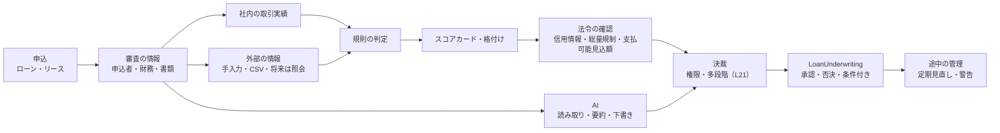
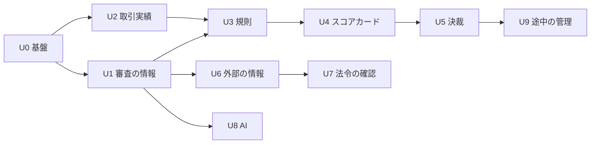

# Apache OFBiz Finance 審査（Underwriting）

finance プラグインの **審査（与信審査）** を、記録だけの状態から、情報の収集・判定・決裁・途中の管理まで行える仕組みに発展させるための要件定義。詳細な設計は `SPEC_UNDERWRITING.md` を正とする。

> **状態：設計（未着手）**。2026-10-17 に方針を決定した。STEP は U0〜U9（4 章）。

---

## 1. 全体方針

### 1.1 現状（2026-10-17 時点）

| 項目 | 現状 |
|------|------|
| 審査の記録 | `LoanUnderwriting`（ローン・リース共通、`applicationTypeId`）：信用スコア（**手入力**）、判断、承認額・承認金利、審査者、審査日、コメント。状態は `LOANUW_IN_REVIEW` → `LOANUW_APPROVED` / `LOANUW_REJECTED`（確定後は変更不可） |
| 自動の確認 | 与信枠（同じ顧客のローン・リースの元本の合計、`financeValidateCustomerCreditLimit`）、担保掛目（LTV）、リースの希望物件の有無（`underwriting.approval.validator.LEASE`） |
| 使える社内の情報 | 延滞の履歴と区分、入金の遅れ、督促、償却、法的措置、取引の残高、担保と評価、保証人、与信枠、商品、販売店、物件の種類、中途解約・条件変更・取消の履歴、取引先と役割（`FinanceContractParty`） |
| ないもの | 申込者の属性・財務の情報の項目、財務比率、社内の取引実績の集計、判定の規則、スコアカード、決裁の権限、外部の情報、法令上の照会、途中の管理 |

### 1.2 確定事項（2026-10-17）

| 項目 | 決定 |
|------|------|
| 対象の顧客 | **法人（事業者）が中心**、**個人（消費者ローン・個人リース）も含める** |
| 法令の対応 | **貸金業法・割賦販売法の信用情報の照会と、総量規制（年収等の 3 分の 1）を作る機能に入れる**（U7）。対象の判定（どの商品・取引が規制の対象か）は商品の設定で持ち、法令の確認を前提とする |
| 外部の情報 | **現時点で導入を想定している外部の情報はない**。法人の信用調査・個人の信用情報機関・反社チェックは、**まず手入力と CSV の取込み**で扱い、将来、照会の口（`CreditInfoAdapter`）に製品別の実装を足す |
| AI | **外部の AI サービス（クラウドの生成 AI）に、審査の書類や顧客の情報を送ってよい**前提。ただし、送る範囲・委託の契約・学習に使わない設定・記録の要件を守る（3.5、U8） |
| 判断の位置付け | **最終の判断は人**（決裁の権限を持つ人）。規則・スコア・AI は判断の根拠を整える。自動の承認・否決は、商品の設定で許した少額・定型の案件だけ |
| 置き場所 | finance の **共通層**（ローン・リース共通、`org.apache.ofbiz.finance.common.underwriting`）。審査の承認時の検証（`underwriting.approval.validator.<種別>`）・与信枠・L21 の承認ワークフローと組み合わせる。商品の種別ごとの違いは設定データと Adapter で持つ |
| 既存の動作 | 既存の `LoanUnderwriting` と状態遷移はそのまま使う（追加のみ）。規則・スコアの設定がない商品は、今まで通り手入力の審査で動く |

### 1.3 全体像

---

## 2. 用語

| 用語 | 意味 |
|------|------|
| **審査の情報（プロファイル）** | 審査の時点の申込者の属性・財務・書類のスナップショット。審査ごとに保存し、後から変えない |
| **財務比率** | 決算書から計算する指標（自己資本比率、流動比率、売上高経常利益率、債務償還年数、インタレスト・カバレッジ・レシオ 等） |
| **取引実績** | 同じ顧客（とグループ会社・代表者・保証人）の、社内の過去と今の取引の集計（延滞の回数・最長日数、償却、完済、残高、取引の年数） |
| **規則（審査ルール）** | 条件と結果（否決・上位の決裁者へ・条件付き・確認事項）の組。データで定義する |
| **スコアカード** | 項目ごとの配点表。点数の合計で格付けを決める |
| **格付け** | スコアの帯ごとのランク（例：A〜E）。決裁の権限・承認の条件・価格の目安に使う |
| **決裁の権限** | 金額・格付け・商品ごとに、決裁できる役職・人 |
| **条件付き承認** | 保証人の追加、担保の追加、保証金・頭金の追加、金額の減額、期間の短縮などを条件にした承認 |
| **指定信用情報機関** | 貸金業法・割賦販売法で指定された信用情報機関。個人向けの貸付・クレジットで照会と登録が必要 |
| **総量規制** | 貸金業法で、個人への貸付の合計を年収等の 3 分の 1 までに制限する規制（除外・例外の貸付がある） |
| **支払可能見込額** | 割賦販売法で、個人のクレジットの審査に使う、年収・生活維持費・他のクレジットの支払から求める支払える見込みの額 |
| **途中の管理（期中管理）** | 契約の後の定期的な見直しと、延滞の兆し・外部の評点の低下などの警告 |

---

## 3. 共通の設計方針

### 3.1 データの考え方

- 審査ごとに、そのとき使った情報（申込者・財務・取引実績・外部の情報・規則とスコアの版・法令の確認の結果・AI の出力）を **スナップショット** として保存する。審査が確定した後は変えない（後から顧客の情報が変わっても、審査の根拠が残る）。
- 顧客の「最新の情報」（`Party` に紐付く財務諸表・属性）と、審査の「その時点の情報」を分ける。
- 規則・配点表・決裁の権限は **版つきの設定データ** とし、審査にはどの版を使ったかを記録する。

### 3.2 外部の情報の扱い

- 情報の種類ごとに、取得の方法（手入力／CSV／照会の口）、取得日、出所、有効期間（例：信用調査は 6 か月）、費用を記録する。
- 照会の口 `CreditInfoAdapter`（情報の種類ごと）を用意し、最初の実装は「手入力・CSV の取込み」だけとする。製品別の実装（照会 API）を足しても、審査の業務は変えない。
- 費用のかかる照会は、商品・金額・新規か既存かの条件で「照会するか」を規則で決める（費用と効果の使い分け）。

### 3.3 個人情報・法令

- 個人の信用情報は、照会の目的・同意の記録（同意書の取得日・範囲）がない限り照会しない。照会と登録の記録を残す。
- 審査に使ってはいけない項目（本籍・出生地・信条 等、要確認）は、項目として持たない。機械学習のスコア（U8）の説明変数からも除く。
- 個人の情報の閲覧は、権限（`FINANCE_UW_PERSONAL_VIEW`）で制限し、閲覧の記録を残す。

### 3.4 判断と記録

- 規則・スコア・法令の確認は **判断の材料** を作り、結果（推奨：承認／否決／人の審査／上位の決裁者へ、条件、確認事項）を審査に記録する。
- 人の判断（承認・否決・条件付き）は、推奨と違う場合に理由を必須にする（例外の承認の記録）。
- 審査の承認・否決は、既存の `setLoanUnderwritingStatus` で行う。決裁が多段階のときは L21 の承認ワークフロー（`requestFinanceApproval`）で依頼する。

### 3.5 AI の扱い（外部の生成 AI に送ってよい前提）

- 送る前に、送る項目を最小にする（審査に必要な書類・項目だけ。マイナンバー等は送らない）。
- 利用する AI サービスとの委託の契約、入力を学習に使わない設定、保存期間・保存場所（国・地域）を確認し、設定（接続先）に記録する。
- AI の入力（の要約とハッシュ）・出力・モデル名と版・指示文の版・日時・費用を記録する。AI の出力は「下書き・候補」として扱い、人が確認して確定する。
- AI の出力だけで承認・否決しない。否決の理由に AI の出力をそのまま使わない（根拠は元の書類・規則・スコア）。
- 接続先は差し替えられる部品（`AiAssistAdapter`）にし、AI サービスを変えても審査の業務は変えない。

---

## 4. STEP の計画

| STEP | 内容 | 状態 |
|------|------|------|
| U0 | 基盤：審査の情報のスナップショット、設定の版、権限、審査の画面の土台 | 設計（未着手） |
| U1 | 審査の情報：法人（業種・業歴・代表者・財務諸表 3 期）と個人（年収・勤務・住居・家族・他社の借入の申告）、財務比率の計算、書類の一覧と回収状況、CSV の取込み | 設計（未着手） |
| U2 | 社内の取引実績：顧客・グループ会社・代表者・保証人の取引の集計（延滞・償却・完済・残高・取引の年数）、社内の注意先の登録 | 設計（未着手） |
| U3 | 規則の判定：審査ルール（データで定義）、当たった規則の記録、推奨と確認事項 | 設計（未着手） |
| U4 | スコアカードと格付け：配点表、格付け、条件付き承認、格付けと価格の目安 | 設計（未着手） |
| U5 | 決裁：決裁の権限（金額・格付け・商品）、多段階の決裁（L21 と連携）、例外の承認の記録 | 設計（未着手） |
| U6 | 外部の情報：法人の信用調査・個人の信用情報・反社チェック・登記・物件の相場を、手入力と CSV で取り込む口（`CreditInfoAdapter`）。製品別の照会は将来 | 設計（未着手） |
| U7 | 法令の確認（個人）：指定信用情報機関の照会と登録の記録（貸金業法・割賦販売法）、総量規制（年収等の 3 分の 1）、支払可能見込額の調査、同意の記録 | 設計（未着手） |
| U8 | AI の活用：書類の読み取り（OCR・項目の抽出）、調査報告書・ニュースの要約、審査メモの下書き、異常の検知。機械学習のスコア（Python 連携、データが貯まってから） | 設計（未着手） |
| U9 | 途中の管理：定期的な見直し（決算書の更新・外部の評点・延滞の兆し）、警告、与信枠の見直し | 設計（未着手） |

最初の範囲は U0〜U5（社内の情報と手入力だけで動く審査）。U7（法令の確認）は個人向けの商品を本番で扱う前に必須。

---

## STEP U0 — 基盤

- 審査の情報のスナップショット（`FinUwProfile`）を審査（`LoanUnderwriting`）ごとに 1 件作る。審査が `LOANUW_IN_REVIEW` の間だけ更新でき、承認・否決で確定する。
- 規則・配点表・決裁の権限・照会の条件の **版**（`FinUwConfigVersion`：有効期間、承認者、変更の理由）。
- 権限：`FINANCE_UW_VIEW`、`FINANCE_UW_PERSONAL_VIEW`（個人の情報）、`FINANCE_UW_EDIT`、`FINANCE_UW_DECIDE`（決裁）、`FINANCE_UW_CONFIG`（設定）。
- 審査の画面：申込の画面から審査を開き、情報・取引実績・規則の結果・スコア・法令の確認・AI の下書き・決裁の履歴を 1 画面で見られる。

## STEP U1 — 審査の情報

| 区分 | 項目 |
|------|------|
| 法人 | 法人番号、業種（日本標準産業分類）、設立年月・業歴、資本金、従業員数、上場の有無、代表者（`Party`、年齢・在任年数）、主要な取引先・取引銀行、許認可、所在地・事業所、グループ会社（`PartyRelationship`） |
| 法人の財務 | 決算書 3 期（貸借対照表・損益計算書の主要項目、決算月、監査の有無、連結／単体）。財務比率を自動で計算する。決算書の原本（Content）を紐付ける |
| 個人 | 生年月日、職業・勤務先・雇用形態・勤続年数、年収（とその確認の書類）、住居（持家・賃貸・家賃・居住年数）、家族の人数、他社の借入の申告（件数・残高・月の返済額） |
| 案件 | 資金の使い道、返済の原資、物件の換金性（リース）、販売店、担保・保証人の予定 |
| 書類 | 商品ごとに必要な書類の一覧（本人確認、収入の証明、決算書、登記事項証明書 等）と、回収の状況・確認者・確認日 |

- 財務比率：自己資本比率、流動比率、当座比率、売上高総利益率、売上高経常利益率、ROA、債務償還年数（有利子負債 ÷（経常利益＋減価償却費 − 税金））、インタレスト・カバレッジ・レシオ、売上の伸び、自己資本の伸び、債務超過の有無、3 期連続の赤字の有無。
- 取込み：決算書の主要項目・個人の属性の CSV。AI による読み取り（U8）の結果も同じ項目に入れる（人が確認）。

## STEP U2 — 社内の取引実績

- 対象：申込者と、グループ会社・代表者・保証人（`FinanceContractParty`、`PartyRelationship`）。
- 集計：取引の年数、契約の件数（ローン・リース、状態別）、現在の残高と与信枠、完済・満了の件数、延滞の回数と最長の日数（期間別：過去 1 年・3 年・全期間）、現在の延滞、遅延損害金・督促の回数、償却・法的措置の有無、中途解約・条件変更・取消の回数、前受金・保証金の残高。
- 社内の注意先：注意の理由・登録日・登録者・有効期間（反社チェックの結果の社内の登録もここ。U6）。
- 集計は審査の時点のスナップショットとして保存する。

## STEP U3 — 規則の判定

- 規則：商品（または商品の種類・顧客の区分）ごとの規則の組。規則は「条件（項目・比較・値の組合せ）→ 結果（否決／上位の決裁者へ／条件付き／確認事項）＋理由のコード」。
- 例：社内で 90 日以上の延滞あり → 否決。債務超過かつ 2 期連続の赤字 → 上位の決裁者へ。業歴 2 年未満 → 確認事項（代表者の経歴）。返済負担率（年間返済 ÷ 年収・売上）> 閾値 → 否決または条件付き。注意先 → 否決。物件が対象外の種類 → 否決。
- 推奨の決め方：否決が 1 つでもあれば否決、なければ最も上位の決裁を要する結果。自動の承認は、商品の設定で許した場合だけ。
- 当たった規則・使った値・規則の版を記録する。

## STEP U4 — スコアカードと格付け

- 配点表：項目（業種・業歴・財務比率・取引実績・外部の評点・物件の換金性・個人の属性）× 値の区分 → 点数。法人と個人で別の配点表。
- 格付け：点数の帯 → 格付け（例：A〜E）。格付けごとに、承認の条件（保証人・保証金・期間の上限）、価格の目安（金利・料率の上乗せ）、決裁の権限（U5）。
- 既存の `LoanUnderwriting.creditScore` にスコアを入れる（手入力も残す。手入力とスコアカードの値が違う場合は理由を記録）。
- 配点の見直し：社内の実績（契約後に延滞したか）と格付けの関係を集計する帳票（格付け別の延滞率）を用意し、担当者が年に 1 回見直す（自動の学習は U8）。

## STEP U5 — 決裁

- 決裁の権限：商品 × 金額の範囲（顧客の与信の合計を含む）× 格付け × 推奨の結果 → 決裁者の役割（担当・課長・部長・審査部・役員・委員会）。
- 1 段階は finance の中で決裁する。多段階・回覧は L21 の承認ワークフロー（外部 BPM）で依頼する（操作 `FINAPROP_UW_DECISION`）。
- 条件付き承認：条件（保証人の追加・担保・保証金・頭金・減額・期間の短縮）を審査に記録し、契約の作成のときに条件を満たしているかを確かめる（満たさなければ契約を作れない）。
- 例外の承認：推奨と違う判断（推奨が否決なのに承認 等）は、理由と上位の決裁を必須にする。

## STEP U6 — 外部の情報（手入力・CSV、将来は照会）

| 情報 | 最初の扱い | 将来 |
|------|------------|------|
| 法人の信用調査（評点・業績・倒産の予兆） | 評点・調査日・主要な項目の手入力、報告書の PDF の添付、CSV の取込み | 信用調査会社の照会 API |
| 個人の信用情報（他社の借入・延滞） | 照会の結果の手入力（U7 の記録と一緒に） | 指定信用情報機関との連携 |
| 反社チェック | 照合の結果（該当なし／要確認／該当）・照合日・方法の記録、社内の注意先との照合 | 照会サービスとの連携 |
| 登記・公的な情報 | 登記事項・官報（破産）の確認の記録 | 公的な API |
| 物件の相場・残価 | 相場の手入力（リースの残価・担保の評価に使う） | 相場の情報の取込み |

- 情報ごとに、出所・取得日・有効期間・費用・取得者を記録する。有効期間が過ぎた情報は審査の判定で「古い」と警告する。
- 照会するかどうか（費用のかかる情報）は、規則（U3）で決める。

## STEP U7 — 法令の確認（個人）

> 法令の要件は、貸金業法・割賦販売法とその施行規則・自主規制の最新の内容と、法務・コンプライアンスの確認を前提とする。

| 確認 | 内容 |
|------|------|
| 対象の判定 | 商品ごとに、貸金業法の対象（個人への貸付）、割賦販売法の対象（個別信用購入あっせん・包括信用購入あっせん 等）、対象外（法人向け、リースのうち規制の対象外のもの 等）を設定する。個人リースの扱いは要確認 |
| 信用情報の照会 | 指定信用情報機関への照会の記録（照会日・機関・照会の目的・同意の取得日・結果の要約）。照会がない個人向けの対象の審査は承認できない |
| 総量規制 | 年収等（年収の証明の書類と確認日）、他社の借入の残高（信用情報の照会の結果）、自社の残高と今回の額の合計 ≤ 年収等の 3 分の 1 の判定。除外・例外の貸付（の区分）を商品・申込で指定できる。収入の証明が必要な条件（借入の額の基準）を設定で持つ |
| 支払可能見込額 | 割賦販売法の対象では、年収・生活維持費（世帯の人数と住居で決まる額の表）・他のクレジットの支払の額から支払可能見込額を求め、今回の支払の額と比べる |
| 登録 | 契約・返済・延滞・完済の情報の、信用情報機関への登録の予定と記録（登録そのものの連携は将来。最初は登録用の CSV の出力） |
| 書面 | 契約前・契約時の書面の交付の記録（finance の帳票と紐付け） |

## STEP U8 — AI の活用

| 機能 | 内容 |
|------|------|
| 書類の読み取り | 決算書・確定申告書・源泉徴収票・登記事項証明書・見積書の画像・PDF から、U1 の項目を抽出する。抽出の値・確からしさ・元の書類の位置を残し、人が確認して確定する |
| 要約 | 信用調査の報告書・ニュース・Web の情報（URL を人が指定）を要約し、懸念点の一覧（出典つき）を作る |
| 審査メモの下書き | 審査の情報・取引実績・規則の結果・スコア・法令の確認から、稟議書の下書き（案件の概要、強み・懸念、条件の案）を作る。担当者が直して確定し、下書きと確定版の両方を残す |
| 異常の検知 | 申込の内容の不整合（年収と勤務先・業種の不自然さ、決算書の数字の矛盾）、同じ電話番号・住所・口座の使い回し、販売店ごとの延滞の偏りを警告する |
| 機械学習のスコア | 社内の実績が十分に貯まってから（目安：数千件・延滞の実例が一定数）、延滞の確率のモデルを作る。説明できる形（項目ごとの寄与）、使ってはいけない項目の除外、精度の定期的な監視、モデルの版の記録。学習と推論は ALM と同じバッチからの Python 連携（ファイル連携）で行う |

## STEP U9 — 途中の管理

- 定期的な見直し：法人は決算書の更新（決算月の数か月後）、与信の大きい顧客は年 1 回の見直し。見直しの予定を作業（WorkEffort）のタスクにする。
- 警告：延滞の発生・区分の上昇、外部の評点の低下（取り込んだ場合）、財務比率の悪化、残高の増加、注意先の登録。警告の一覧と、対応の記録。
- 与信枠の見直し：見直しの結果で与信枠（`CreditLine`）を変える（既存のサービスで）。

---

## 5. 範囲外・将来の拡張

- 外部の情報の製品別の照会 API（U6 の将来）、信用情報機関への登録の自動連携（U7 の将来）。
- 貸倒引当金の見積（PD・LGD）とポートフォリオの信用リスクの計量（ALM・会計との連携）。
- リスクに応じた価格の自動計算（格付けの価格の目安は U4、ALM の FTP と組み合わせた計算は将来）。
- 審査の書類の電子契約・電子署名。
