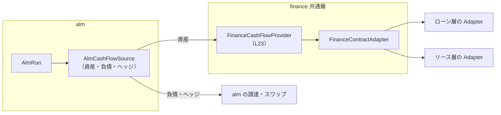
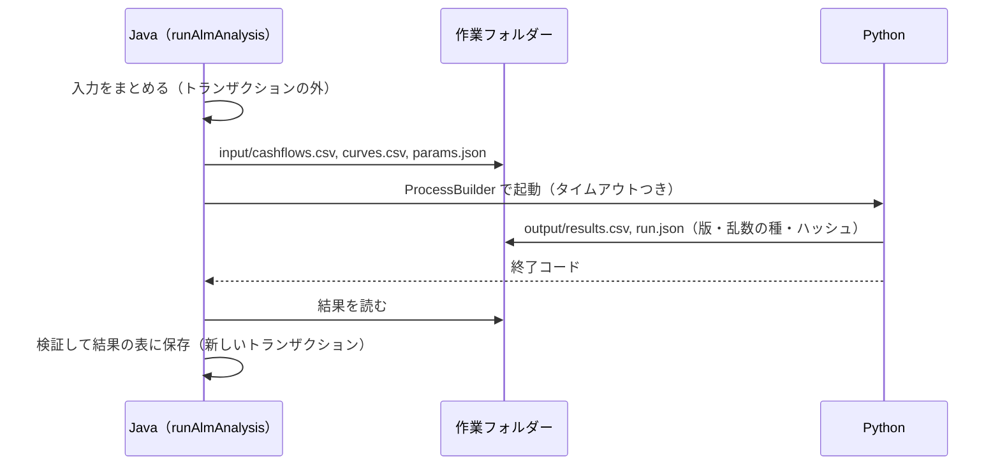

# Apache OFBiz ALM 仕様書

`REQUIREMENTS_ALM.md` の要件に対する設計。各 STEP の実装後に「実装」「テスト」「検証」を追記する。

> **状態：設計（未着手）**。2026-10-17 作成。alm プラグインを作るまで `plugins/finance/` に置く。

## 進捗

| STEP | 内容 | 状態 |
|------|------|------|
| L23（finance） | 将来キャッシュフローの部品（`SPEC_COMMON.md` 14 章） | 設計（未着手） |
| A0 | 基盤（2 章） | 設計（未着手） |
| A1 | 調達の管理（3 章） | 設計（未着手） |
| A2 | 資金ギャップ（4 章） | 設計（未着手） |
| A3 | 市場データ（5 章） | 設計（未着手） |
| A4 | 金利スワップ（6 章） | 設計（未着手） |
| A5 | 金利改定ギャップ・NII（7 章） | 設計（未着手） |
| A6 | EVE の感応度（8 章） | 設計（未着手） |
| A7 | FTP（9 章） | 設計（未着手） |
| A8 | Python 連携（10 章） | 設計（未着手） |

---

## 1. 構成

### 1.1 プラグインとパッケージ

| 項目 | 内容 |
|------|------|
| プラグイン | `plugins/alm`（コンポーネント名 `alm`、Web アプリ `/alm`、基本権限 `OFBTOOLS,ALM`） |
| パッケージ | `org.apache.ofbiz.alm.funding`（調達）、`org.apache.ofbiz.alm.hedge`（スワップ）、`org.apache.ofbiz.alm.market`（市場データ）、`org.apache.ofbiz.alm.analysis`（実行・スナップショット・計算）、`org.apache.ofbiz.alm.ftp`（FTP） |
| 依存 | alm → finance の共通層（`org.apache.ofbiz.finance.common`）と OFBiz core。finance のローン層・リース層は参照しない。finance は alm を参照しない |
| ビルド | alm の `build.gradle` で finance のクラスをコンパイル時に参照する（OFBiz のプラグインは同じビルドでまとめてコンパイルされるため、finance と alm を同時に置く） |
| データ | `data/AlmTypeData.xml`（seed）、`data/AlmDemoData.xml`（demo）、`testdef/data/AlmTestData.xml`（テスト）。用途を混在させない（finance と同じ） |

### 1.2 finance との境界



- 資産のキャッシュフローは finance の `FinanceCashFlowProvider.projectCashFlows`（L23、`SPEC_COMMON.md` 14 章）だけから受け取る。
- alm は finance のエンティティ（`FinanceContract` 等）を読んでよいが、書き込まない。例外は流動化の印（3.6、finance の別の STEP で決める）。

### 1.3 調達を共通契約台帳に載せるか

| 案 | 内容 | 判断 |
|----|------|------|
| (1) alm の独自の台帳 | 調達の契約を alm の `AlmFundingAgreement` で持つ。finance の `FinanceContract` は使わない | **推奨**。finance の台帳は「貸手として顧客と結ぶ契約」で、与信・延滞・督促の対象を表す。調達（自社が借り手）を混ぜると、与信判定・延滞バッチの対象から外す条件を finance に足すことになり、範囲（貸手側のみ）とも合わない |
| (2) 共通契約台帳に新しい種別 `FUNDING` | `FinanceContract` に調達を載せ、`FinanceContractAdapter` を実装する | 契約・取引先の土台（`FinanceContractParty`、作業管理）を使える利点はあるが、上の理由で採らない |

取引先は OFBiz core の `Party`（金融機関・投資家・SPC）と役割（`RoleType`、alm の seed で `ALM_LENDER`・`ALM_BONDHOLDER`・`ALM_SPC`・`ALM_SWAP_CPTY` を `ALM_ROLE` の下に追加）を使う。

### 1.4 計算の部品

```java
public interface AlmCalculator {
    /** Name registered in alm.properties (alm.calculator.<name>=<class>). */
    String getName();
    /** Compute the results of one analysis of a run (gap, repricing, NII, EVE, FTP). */
    void compute(AlmCalculationContext context) throws AlmCalculationException;
}
```

- 既定は Java の `JavaAlmCalculator`。分析の種類ごとに計算クラスを分ける（`LiquidityGapCalculator`、`RepricingGapCalculator`、`NiiSimulator`、`EveCalculator`、`FtpCalculator`）。
- `alm.properties` の `alm.calculator.<分析>=<名前>` で分析ごとに選ぶ（A8 で `PYTHON` を追加）。
- 計算クラスは DB を読まず、`AlmCalculationContext`（キャッシュフロー・市場データ・前提の集合）だけを受け取る（テストしやすくし、Python の実装と同じ入力にする）。

---

## 2. STEP A0 — 基盤

### 2.1 エンティティ

| エンティティ | 主な項目 |
|--------------|----------|
| `AlmRun` | `almRunId`、`asOfDate`（基準日）、`organizationPartyId`、`baseCurrencyUomId`、`almBucketSetId`、`almScenarioSetId`（A3）、`almAssumptionSetId`、`analysisTypes`（実行する分析）、`calculatorVersion`、`statusId`（`ALMRUN_CREATED` → `ALMRUN_RUNNING` → `ALMRUN_COMPLETED` / `ALMRUN_ERROR` → `ALMRUN_FINAL`）、作成者・日時、確定者・日時、コメント |
| `AlmBucketSet` / `AlmBucket` | 帯の組と帯（`fromDays`・`thruDays` または `fromMonths`・`thruMonths`、表示順、名前） |
| `AlmCashFlow` | 実行のキャッシュフロー（REQUIREMENTS_ALM 3.2）：`almRunId`、`seqId`、`sideEnumId`（ASSET / LIABILITY / OFF_BALANCE）、`sourceTypeEnumId`（LOAN / LEASE / BORROWING / BOND / CP / SECURITIZATION / COMMITMENT / SWAP_FIXED / SWAP_FLOAT）、`sourceId`（`financeContractId` または alm の契約 ID）、`flowDate`、`flowTypeEnumId`（PRINCIPAL / INTEREST / TAX / COMPONENT / RESIDUAL / FEE / ADVANCE / DEPOSIT）、`amount`（入り＋／出−）、`currencyUomId`、`certaintyEnumId`（BILLED / SCHEDULED / ASSUMED）、`rateTypeEnumId`（FIXED / FLOATING）、`nextRepricingDate`、`benchmarkId`、`spread`、`outstandingBefore`（その期日の前の残高） |
| `AlmPosition` | 実行の残高（契約ごと、基準日）：区分・発生源・残高・通貨・金利・満期日・次の改定日（金利改定ギャップと照合に使う） |
| `AlmAssumptionSet` / `AlmAssumption` | 行動の前提：種類（繰上返済の比率・中途解約の比率・再リースの比率・コミットメントラインの利用の比率・回収遅れの日数）、対象（商品・契約種別）、期間の帯ごとの値 |
| `AlmRunLog` | 実行の記録（取込み件数・時間・警告・エラー） |
| `AlmGlReconciliation` | 基準日の GL の残高と、`AlmPosition` の合計の照合（科目の種類ごと、差額） |

### 2.2 サービス

| サービス | 内容 |
|----------|------|
| `createAlmRun` | 実行を作る（基準日・組織・帯・前提・分析の種類） |
| `runAlmSnapshot` | 資産（L23）・負債（A1）・ヘッジ（A4）のキャッシュフローと残高を取り込む。契約 500 件ごと（設定）に別のトランザクションで確定し、途中で失敗した実行はエラーにする（同じ実行で再実行すると明細を作り直す） |
| `runAlmAnalysis` | `AlmCalculator` で分析の結果を作る |
| `runAlmBatch` | 上の 3 つをまとめて実行する（ジョブスケジューラで月次・日次に登録） |
| `finalizeAlmRun` | 確定（`ALMRUN_FINAL`）。確定した実行の明細・結果は変えない |
| `reconcileAlmRunWithGl` | GL との照合表を作る |

### 2.3 将来キャッシュフローの取込み

- 対象：基準日に有効な契約（finance の L23 が返すもの）。中途解約で回収中・分割済の契約は、請求済みの未回収の分だけ。
- 請求済みの回（未回収）は `BILLED`、確定表の未請求の回は `SCHEDULED`、行動の前提による調整は `ASSUMED` として別の行にする（調整前の契約どおりの値を残す）。
- 前受金・保証金の残高は負債（`DEPOSIT`／`ADVANCE`）として取り込む。保証金は返還の予定日（契約の終了日）に資金の出とする。
- 延滞中の未回収は、行動の前提の「回収遅れの日数」で期日をずらす（既定 0 日）。

---

## 3. STEP A1 — 調達の管理

### 3.1 エンティティ

| エンティティ | 主な項目 |
|--------------|----------|
| `AlmFundingAgreement` | `almFundingAgreementId`、`fundingTypeEnumId`（TERM_LOAN / OVERDRAFT / COMMITMENT / BOND / CP / SECURITIZATION）、`counterpartyPartyId`、`organizationPartyId`、`currencyUomId`、`principalAmount`（極度額・額面）、`issuePrice`（社債・CP）、`agreementDate`・`startDate`・`maturityDate`、金利（`rateTypeEnumId`、`fixedRate`、`benchmarkId`、`spread`、`repricingIntervalMonths`、`dayCountEnumId`、`interestIntervalMonths`）、返済の方法（`repaymentMethodEnumId`）、`statusId`、担保・保証・コベナンツの備考、`glAccountTypeId` の上書き |
| `AlmFundingSchedule` | 予定表（revision つき。finance の確定表と同じ考え方）：回、期日、元本、利息、残高、金利、確定（約定済み）か |
| `AlmFundingDrawdown` | 実行（当座貸越・コミットメントラインの引出し、借入の実行）と返済の明細 |
| `AlmFundingTransaction` | 実行・返済・利払い・手数料の記録と、OFBiz の支払（`Payment`）・仕訳（`AcctgTrans`） |
| `AlmFundingAccrual` | 未払利息の月次計上（増分。finance の利息計上と同じく二重に計上しない） |
| `AlmRateReset` | 変動金利の改定（改定日、基準金利の値、スプレッド、適用金利、適用期間） |
| `AlmSecuritization` / `AlmSecuritizationAsset` | 流動化：譲渡日、譲渡価額、劣後部分、オフバランスか、対象の finance の契約（`financeContractId`）と譲渡した残高、回収金の受け渡しの予定 |
| `AlmCovenant` | コベナンツ（指標・閾値・判定の頻度）と判定の結果（任意） |

### 3.2 状態（seed）

`ALM_FUNDING_STATUS`：`ALMFND_CONTRACTED`（契約済）→ `ALMFND_ACTIVE`（実行済み・残高あり）→ `ALMFND_REPAID`（完済・償還済み）、`ALMFND_CONTRACTED` → `ALMFND_CANCELLED`。コミットメントラインは `ALMFND_ACTIVE` の間に引出し・返済を繰り返し、期間の満了で `ALMFND_EXPIRED`。状態は専用のサービスだけで変える。

### 3.3 サービス

| サービス | 内容 |
|----------|------|
| `createAlmFundingAgreement` | 契約の登録と予定表（revision 1）の作成（期日一括・元金均等・元利均等。社債は満期一括・定時償還、CP は割引） |
| `drawAlmFunding` | 実行・引出し（仕訳：借 現預金 ／ 貸 借入金・社債・CP。社債の発行差金・発行費用） |
| `repayAlmFunding` | 予定の返済・期限前返済（予定表を新しい revision で作り直す） |
| `payAlmFundingInterest` | 利払い（借 未払利息・支払利息 ／ 貸 現預金） |
| `accrueAlmFundingInterest` | 月次の未払利息の計上（増分） |
| `resetAlmFundingRate` | 変動金利の改定（基準金利は A3 の値、なければ入力） |
| `runAlmFundingMonthlyBatch` | 期日の来た利払い・返済の予定の通知（タスク）と未払利息の計上。支払そのものは担当者が実行する（自動で支払わない） |
| `createAlmSecuritization` | 流動化の登録（譲渡する finance の契約の選択、譲渡価額、劣後部分）。オフバランスの場合の仕訳（債権の消滅と譲渡損益）は会計の確認が必要（3.6） |

### 3.4 勘定科目（seed の `GlAccountType`）

借入金（短期・長期）、社債、CP、未払利息、支払利息、社債利息、社債発行費、コミットメントフィー、流動化の譲渡損益、回収金の預り金（サービサー）。組織への割り当ては demo・テストデータで行う（finance と同じ）。

### 3.5 画面

調達の一覧（種類・相手先・状態・満期）、契約の詳細（予定表・実行・返済・利払い・金利の改定・仕訳）、満期の一覧、コミットメントラインの未使用の枠。

### 3.6 要確認

- **流動化の会計**：オフバランスの要件と仕訳（譲渡損益、劣後部分、サービシング資産・負債）は、会計の専門家の確認が必要。初期は「オンバランス（借入と同じ扱い）」だけを実装し、オフバランスは確認後に追加する。
- **流動化済みの印**：finance の契約に印を付けるかどうか。付ける場合は finance の共通層に「契約の属性」を足す変更になるので、finance の STEP として記録する（初期は alm の `AlmSecuritizationAsset` だけで管理し、finance は変えない）。
- **社債の償却原価法**：発行差金の期間配分（利息法・定額法）の選び方。

---

## 4. STEP A2 — 資金ギャップ

### 4.1 計算

- 期間の帯 b ごとに：入り(b) ＝ Σ 資産の回収（元本・利息・消費税・残価）＋ 調達の実行予定、出(b) ＝ Σ 調達の返済・利払い ＋ 新しい実行の予定（入力）＋ 経費の見込み（任意）＋ 保証金の返還。
- 差(b) ＝ 入り(b) − 出(b)、累計(b) ＝ Σ 差。消費税は預り（納付の予定）として、納付月に出として計上する選択肢を設ける（既定は含めない）。
- 通貨別に計算し、基準通貨への換算は基準日の為替レート（`UomConversionDated`）で行う。
- 使える資金：基準日の手元資金（GL の現預金の残高）＋ コミットメントラインの未使用の枠。累計の不足と比べ、不足の最初の帯を「資金が足りなくなる時期」として示す。

### 4.2 エンティティ・帳票

| 種類 | 内容 |
|------|------|
| `AlmGapResult` | 実行 × 分析（LIQUIDITY）× シナリオ × 通貨 × 帯 → 入り・出・差・累計・使える資金 |
| `AlmLimit` / `AlmLimitBreach` | 限度額（指標・帯・閾値・通貨）と、実行ごとの超過の記録。超過したら finance の作業管理のタスク（`FinanceWorkEffortHelper` は finance の契約に紐付けるため使わず、alm の `AlmRunWorkEffort` で実行に紐付ける） |
| 帳票 | 資金ギャップ表（帯 × 入り・出・差・累計）、前回の確定した実行との比較、調達の満期の一覧、調達先別の残高と割合。PDF（jasperreports）・CSV |

---

## 5. STEP A3 — 市場データ

| エンティティ | 主な項目 |
|--------------|----------|
| `AlmYieldCurve` | カーブの定義（通貨、種類：市場／自社の調達／FTP、日割り基準、補間の方法） |
| `AlmYieldCurvePoint` | カーブ × 基準日 × 期間（日数または月数）→ 金利（ゼロレート、または入力の種類：スワップレート → ブートストラップは A6 で検討） |
| `AlmBenchmark` / `AlmBenchmarkRate` | 基準金利（TONA・TORF・TIBOR 等）と日々の値 |
| `AlmScenarioSet` / `AlmScenario` / `AlmScenarioShock` | シナリオの組・シナリオ・カーブ × 期間ごとの変化幅（bp） |

- 補間：線形（既定）。外挿は端の値で一定。
- 取込み：CSV（カーブ・基準日・期間・金利）の取込みサービス `importAlmMarketData`。
- 既定のシナリオ（seed）：基準（変化なし）、±100bp・±200bp の平行移動、短期上昇（1 年以下 +200bp、10 年 0bp を線形）、長期上昇。

---

## 6. STEP A4 — 金利スワップ

| エンティティ | 主な項目 |
|--------------|----------|
| `AlmSwap` | 相手先、約定日・開始日・満期日、想定元本（一定／予定表）、方向（PAY_FIXED / RECEIVE_FIXED）、固定金利、変動側の基準金利・スプレッド、利払いの間隔・日割り基準、ヘッジ対象（`almFundingAgreementId`、任意）、状態 |
| `AlmSwapSchedule` | 固定側・変動側の予定（期間・想定元本・金利・金額）。変動側は改定日に金額を確定する |
| `AlmSwapSettlement` | 受払いの差額の決済と仕訳 |

- 仕訳：受払いの差額を支払利息の調整として計上する（特例処理の考え方）。時価評価・繰延ヘッジの処理は会計の確認が必要（要確認）。
- 分析：固定側・変動側を別のキャッシュフロー（`SWAP_FIXED`・`SWAP_FLOAT`）として取り込み、金利改定ギャップでは変動側を次の改定日、固定側を満期に入れる。

---

## 7. STEP A5 — 金利改定ギャップと NII

### 7.1 金利改定ギャップ

- 資産・負債・スワップの残高を、固定は満期（元本の期日ごと）、変動は次の改定日の帯に入れ、帯ごとの差と累計を出す（`AlmGapResult`、分析 REPRICING）。

### 7.2 NII のシミュレーション

- 期間：基準日の翌月から 12〜36 か月（設定）、月次。
- 受取利息：ローンは日次残元本方式（finance と同じ日割り基準）、リースは利息相当額の期間配分（finance の `LeaseProfitAllocator` と同じ考え方。alm は finance の計算クラスを直接使わず、L23 が返す期間ごとの利息相当額を使う）。
- 支払利息：調達・スワップの予定。変動はシナリオのカーブで改定する。
- 残高の前提：
  - **静的**：満期・返済の分は補充しない。
  - **動的**：新しい実行の計画（`AlmNewBusinessPlan`：月 × 商品 × 実行額 × 期間 × 利ざや（FTP＋α））と、それに合わせた調達の補充（期間 × 種類）を入力する。
- 結果：`AlmNiiResult`（実行 × シナリオ × 月 → 受取利息・支払利息・NII、基準シナリオとの差）。

---

## 8. STEP A6 — EVE の感応度

- 現在価値：各キャッシュフローを、通貨ごとの割引カーブ（市場カーブ、設定で選ぶ）＋シナリオで割り引く。PV ＝ Σ CF × exp(−r(t)·t)（連続複利、設定で年複利も選べる）。
- EVE ＝ PV(資産) − PV(負債) ＋ PV(スワップ)。
- 感応度：シナリオごとの ΔEVE、修正デュレーション、BPV（全期間 +1bp）、キーレート BPV（帯ごとに +1bp）。
- 前提の記録：リースの残価を含めるか、消費税を除くか（既定は除く）、行動の前提。
- 結果：`AlmEveResult`（実行 × シナリオ × 区分 → PV、ΔEVE、デュレーション）、`AlmKeyRateResult`。

---

## 9. STEP A7 — FTP

- FTP カーブ（A3 の種類 FTP、または自社の調達カーブ＋流動性のプレミアム）。
- 契約の FTP 金利：キャッシュフローの元本の期日ごとに、その期間の FTP 金利を元本×期間で加重平均する（マッチドマチュリティ）。
- `AlmFtpRate`：契約（`financeContractId`）× 確定日 → FTP 金利、使ったカーブと基準日。契約時（finance の契約の作成時）に計算して固定する。finance の契約の作成から呼ぶことはしない（finance は alm を参照しない）ため、alm のバッチ（日次）が新しい契約を見つけて計算する。
- 見積の参考値：finance の見積画面に「FTP の参考金利」を出すには finance の画面の変更が要るため、finance の別の STEP として記録する（alm 側は照会サービス `getAlmFtpQuote(productId, termMonths, amount, date)` を用意する）。
- 採算：`AlmProfitabilityResult`（実行 × 契約・商品・部門 → 利率、FTP 金利、利ざや、利ざや×残高）。

---

## 10. STEP A8 — Python 連携

### 10.1 方式（ファイル連携）



- 作業フォルダー：`runtime/alm/<almRunId>/`（入力・出力・ログを残し、再現と監査に使う）。
- 形式：CSV（UTF-8、ヘッダーつき）と JSON。データ量が大きくなったら Parquet を検討する。
- 起動：`alm.properties` の `alm.python.executable`（仮想環境の python）、`alm.python.script.<分析>`、`alm.python.timeout.seconds`。
- 結果の検証：行数・合計の照合（例：シナリオ「基準」の結果は Java の計算と一致すること）、終了コード、出力の版。
- 失敗したら実行を `ALMRUN_ERROR` にし、ログを `AlmRunLog` に残す。

### 10.2 バッチから呼ぶことについて

- バッチ（ジョブスケジューラの非同期ジョブ）で動かすので、計算に時間がかかっても画面の応答に影響しない。Python の起動自体は `ProcessBuilder` で簡単に行える。
- 注意点：①DB のトランザクションを開いたまま Python を待たない（取込みと保存を別のトランザクションにする）②サーバーに Python とライブラリを用意し、版を固定する（`requirements.txt` とハッシュ）③同時に動かす数を制限する ④入力のファイルに個人情報を含めない（取引先は ID だけ）⑤出力を信用せず検証してから保存する。

---

## 11. テストの方針

| 種類 | 内容 |
|------|------|
| 計算の単体テスト | 計算クラスは DB を使わないので、決めた入力（手計算できるキャッシュフロー・カーブ）で結果を確かめる（ギャップの合計＝キャッシュフローの合計、平行移動 +1bp の ΔEVE ≒ −BPV 等） |
| 取込みのテスト | finance のテストと同じ方法でローン・リースの契約を作り、L23 の部品の結果と `AlmCashFlow` が一致すること（請求済み・未請求・分割済・中途解約） |
| 調達のテスト | 予定表・実行・返済・利払い・未払利息の増分（二重に計上しない）・仕訳の貸借・変動金利の改定 |
| 再現性 | 同じ入力で 2 回実行して結果が一致すること、確定した実行が変わらないこと |
| finance への影響 | finance の全体テストが毎回通ること |

---

## 12. 要確認・制約

- **会計**：流動化のオフバランス、社債の償却原価法、スワップのヘッジ会計は、経理担当者・会計士の確認が必要（確認するまでは簡便な処理だけを実装する）。
- **資産側の金利**：finance のローン・リースは固定金利だけ。金利改定ギャップ・NII の資産側は、変動金利の商品を finance に追加するまで「満期まで固定」として扱う。
- **データ量**：契約数 × 回数でキャッシュフローの行が多くなる（例：1 万契約 × 60 回 ＝ 60 万行／実行）。実行ごとの明細は保存期間を決め、古い実行は集計値だけを残す（設定）。
- **Derby**：開発環境の Derby では大量の行で遅くなる。本番は PostgreSQL 等を想定し、性能を確認する。
- **市場データの出所**：市場データの利用には配信元の契約・利用条件の確認が必要。demo には架空の値だけを入れる。
- **経費・税金・配当等の資金の出**：会計システム（GL）の予算からの取込みは対象外。任意の入力で扱う。
