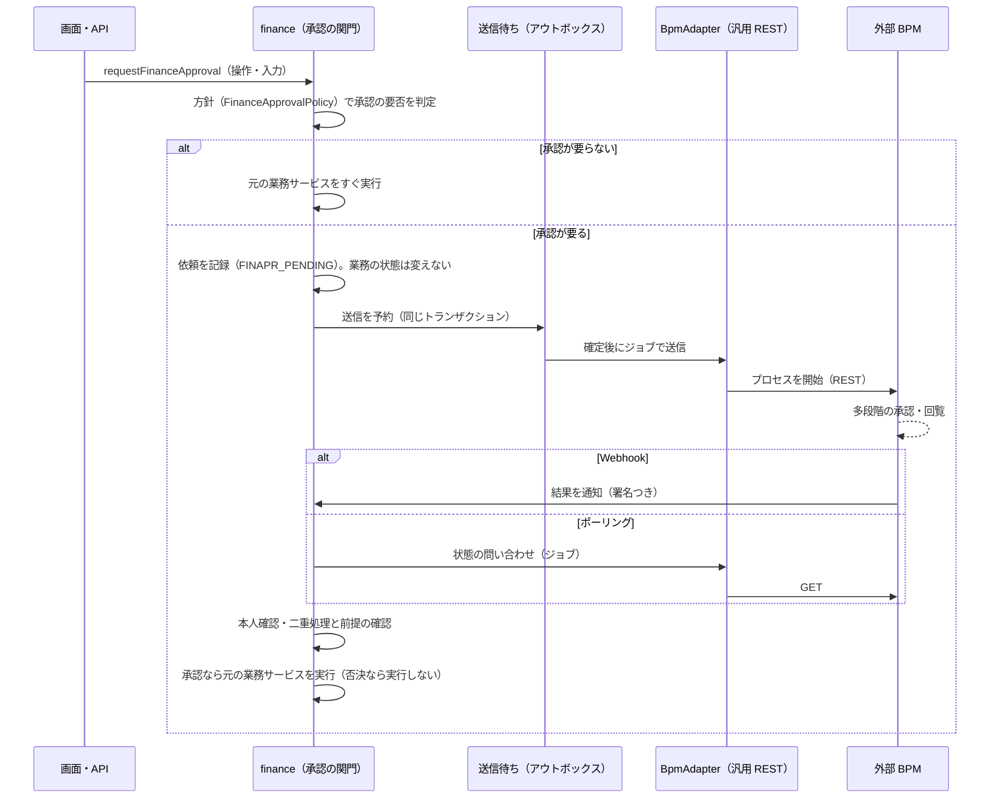
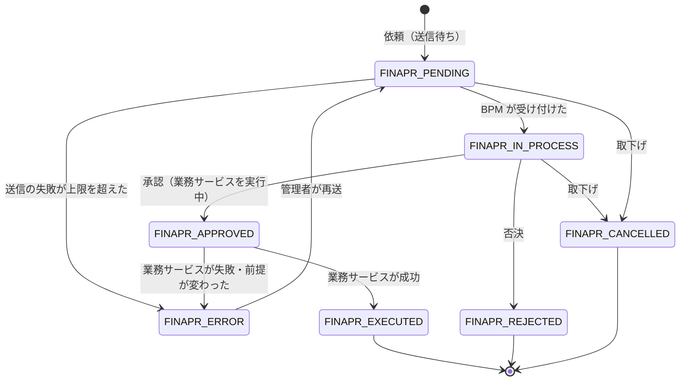

# Finance プラグイン 仕様 — 共通層（STEP L0〜）

Apache OFBiz 上に構築する独立ファイナンスモジュール（`plugins/finance`）のうち、
ローン業務とリース業務が共有する **共通層** の詳細仕様・運用記録をまとめる。

| 文書 | 対象 |
|------|------|
| `REQUIREMENTS.md` | ローン業務の要件（STEP 1〜10） |
| `REQUIREMENTS_LEASE.md` | 共通層の切り出し（STEP L0）とリース業務の要件（STEP L1〜） |
| **`SPEC_COMMON.md`（本書）** | 共通層の詳細仕様・運用記録 |
| `SPEC.md` | ローン層（STEP 1〜10）の詳細仕様・運用記録 |
| `SPEC_LEASE.md` | リース層（STEP L1〜）の詳細仕様・運用記録 |

記録の振り分け：

- 共通層（`FinanceContract`、契約ロック、審査、与信合算、延滞・督促、利息計算・営業日調整、設定解決、帳票基盤）は本書に記録する。
- STEP L0 で共通層へ移した機能について、`SPEC.md` の該当節は要約と本書への参照に置き換え、二重管理しない。
- ローン層だけ・リース層だけに関わる変更は、それぞれ `SPEC.md` / `SPEC_LEASE.md` に記録する。
- core 変更は、その変更を必要とした層の仕様書に記録する（既存の `PaymentServices.groovy` 修正は `SPEC.md`）。

実装言語の方針：計算・会計・バッチ＝**Java**、CRUD / ステータス遷移 / 画面データ準備＝**entity-auto / Groovy**。

---

## 進捗

| STEP | 内容 | 状態 |
|------|------|------|
| L0 | 共通層の切り出し（`FinanceContract`、契約ロック、審査・与信・延滞の共通化、パッケージ整理、顧客照会） | 完了（tests=50 / errors=0 / failures=0） |
| L1 | 申込種別に依存しない審査作成・承認検証の登録、共通の金融商品画面（リース層側は `SPEC_LEASE.md`） | 完了（tests=63 / errors=0 / failures=0） |
| L3 | 共通の GL 計上部品 `FinanceGlHelper`（リース層側は `SPEC_LEASE.md` 4 章） | 完了（testcase 44 件、errors=0 / failures=0） |
| L2 | 与信額に CONTRACTED を算入、共通の与信枠チェック `financeValidateCustomerCreditLimit`、LEASE アダプタの登録 | 完了（tests=70 / errors=0 / failures=0） |
| L6 | 延滞・督促へのリース用契約アダプタ登録（共通層側の変更） | 未着手 |
| L10a | 契約×取引先×役割×持分率（`FinanceContractParty`）と契約の親子関係（10 章） | 完了（tests=138 / errors=0 / failures=0） |
| L15a | 誤操作の取消（取消記録・逆仕訳・管理者権限。11 章。ローン・リースの各操作は `SPEC.md` 27 章・`SPEC_LEASE.md` 18 章） | 完了（tests=192 / errors=0 / failures=0） |
| L15b | 祝日カレンダーを考慮した営業日調整（core `TechDataCalendar`、複数カレンダー。12 章） | 完了（tests=203 / errors=0 / failures=0） |
| L21 | 外部 BPM 連携の承認ワークフロー（汎用 REST、依頼サービス・Webhook とポーリング。13 章） | 設計（未着手） |

L0 のコミット：L0-1 `6d46268`、L0-2 `fe644c8`、L0-3 `ae6fa2e`、L0-4 `2afe7f7`、L0-5 `beea390`、L0-6 `450b654`。

---

## 1. 層構成

| 層 | Java パッケージ | 定義ファイル | 仕様書 |
|----|-----------------|--------------|--------|
| 共通層 | `org.apache.ofbiz.finance.common` | `entitymodel_common.xml` / `services_common.xml` / `FinanceCommon*.xml` / `FinanceCommonTypeData.xml` | 本書 |
| ローン層 | `org.apache.ofbiz.finance.loan` | 既存の `entitymodel*.xml` / `services*.xml` 等 | `SPEC.md` |
| リース層 | `org.apache.ofbiz.finance.lease`（L1〜） | `entitymodel_lease*.xml` / `services_lease*.xml` | `SPEC_LEASE.md` |

依存は「ローン層 → 共通層」「リース層 → 共通層」のみ。共通層の Java はローン層・リース層のクラスを import しない。
契約種別ごとの処理は `FinanceContractAdapter` を介して呼び出し、実装クラスは `finance.properties` に登録して
リフレクションで読み込む（共通層からローン層へのコンパイル時依存を持たない）。

### 1.1 クラス一覧（L0 時点）

| 層 | クラス | 役割 |
|----|--------|------|
| 共通 | `FinanceContractHelper` | 共通契約台帳の作成・状態反映・ロック・与信合算 |
| 共通 | `FinanceContractAdapter` | 契約種別アダプタのインターフェース |
| 共通 | `FinanceContractAdapters` | アダプタ登録簿（`contract.adapter.<type>`）、サービス引数からの契約解決 |
| 共通 | `DelinquencyComputation` | 延滞日数・延滞元本・延滞利息の値オブジェクト（STEP L6 で延滞消費税と遅延損害金の計算基礎を追加。償却科目はアダプタの `getWriteOffCreditAccountType`。詳細は `SPEC_LEASE.md` 7.2） |
| 共通 | `FinanceWorkEffortHelper` | STEP L7：契約のタスク（core WorkEffort、`FinanceContractWorkEffort` で紐付け）の作成（冪等）・完了・一覧、サービス `createFinanceContractTask`。詳細は `SPEC_LEASE.md` 8.1 |
| 共通 | `FinanceContractPartyHelper` | STEP L10a：契約の取引先（役割・持分・期間）と親子関係。照会部品、主取引先の自動登録、サービス 4 本（10 章） |
| 共通 | `FinanceDelinquencyServices` | 延滞判定バッチ・遅延損害金・督促・償却/法的手続き（契約種別に依存しない） |
| 共通 | `FinanceInterestCalculator` | 日割り基準・端算入・通貨別丸め・設定解決（STEP 8〜10 から移動） |
| 共通 | `BusinessDayCalculator` | 営業日調整（STEP 10 から移動） |
| ローン | `FinanceAccountingServices` | 月次利息計上・請求・入金消込（STEP 3）。契約ロックは `FinanceContractHelper` 経由 |
| ローン | `FinancePrepaymentServices` | 繰上返済・条件変更（STEP 7） |
| ローン | `LoanContractAdapter` | ローン用アダプタ（確定返済表と分割請求 Invoice から延滞を算出） |

旧パッケージ `org.apache.ofbiz.finance.accounting` は廃止した。サービス名・リクエスト URI・画面名は変更していない。

---

## 2. 共通契約台帳（FinanceContract）

### 2.1 エンティティ（`entitymodel_common.xml`）

| エンティティ | 主なフィールド | 説明 |
|--------------|----------------|------|
| `FinanceContractType` | contractTypeId (PK), description | `LOAN` / `LEASE`（seed） |
| `FinanceContract` | financeContractId (PK), contractTypeId, customerPartyId, productId, statusId, currencyUomId, principalAmount, contractDate, processingLockVersion, createdDate | 全契約の共通台帳。`customerPartyId` に索引 |

- `principalAmount`：ローンは契約元本、リースは取得価額（与信額の算定に使う）。
- `statusId`（`FINANCE_CTR_STATUS`）：`FINCTR_CONTRACTED` / `FINCTR_ACTIVE` / `FINCTR_COMPLETED` / `FINCTR_CANCELLED`。
  各層の状態の写しで、各層の状態遷移サービスからだけ更新する。

### 2.2 各層との紐付け

- `LoanAgreement.financeContractId`（FK、一意索引 `LOANAGR_FINCTR_UQ`）で 1:1。
- `createLoanAgreement` が契約作成時に `FinanceContract`（`LOAN`、`FINCTR_CONTRACTED`）を作成し、`financeContractId` を返す。
- `setLoanAgreementStatus` がローン契約状態を共通状態へ反映する。

| ローン契約状態 | 共通状態 |
|----------------|----------|
| `LOANAGR_DRAFT` | `FINCTR_CONTRACTED` |
| `LOANAGR_ACTIVE` | `FINCTR_ACTIVE` |
| `LOANAGR_CLOSED` | `FINCTR_COMPLETED` |
| `LOANAGR_CANCELLED` | `FINCTR_CANCELLED` |

### 2.3 契約ロック

- `FinanceContractHelper.lock(financeContractId)`：`processingLockVersion` を条件付き更新で +1 し、
  同一契約の計上・請求・入金・延滞処理を直列化する（競合時は最大 5 回再試行）。
- ローン層の `lockLoanAgreement` はローン契約から `financeContractId` を引いてこのロックを取得し、契約を再読込して返す。
- `LoanAgreement.processingLockVersion` は廃止（列は互換のため残し、更新しない）。

---

## 3. 与信（合算）

- `FinanceContractHelper.sumExposurePrincipal(customerPartyId)`：顧客の `FINCTR_CONTRACTED` と `FINCTR_ACTIVE` の
  `FinanceContract` の `principalAmount` 合計。契約種別を問わない（ローン＋リース）。返済による減額はしない（STEP 5 の方式を踏襲）。
  - **STEP L2 で CONTRACTED を算入**した。リース契約は契約後、検収（L3）まで CONTRACTED のままなので、未開始の契約も与信を使うものとして扱う。
    ローン契約は作成時に即 ACTIVE になるため、ローンの結果は変わらない（DRAFT のまま残ったローン契約がある場合だけ増える）。
  - 旧名 `sumActivePrincipal` は `@Deprecated` の別名として残した。
- 与信枠チェックの本体は共通層の `financeValidateCustomerCreditLimit`（`services_common.xml`、`ValidateCustomerCreditLimit.groovy`、STEP L2）：
  顧客・通貨・新規元本を受け取り、有効な `CreditLine`（顧客単位のマスタとして扱う。エンティティは STEP 5 で定義）があれば
  「既存与信額＋新規元本 ≦ 与信枠」を検証する。
  - ローン：`financeValidateCreditLimit`（`ValidateCreditLimit.groovy`）がローン申込から借手・通貨を引いてこれを呼ぶ（入出力は従来どおり）。
  - リース：審査承認時（`financeValidateLeaseUnderwritingApproval`）と契約作成時（`createLeaseAgreement`）に取得価額で呼ぶ。
- 顧客照会の「与信額」も同じ合計を表示する。

---

## 4. 延滞・督促（共通エンジン）

### 4.1 契約種別アダプタ

`FinanceContractAdapter` は、共通エンジンが必要とする契約種別ごとの処理を提供する。

| メソッド | 内容 |
|----------|------|
| `getContractTypeId` / `getAgreementIdField` / `getAgreementEntityName` / `getDescriptionPrefix` | 種別・キー項目名・エンティティ名・仕訳摘要の接頭辞 |
| `findContractIdByAgreementId` / `findAgreement` | 層の契約 ID と共通契約の相互解決 |
| `isActive` / `getOrganizationPartyId` | 請求対象かどうか、会計組織 |
| `computeDelinquency` | 基準日時点の延滞日数・延滞元本・延滞利息 |
| `findOpenInvoiceIds` | 未入金・未償却の請求書（償却時に `INVOICE_WRITEOFF` にする） |
| `getAgreementKeyFields` | 延滞関連レコードに互換用に保存する層のキー（例 `loanAgreementId`） |

登録（`config/finance.properties`）：

```properties
contract.adapter.LOAN=org.apache.ofbiz.finance.loan.LoanContractAdapter
contract.adapter.LEASE=org.apache.ofbiz.finance.lease.LeaseContractAdapter
```

アダプタ未登録の契約種別は、延滞バッチで処理対象外となる（顧客照会には表示される）。
LEASE は顧客照会・契約画面への遷移のため STEP L2 で登録した。延滞算出は L6 で実装し、それまでは「延滞なし」を返す（`SPEC_LEASE.md` 3.5）。

### 4.2 処理

| サービス | 変更点（L0） |
|----------|--------------|
| `runLoanDelinquencyBatch` | `FINCTR_ACTIVE` の `FinanceContract` を順に処理。契約ロック → アダプタで延滞算出 → 商品の `FinancialProductDelinquency` で区分 → スナップショット・償却・法的手続き |
| `runLateFeeAccrual` / `runLateFeeAccrualInternal` | 契約を `financeContractId` で特定。日割り基準は契約の商品から解決 |
| `createLoanDunningNotice` | 同上 |

- 4 サービスとも `loanAgreementId`（従来）または `financeContractId` で呼び出せる（`loanAgreementId` は任意化）。
- `LoanDelinquency` / `LoanLateFeeAccrual` / `LoanDunningNotice` / `LoanDelinquencyAction` に `financeContractId`（FK・索引）を追加。
  重複防止（冪等性）の判定は `financeContractId` で行い、`loanAgreementId` も互換のため設定する。
- 仕訳の取引先は `FinanceContract.customerPartyId`、通貨は `FinanceContract.currencyUomId`。

---

## 5. 審査

- `LoanUnderwriting` に `applicationTypeId`（FK `FinanceContractType`）と `applicationId` を追加（索引 `LOANUW_APP_IDX`）。
- `createLoanUnderwriting` は `LOAN` と `loanApplicationId` を自動設定する。両項目は create/update の入力から除外。
- 状態規則（`LOANUW_IN_REVIEW` で作成、承認・否決後は変更不可、状態・decision・reviewDate の一貫確定）は従来どおり。
  リース申込の審査は L1 以降で `applicationTypeId=LEASE` として扱う。

### 5.1 申込種別に依存しない審査（STEP L1）

| 項目 | 内容 |
|------|------|
| `createFinanceUnderwriting`（`services_common.xml`） | `applicationTypeId` + `applicationId` を必須にした共通の審査作成。実装は `createLoanUnderwriting` と同じ `SaveLoanUnderwriting.groovy`（`LOAN` の場合だけ `loanApplicationId` も設定） |
| 承認時の検証 | `setLoanUnderwritingStatus` で `LOANUW_APPROVED` にするとき、`LOAN` は従来の担保 LTV・与信枠チェック、それ以外は `finance.properties` の `underwriting.approval.validator.<type>` に登録したサービスを `applicationId` / `principalAmount` で呼ぶ。未登録の種別は承認できない |
| 登録 | `underwriting.approval.validator.LEASE=financeValidateLeaseUnderwritingApproval`（リース層、`SPEC_LEASE.md` 2.3） |

共通層の Groovy はリース層のサービス名を直接持たず、設定経由で呼ぶ。

---

## 5A. 金融商品画面（STEP L1）

ローン・リース共通の商品画面を追加した（ローン用の商品画面は従来なかった）。

| 項目 | 内容 |
|------|------|
| ビュー | `FinancialProductAndType`（`entitymodel_common.xml`）：`FinancialProduct` ＋ 種別の `parentTypeId`（LOAN / LEASE）・説明 ＋ core `Product.productName` |
| サービス | `createFinanceProduct`：core `Product`（`SERVICE`）がなければ `productName` で作成し、`FinancialProduct` を作成。`productId` 省略時は採番。更新は既存の `updateFinancialProduct` |
| 画面 | `FindFinancialProduct`（業務・商品種別・ID・名称で検索）、`EditFinancialProduct`（登録・編集）。タブ `FinancialProductTabBar` はリース商品にだけ「リース条件」を表示 |

率の項目は小数（0.15 = 15%）で入力する。

---

## 6. 顧客照会

| 項目 | 内容 |
|------|------|
| サービス | `getFinanceCustomerSummary`（`services_common.xml`、VIEW 権限）：顧客の全 `FinanceContract`（層の契約番号をアダプタで解決）、有効契約の与信額合計、契約ごとの最新延滞スナップショット、督促通知 |
| 画面 | `FinanceCustomerSummary`（メニュー「顧客照会」）：顧客検索（LookupPartyName）、顧客名・与信額、契約一覧、延滞、督促 |
| 遷移 | `ViewFinanceContract?financeContractId=...`：契約種別に応じて各層の管理画面へリダイレクト（`LOAN` → `ManageLoanAgreement`） |

---

## 7. 設定・データ

| ファイル | 種別 | 内容 |
|----------|------|------|
| `data/FinanceCommonTypeData.xml` | seed | `FinanceContractType`（LOAN/LEASE）、`FINANCE_CTR_STATUS` |
| `data/FinanceStatusDemoData.xml` | demo | デモのローン契約 8 件に対応する `FinanceContract`（`FDCTR_*`）、審査の `applicationTypeId` / `applicationId` |
| `config/finance.properties` | 設定 | `contract.adapter.LOAN` |

L0-1 で、未登録だった `FinanceStep8TypeData.xml` / `FinanceStep9TypeData.xml` を `ofbiz-component.xml` の seed に登録した。

---

## 8. 検証

| 検証項目 | 方法 | 結果 |
|----------|------|------|
| Java / Groovy | `gradlew compileJava compileGroovy` | BUILD SUCCESSFUL |
| finance テスト | `gradlew "ofbiz --test component=finance"` | tests=50 / errors=0 / failures=0 |
| demo 投入 | `gradlew "ofbiz --load-data readers=demo --load-data component=finance"` | BUILD SUCCESSFUL |
| 層の依存 | `common` パッケージに `finance.loan` / `finance.lease` への参照がないこと | 該当なし |

L0 で追加したテスト：`FinanceContract` の作成と状態反映、与信合算（リース契約の加算・取消契約の除外）、
延滞レコードの `financeContractId` と契約 ID 指定での呼出し、審査の申込参照、顧客照会。

---

## 9. GL 計上部品（STEP L3）

`org.apache.ofbiz.finance.common.FinanceGlHelper`：

| メソッド | 内容 |
|----------|------|
| `findGlAccountId(org, glAccountTypeId)` | 組織の `GlAccountTypeDefault`、なければ組織に割り当てた（`GlAccountOrganization`）同じタイプの最初の科目。ローン層の同名の非公開メソッドと同じ規則 |
| `postTransaction(...)` | 複数明細の取引を、core の `createAcctgTransAndEntries` で作成して転記する（まだ転記されていない場合だけ `postAcctgTrans` を呼ぶ）。科目の割当がない、換算できない、貸借が一致しない場合はエラー。金額 0 の明細は作らない |
| `postUnposted(field, value)` | `invoiceId` / `paymentId` を持つ未転記の取引を転記する |

- 金額は契約通貨で受け取る。組織の基準通貨（`PartyAcctgPreference`）と違うときは明細ごとに `convertUom`（取引日基準）で換算して小数 2 桁に丸め、端数差は最大の貸方明細で調整する。元の金額・通貨は `origAmount` / `origCurrencyUomId` に残す。
- 取引種別は `OTHER_INTERNAL`、会計種別は `ACTUAL`（ローン層の月次計上と同じ）。
- ローン層の仕訳処理（`FinanceAccountingServices`）は L3 では変更していない。共通化は必要になった時点で行う。

---

## 10. 契約の取引先と親子関係（STEP L10a）

要件「後続 STEP の設計上の考慮事項 1.（土台）」（`REQUIREMENTS_LEASE.md`）。協調リース・転貸・フリート・ベンダープログラム（L16〜L20）で
作り直しが起きないよう、契約×取引先×役割×持分率と契約の親子関係を共通層に置く。**追加のみ**で、既存処理の挙動は変えない。

### 10.1 データモデル（`entitymodel_common.xml`）

| エンティティ / 列 | 主キー | 内容 |
|-------------------|--------|------|
| `FinanceContractParty` | financeContractId + partyId + roleTypeId + fromDate | 契約の取引先：役割（core `RoleType`、`FIN_CTR_ROLE` 配下）、持分率 `shareRate`（0 超 1 以下、空＝持分なし）、期間（from/thru、thru 空＝有効）、`isPrimary`（各層の契約から登録した借手・貸手等）、備考 |
| `FinanceContract.parentFinanceContractId` | — | 親契約（基本契約：フリート、ベンダープログラム、協調リース全体）。空＝最上位。循環は禁止 |

core の `Agreement` / `AgreementRole` は使わない（`FinanceContract` は core の Agreement ではなく、持分率・期間を持たせる必要があるため）。役割は core の `RoleType` を使う。

### 10.2 役割（seed `FinanceCommonTypeData.xml`）

`FIN_CTR_ROLE`（親）配下：`FIN_BORROWER` 借主 / `FIN_LENDER` 貸主 / `FIN_LESSEE` 借手 / `FIN_LESSOR` 貸手 / `FIN_GUARANTOR` 保証人 /
`FIN_PARTICIPANT` 協調参加者 / `FIN_ARRANGER` 幹事 / `FIN_HEAD_LESSOR` 元リースの貸手 / `FIN_VENDOR` 販売店 / `FIN_RECOURSE` リコース先。

### 10.3 主取引先の登録

- `FinanceContractHelper.createContract` に貸手組織つきの版を追加した（従来の版は組織なしで残す）。契約作成時に、顧客（`customerPartyId`）と貸手組織を **持分 100%・`isPrimary=Y`・開始日＝契約日** で登録する。
- 役割は契約種別のアダプタが返す：`FinanceContractAdapter.getCustomerRoleTypeId` / `getOrganizationRoleTypeId`（既定＝ローン：借主・貸主、`LeaseContractAdapter`：借手・貸手）。共通層はローン層・リース層を参照しない。
- 呼び出し元：ローン `CreateLoanAgreement.groovy`（組織＝`organizationPartyId`、既定 Company）、リース `createLeaseAgreement`（貸手組織）。
- **既存契約**：`backfillFinanceContractParties` が、主取引先のない契約に顧客と（アダプタで解決できれば）貸手組織を登録する。役割ごとに既存行があれば作らない（冪等）。

### 10.4 サービス（`services_common.xml`、`FinanceContractPartyHelper`）

| サービス | 内容 |
|----------|------|
| `addFinanceContractParty` | 役割は `FIN_CTR_ROLE` 配下のみ、持分は 0 超 1 以下、同じ取引先・役割の重複（開始日時点で有効）を拒否、同じ役割の有効な持分合計が 100% を超えるなら拒否 |
| `expireFinanceContractParty` | 終了日（既定＝現在）を設定。開始日より前・終了済みは拒否 |
| `setFinanceContractParent` | 親契約の設定・解除（空）。存在しない親、自分自身、循環（親の祖先に自分を含む）を拒否 |
| `backfillFinanceContractParties` | 10.3 の既存契約の登録 |

照会部品：`findParties(契約, 役割, 時点)`（期間で有効な行）、`isContractRole`、`ancestors`（親→祖父…）、`registerPrimaryParties`。

### 10.5 画面

`FinanceContractParties`（ローン・リース契約画面のボタン「契約の取引先」から）：契約ヘッダ・取引先一覧（役割・持分・期間・有効・役割の終了）、取引先の追加、親契約の設定、子契約の一覧。

### 10.6 既存処理への影響

なし。請求・入金・与信（`sumExposurePrincipal` は `customerPartyId`）・延滞・督促・固定資産税（`FixedAsset.partyId`。L10b 以降は公租公課 `LeasePublicCharge*`、物件の持分は `LeaseAgreementAsset.ownershipShare`）は従来どおり各層の取引先列を読む。
土台を読むように切り替えるのは、複数の貸手・持分が必要になる L16 以降とする。

### 10.7 テスト（`FinanceContractPartyTests`）

| テスト | 内容 |
|--------|------|
| `testPrimaryPartiesOnCreation` | リース契約（直接作成・リースのサービス経由）に借手・貸手 100%、組織なしの旧版は借主のみ、照会部品 |
| `testAddExpireAndShares` | 参加者 60%＋40%、100% 超・重複・対象外の役割・持分の範囲外・存在しない取引先の拒否、持分なしの保証人、役割の終了（開始日前・二重終了の拒否）、終了後の持分の再割当、時点指定の照会 |
| `testParentAndCycle` | 3 階層の親子と祖先、循環・自分自身・存在しない親の拒否、解除 |
| `testBackfill` | 取引先のない旧契約への登録（層の契約がないため借手のみ）、再実行で 0 件 |

### 10.8 検証

| 検証項目 | 結果 |
|----------|------|
| `gradlew compileJava compileGroovy` | BUILD SUCCESSFUL |
| seed 投入 | `FINANCE_CONTRACT_PARTY` 新設、`FINANCE_CONTRACT.PARENT_FINANCE_CONTRACT_ID` 追加、役割 11 件 |
| `gradlew "ofbiz --test component=finance"` | tests=138 / errors=0 / failures=0（L10a の 4 件を含む） |
| 画面 | 未確認 |

### 10.9 運用メモ

- 既存環境では seed 投入後に `backfillFinanceContractParties` を 1 回実行する（テスト `testBackfill` が開発 DB 全体に対して実行するため、開発 DB の既存契約は登録済み）。
- 手動で追加した取引先（保証人・参加者等）は、現時点では業務処理に使われない（記録のみ）。

---

## 11. 誤操作の取消（STEP L15a）

誤って実行した操作を取り消す。対象はリースの検収・中途解約・条件変更と、ローンの契約（有効化）・繰上返済・条件変更（各層の内容は `SPEC_LEASE.md` 18 章・`SPEC.md` 27 章）。

### 11.1 方針（2026-10-15 決定）

| 項目 | 決定 |
|------|------|
| 方式 | **操作ごとに専用の取消サービス**（案A）。元の記録は消さず、逆仕訳と取消記録を足す。行を消す必要があるもの（検収記録・解約記録）は取消記録に写し（スナップショット）を残す |
| 取り消せる条件 | **その後の処理がない場合だけ**（請求・入金・戻入・償却・計上・延滞・後続の変更 等）。後続の処理がある場合はエラー（`FinanceReversalBlocked`、何があるかを示す） |
| 権限 | **FINANCE_ADMIN だけ**（`financeAdminPermission`。他の finance 権限では不可） |
| 理由 | **必須**（空白は不可） |
| 対象 | リース：検収・中途解約・条件変更。ローン：有効化・繰上返済・条件変更 |

### 11.2 共通部品

| 部品 | 内容 |
|------|------|
| `FinanceReversal`（entity） | 契約、取消の種類（`FINANCE_REV_TYPE`：`FINREV_*`）、取り消した記録の ID、操作日、理由、取消日、取消者、逆仕訳の ID（カンマ区切り）、消した行の写し |
| `FinanceReversalHelper` | 取消記録の作成、写しの作成、理由の検査、「ある時点より後に作られた行」の件数 |
| `FinanceGlHelper.reverseTransaction` | 仕訳の借方・貸方を入れ替えた逆仕訳を作って転記する（元の仕訳は残す） |
| `FinanceWorkEffortHelper.cancelAndUnlinkTask` | タスクを取り消し、紐付けを外す（同じきっかけで再びタスクを作れるようにする） |
| `financeAdminPermission`（service / minilang） | FINANCE_ADMIN を持つ利用者だけを許可する |

### 11.3 状態遷移

取消用の遷移を `StatusValidChange` に追加したが、汎用の状態サービス（`setLeaseAgreementStatus` / `setLoanAgreementStatus` / `setLoanApplicationStatus`）では使えないようにしている（`FinanceReversalRequiresService`）。

| 層 | 遷移 |
|----|------|
| リース | `LEASEAGR_ACTIVE` → `LEASEAGR_CONTRACTED`（検収の取消）、`LEASEAGR_TERMINATED` → `LEASEAGR_ACTIVE`（解約の取消）、再リースの戻し 2 本 |
| ローン | `LOANAGR_ACTIVE` → `LOANAGR_CANCELLED`（有効化の取消）、`LOANAGR_CLOSED` → `LOANAGR_ACTIVE`（全額繰上返済の取消）、`LOANAPP_CONTRACTED` → `LOANAPP_APPROVED` |

### 11.4 要確認・制約

- **後続の処理がある場合**：まとめて戻す（請求の取消→入金の取消→…）ことはしない。先に後続の処理を core の機能（請求書の取消・入金の取消）で戻してから取消すること。ただし finance の計上記録（戻入・償却・計上）を戻すサービスはないため、計上後の取消はできない。
- **取消の取消**：取り消した操作をもう一度行う（検収し直す 等）ことで対応する。取消そのものを戻すサービスはない。
- **仕訳の日付**：逆仕訳は取消した日付で計上する（元の操作日ではない）。締めた会計期間の操作を取り消すと、当期に影響する。
- **対象外の操作**：物件購入・支払、返還・処分・譲渡、再リースの開始、月次の計上、公租公課の申告・納付は対象外（必要なら同じ方式で追加する）。

---

## 12. 祝日カレンダーを考慮した営業日調整（STEP L15b）

> **状態：完了**（2026-10-16。tests=203 / errors=0 / failures=0）。

期日の営業日調整（`BusinessDayCalculator`）は、STEP 9 からこれまで土日だけを休日にしていた。祝日と、国ごとに違う休日も扱えるようにした。
ローン層・リース層の両方が使う共通の部品である。

### 12.1 決定事項（2026-10-16）

| 項目 | 決定 |
|------|------|
| カレンダーの持ち方 | **core の `TechDataCalendar` を使う**（datamodel にあるため、追加のコンポーネントは不要）。国（または市場）ごとにカレンダーを作る（例：`FIN_JP`、`FIN_US`） |
| 休日の表し方 | 曜日の定義（`TechDataCalendarWeek`）で、稼働（`xxxCapacity`）が空または 0 の曜日を休日とする（金土が休みの国にも対応）。例外日（`TechDataCalendarExcDay`）は、稼働が空または 0 なら祝日、稼働ありなら振替出勤日。例外日は曜日の定義より優先する |
| 複数のカレンダー | 1 つの商品に複数のカレンダーを指定できる。**指定したどれか 1 つでも休みの日は休業日**（例：円とドルの両方の銀行休業日） |
| 既存の契約 | **新しく作る表から適用する**。既存の見積の表・確定リース料表・確定返済表の期日は変えない（契約確定後は不変の原則） |
| 保守 | カレンダー・祝日の登録は core（manufacturing アプリ）の画面で行う |

### 12.2 データモデル・設定

| エンティティ | 主キー | 内容 |
|--------------|--------|------|
| `FinancialProductCalendar`（新規、共通層、`entitymodel_common.xml`） | productId + calendarId | 商品が使うカレンダー（FK：`FinancialProduct`、core `TechDataCalendar`）。行がない商品は既定のカレンダーを使う |

- 既定のカレンダー：`finance.properties` の `business.calendar.ids`（カンマ区切り。SystemProperty でも上書きできる）。既定値は `FIN_JP`。空にすると、従来どおり土日だけを休日とする。
- 存在しないカレンダーの ID は読み飛ばし、警告をログに出す。使えるカレンダーが 1 つもなければ土日だけを休日とする。曜日の定義がないカレンダーは土日を休日とする。

### 12.3 計算部品

| クラス | 内容 |
|--------|------|
| `FinanceBusinessCalendar`（新規、`org.apache.ofbiz.finance.common`） | カレンダーの読み込みと休日の判定。`forProduct(delegator, productId)`（商品 → 既定 → 土日のみ）、`load(delegator, calendarIds)`、`defaultCalendarIds`、`isBusinessDay(date)`、`WEEKEND_ONLY`（土日のみ）。エンティティのキャッシュを使い、1 回の処理（見積・検収 等）の中では読み込んだ内容を使い回す |
| `BusinessDayCalculator`（変更） | `isBusinessDay` / `adjust` / `following` / `preceding` / `modifiedFollowing` に、カレンダーを受け取る形を追加した。カレンダーを渡さない形は `WEEKEND_ONLY` を使い、従来と同じ結果になる。すべて休みのカレンダーで止まらないよう、ずらす日数を 366 日までにした（超えたらエラー）。`Timestamp` の調整は時刻を保ったまま日付を動かす |
| `FinanceInterestCalculator.resolveBusinessCalendar(delegator, loanAgreement)`（追加） | ローン契約の商品（申込から辿る）のカレンダー |

- 期日の調整方式（`LOAN_DUEDATE_CONV`：調整なし・翌営業日・前営業日・修正翌営業日）は 4 つのまま。調整方式が `DUEDATE_NONE`（既定）の商品は、カレンダーがあっても期日は変わらない。
- 利息の日割り計算の期間・リースの期間（`periodFromDate` / `periodThruDate`）は暦日のまま。営業日調整は期日（`dueDate`）だけに使う。

### 12.4 適用した処理

| 層 | 処理 |
|----|------|
| ローン | 見積（`CreateLoanQuote.groovy`）、繰上返済・条件変更の返済表の作り直し（`FinancePrepaymentServices.persistSchedule`） |
| リース | 見積（`LeaseQuoteServices.groovy`）、検収（`LeaseAcquisitionServices.acceptLeaseAgreement` の revision の作り直し）、条件変更（`LeaseModificationServices`） |

契約の作成（見積の表を写す）は期日を計算し直さないため、見積の期日がそのまま確定表に入る。

### 12.5 サービス・画面

| サービス | 内容 |
|----------|------|
| `addFinancialProductCalendar` / `removeFinancialProductCalendar`（entity-auto、`services_common.xml`） | 商品にカレンダーを追加・削除する。この後に作る表から使われる。存在しないカレンダーは FK で追加できない |

- 金融商品の画面（`EditFinancialProduct`）に「営業日カレンダー」の一覧と追加フォームを加えた。

### 12.6 seed・テストデータ

- seed `data/FinanceCalendarSeedData.xml`（新規）：曜日の定義 `FIN_WEEK_MON_FRI`（月〜金）、カレンダー `FIN_JP`、SystemProperty `business.calendar.ids=FIN_JP`、例外日（祝日）104 件。2026〜2030 年の国民の祝日・振替休日・国民の休日と、銀行の年末年始（12/31〜1/3）を入れた。春分・秋分の日は 2027 年以降は予定の日付（毎年 2 月に翌年分が公表される）。
- テストデータ：`TEST_FIN_US`（米国：2027-07-05・2027-09-06 休み）、`TEST_FIN_AE`（金土休み。曜日の定義 `TEST_FIN_WK_SUN_THU`）、`TEST_FIN_X`（曜日の定義なし。2027-05-08 の土曜を出勤日、2027-05-12 の水曜を休日とする）。

### 12.7 テスト（`FinanceBusinessCalendarTests`、3 件）

| テスト | 確認すること |
|--------|--------------|
| `testCalendarDefinition` | 祝日・振替休日・国民の休日・年末年始、金土休みの曜日の定義、曜日の定義がない場合、振替出勤日、複数カレンダーの合成、4 つの調整方式（修正翌営業日で月をまたぐ場合を含む）、時刻を保つこと、存在しない ID の扱い、既定のカレンダー、カレンダーなしは土日のみで従来と同じ |
| `testLeaseScheduleUsesProductCalendars` | 商品に `FIN_JP` と `TEST_FIN_US` を指定し、見積の期日が両方の休日を避けること（期間は暦日のまま）、契約の確定表が見積と同じこと、検収の revision 2 も休日を避けること、カレンダーを外しても既存の表は変わらないこと |
| `testLoanQuoteUsesProductCalendars` | ローン見積の期日が祝日を避け（年始・ゴールデンウィーク）、`interestThruDate` は暦日のままであること、存在しないカレンダーは追加できないこと、ローン契約から同じカレンダーを解決すること |

### 12.8 検証

| 検証項目 | 結果 |
|----------|------|
| XML の整形式 | 変更したすべてのファイルで OK |
| `gradlew compileJava compileGroovy` | BUILD SUCCESSFUL |
| seed 投入 | 新規 1 テーブル（`FINANCIAL_PRODUCT_CALENDAR`）。新しい seed ファイルから 107 行、全体で 477 行を変更 |
| `gradlew "ofbiz --test component=finance"` | tests=203 / errors=0 / failures=0（44 分）。初回はテストデータの ID が 20 文字を超えて（`TEST_FIN_WEEK_SUN_THU`）データの読み込みが失敗したため、`TEST_FIN_WK_SUN_THU` に直した |
| demo 投入 | BUILD SUCCESSFUL（244 行） |
| 画面 | 未確認（定義のみ） |

### 12.9 要確認・制約

- **祝日データの保守**：祝日は法律の改正や臨時の休日で変わる。seed は 2030 年まで。毎年、翌年の祝日（春分・秋分の日の公表後）を manufacturing の画面か seed で登録する運用が必要。登録がない年は土日だけが休日になる（エラーにはしない）。
- **既定のカレンダーの影響**：既定を `FIN_JP` にしたため、カレンダーを指定していない商品でも、調整方式が `DUEDATE_NONE` 以外なら日本の祝日を避けるようになる（STEP L15b より前は土日のみ）。今の seed・demo・テストの商品は `DUEDATE_NONE` のため、結果は変わらない。
- **キャッシュ**：カレンダーはエンティティのキャッシュを通して読む。core の画面で祝日を変えたときは、エンティティエンジンがキャッシュを消してから反映される。
- **ローン層への影響**：ローンの返済表の期日にも適用する（`SPEC.md` 28 章）。
- **core 変更**：なし（core のエンティティを読むだけ）。
- **テスト時間**：今回の全体テストは 44 分かかった。目安の 20 分を超えているため、次の STEP の前に開発用 DB を作り直す（`cleanAll loadAll`）ことを勧める。

---

## 13. 外部 BPM 連携の承認ワークフロー（STEP L21、設計）

> **状態：設計（未着手）**。2026-10-17 に方針を決定した。設計だけを記録し、実装は別途行う。実装後に「実装」「テスト」「検証」を追記する。

実務では、何段階もの承認、複数部署への回覧、金額による決裁者の切替などの承認ワークフローが必要になる。OFBiz 本体には現在ワークフローエンジンがない（古い workflow エンジンは削除済み）ため、**外部の BPM（Business Process Management）製品に承認を任せ、finance には汎用の薄い連携層（ラッパー）だけを置く**。

### 13.1 決定事項（2026-10-17）

| 項目 | 決定 |
|------|------|
| 対象の BPM | **汎用 REST だけ**。製品別（Camunda・Flowable 等）の実装は作らず、汎用 REST の設定（URL・認証・項目の対応）で合わせる。製品別の実装が必要になったら `BpmAdapter` を追加する |
| 最初の対象操作 | **審査の承認・否決**（`setLoanUnderwritingStatus` → `LOANUW_APPROVED` / `LOANUW_REJECTED`。ローン・リース共通）、**契約の作成**（`createLoanAgreement` / `createLeaseAgreement`）、**中途解約**（`terminateLeaseAgreement`） |
| 差し込み方 | **A：依頼サービスを分ける**。画面・API は承認の依頼サービス（`requestFinanceApproval`）を呼び、承認されたら記録してある元の業務サービスを実行する。元の業務サービスは変えない（直接呼べば今まで通り動く。サービスの中で承認済みかを確かめる方式 B は採らない） |
| 結果の受け取り | **Webhook（BPM から呼んでもらう）と、定期的な問い合わせ（ポーリング）の両方**。BPM 製品によって使える方式が違うため、接続先ごとに設定で選ぶ（両方を有効にしてもよい。二重処理は依頼 ID で防ぐ） |
| 業務の状態 | **BPM は業務の状態を変えない**。BPM が返すのは判断（承認／否決）だけで、業務の状態は既存の状態遷移サービスが変える（AGENTS.md の「業務STATUSは状態遷移サービスだけで変える」を守る） |
| 層 | **共通層**（`org.apache.ofbiz.finance.common`）に置く。共通層はローン層・リース層のクラスを参照しない（操作は「サービス名＋入力」で記録し、OFBiz の dispatcher で呼ぶ） |

### 13.2 全体の流れ



依頼の状態（`FIN_APPROVAL_STATUS`）：



### 13.3 データモデル（予定）

| 種類 | 内容 |
|------|------|
| `FinanceApprovalRequest`（新規） | 依頼 1 件：`financeApprovalRequestId`、操作（`approvalOperationEnumId`）、対象（`contractTypeId`・`targetEntityName`・`targetId`、あれば `financeContractId`）、実行するサービス名（`serviceName`）と入力（`serviceContext`、JSON。`userLogin`・`locale` は保存しない）、前提の値（`preconditionJson`：依頼時の対象の状態・金額など）、方針（`financeApprovalPolicyId`）、接続先（`bpmEndpointId`）、BPM 側の ID（`externalProcessId`）、状態（`statusId`）、判断（`decision`）・判断者（`decisionByText`）・コメント、依頼者（`requestedByUserLogin`）、依頼日時・判断日時・実行日時、実行結果（`resultMessage`、作成された ID など `resultJson`）、送信回数・最終送信日時 |
| `FinanceApprovalEvent`（新規） | 依頼ごとの履歴（送信・受付・Webhook 受信・問い合わせ・判断・実行・エラー）。受信した本文の要約とハッシュ（二重受信の判定に使う）を残す |
| `FinanceApprovalPolicy`（新規、設定データ） | 「操作 × 契約種別 × 商品（空＝すべて）× 金額の範囲（空＝制限なし）→ 承認の要否、接続先、BPM のプロセス名（`processKey`）、有効期間」。先に一致した優先順位（`sequenceNum`）の行を使う。一致する行がなければ**承認不要**（今まで通り） |
| `FinanceBpmEndpoint`（新規、設定データ） | 接続先：`bpmEndpointId`、アダプター（`adapterName`、既定 `GENERIC_REST`）、基本 URL、開始・問い合わせ・取下げのパスと HTTP メソッド、認証の方式（なし／Basic／Bearer トークン）と資格情報のプロパティ名（値そのものは DB に置かない）、Webhook の有効・署名鍵のプロパティ名、ポーリングの有効・間隔、タイムアウト、再送の上限、応答の項目の対応（`responseMappingJson`：BPM 側の ID・状態・判断の項目名と値の対応） |
| `FinanceApprovalOutbox`（新規） | 送信待ち：依頼 ID、送る操作（開始／取下げ）、次の送信予定日時、送信回数、最後のエラー |
| seed | 状態 `FIN_APPROVAL_STATUS`（上の図）と `StatusValidChange`、操作 `FIN_APPROVAL_OP`（`FINAPROP_UW_DECISION` 審査の判断、`FINAPROP_AGR_CREATE` 契約の作成、`FINAPROP_LS_TERMINATE` 中途解約）、権限 `FINANCE_APPROVAL_*`、BPM 用のシステムユーザー |
| demo | 内部テスト用の接続先（`FINBPM_DEMO`、ポーリングのみ、URL はローカル）と、承認を要求する方針の例（無効の状態で登録） |

### 13.4 操作の対応（最初の 3 つ）

| 操作 | 依頼で受け取る入力 | 実行するサービス | 前提の確認（判断を受けたとき） | 方針の金額 |
|------|--------------------|------------------|--------------------------------|------------|
| 審査の判断 | `loanUnderwritingId`、`statusId`（APPROVED / REJECTED） | `setLoanUnderwritingStatus` | 審査がまだ `LOANUW_IN_REVIEW` で、承認額が依頼時と同じ | 審査の承認額（`approvedPrincipalAmount`） |
| 契約の作成 | `loanQuoteId` または `leaseQuoteId` と、契約日など | `createLoanAgreement` / `createLeaseAgreement` | 見積が受理済みのまま、同じ見積の契約がまだない | 見積の元本・取得価額 |
| 中途解約 | `leaseAgreementId`、解約日、理由 | `terminateLeaseAgreement` | 契約がまだ `LEASEAGR_ACTIVE`。規定損害金を依頼時に計算して保存し、判断時の再計算と比べて違えば `FINAPR_ERROR` | 規定損害金（`calculateLeaseTerminationDamages`） |

- 操作ごとの「入力の検証・前提の取得・方針の金額」は、`FinanceApprovalOperation`（共通層のインターフェース）の実装が受け持つ。実装クラスは `finance.properties` の `approval.operation.<操作>` で登録する（`FinanceContractAdapter` と同じ形）。中途解約の実装はリース層、審査の判断は共通層、契約の作成はローン層・リース層に置く。
- 審査の判断は、否決も承認の対象にできる（方針の設定で選ぶ）。否決を承認なしで行う運用なら、方針に否決の行を作らない。
- 依頼を作るときにも業務サービスの事前確認を行い（契約の作成なら申込・見積・審査の状態、中途解約なら計算サービス）、実行できない依頼は作らない。

### 13.5 サービス（予定）

| サービス | 内容 |
|----------|------|
| `requestFinanceApproval` | 操作と入力を受け取る。方針で承認が要らなければ元のサービスをすぐ実行して結果を返す。要るときは依頼と送信待ちを作り、`financeApprovalRequestId` を返す（同じ対象・操作の進行中の依頼があればエラー） |
| `cancelFinanceApproval` | 依頼者または管理者が取り下げる。BPM にも取下げを送る（送信待ち） |
| `processFinanceApprovalOutbox`（ジョブ） | 送信待ちを送る。失敗したら間隔をあけて再送し、上限を超えたら `FINAPR_ERROR` |
| `pollFinanceApprovals`（ジョブ） | ポーリングが有効な接続先の、進行中の依頼の状態を問い合わせ、判断が出ていれば `completeFinanceApproval` を呼ぶ |
| `receiveFinanceApprovalWebhook`（イベント） | Webhook の受け口。署名と接続先を確かめ、本文を `BpmAdapter.parseCallback` で判断に変換して `completeFinanceApproval` を呼ぶ |
| `completeFinanceApproval`（内部） | 判断を確定する：①依頼をロック（`FinanceContractHelper.lock` または依頼の行のロック）②状態が終わっていれば何もしない（冪等）③前提を確かめる ④承認なら記録したサービスを依頼者の権限で実行し、結果を保存 ⑤履歴を残す |
| `retryFinanceApproval` | 管理者が `FINAPR_ERROR` の依頼を送り直す（前提が変わった場合は取り下げて新しく依頼する） |
| `getFinanceApprovalStatus` | 画面・API 用の照会 |

**`BpmAdapter`**（共通層のインターフェース）：

```java
public interface BpmAdapter {
    /** Start a process; returns the external process id (null = accepted asynchronously). */
    String start(GenericValue endpoint, GenericValue request, Map<String, Object> payload) throws BpmException;
    /** Current state of a process (for polling); null when not decided yet. */
    BpmDecision status(GenericValue endpoint, GenericValue request) throws BpmException;
    void cancel(GenericValue endpoint, GenericValue request, String reason) throws BpmException;
    /** Verify and translate a webhook call into a decision. */
    BpmDecision parseCallback(GenericValue endpoint, Map<String, String> headers, String body) throws BpmException;
}
```

- 実装は `GenericRestBpmAdapter` の 1 つ（Java 標準の `java.net.http.HttpClient` と JSON。外部ライブラリを増やさない）。`finance.properties` の `bpm.adapter.GENERIC_REST` で登録し、製品別の実装を足すときも同じ形で登録する。
- テスト用に、HTTP を使わず決めた判断を返す `StubBpmAdapter` をテストのソース（`src/main/groovy/.../test`）に置き、テストの中だけで登録する。

### 13.6 汎用 REST の送受信（既定の形）

**開始（POST 開始のパス）** で送る本文：

```json
{
  "requestId": "10010",
  "processKey": "lease-termination-approval",
  "operation": "FINAPROP_LS_TERMINATE",
  "contractType": "LEASE",
  "targetId": "10070",
  "financeContractId": "10230",
  "amount": 1234567,
  "currency": "JPY",
  "requestedBy": "admin",
  "summary": { "lessee": "...", "terminationDate": "2026-10-31", "reason": "..." },
  "callbackUrl": "https://<host>/finance/control/financeApprovalWebhook",
  "detailUrl": "https://<host>/finance/control/ViewFinanceApproval?financeApprovalRequestId=10010"
}
```

- 個人情報・金額の明細は最小限にし、詳細は `detailUrl` から finance の画面で見てもらう（BPM 側に業務データを複製しない）。
- 応答から BPM 側の ID を `responseMappingJson` の項目名で取り出す（例 `{"processId": "$.id"}`）。

**判断（Webhook の本文、または問い合わせの応答）**：`responseMappingJson` で、BPM の項目と値を finance の判断に対応づける。

```json
{ "requestId": "10010", "processId": "abc-123", "state": "COMPLETED", "outcome": "APPROVED",
  "decidedBy": "部長 山田", "comment": "...", "decidedAt": "2026-10-20T15:00:00+09:00" }
```

| 対応の例（`responseMappingJson`） | 意味 |
|------|------|
| `"decision": "$.outcome"`、`"approvedValues": ["APPROVED", "OK"]`、`"rejectedValues": ["REJECTED", "NG"]` | 判断の項目と値 |
| `"doneStates": ["COMPLETED"]`、`"cancelledStates": ["TERMINATED", "CANCELED"]` | 問い合わせで終わったとみなす状態 |

### 13.7 安全性・整合性

| 観点 | 対応 |
|------|------|
| Webhook の本人確認 | 本文の HMAC-SHA256 署名（ヘッダー、鍵は接続先ごと）または Bearer トークン。時刻のずれの許容範囲を設け、古い通知・同じ通知（本文のハッシュ）は拒否する。HTTPS 必須 |
| 二重処理 | 判断の確定は依頼の状態が進行中のときだけ（冪等）。Webhook とポーリングが両方届いても 1 回だけ実行する |
| 待っている間の変化 | 判断を受けたとき、依頼時に保存した前提（状態・金額）を確かめ、違えば実行せず `FINAPR_ERROR`（理由つき）。対象の業務サービス自身の検査も通常通り働く |
| 実行する権限 | 記録したサービスを**依頼者の `UserLogin`** で実行する（依頼者がその操作の権限を持たない依頼は作れない）。Webhook の受け口は BPM 用のシステムユーザーで、承認の確定以外の権限を持たせない |
| トランザクション | 依頼と送信待ちは同じトランザクションで作り、送信は確定後にジョブで行う（アウトボックス）。HTTP 通信を業務のトランザクションの中で行わない |
| 入力の保存 | `serviceContext` はサービス定義の IN 属性だけを JSON で保存する（`userLogin`・`locale`・パスワード類は除く）。実行時に型を戻す |
| 資格情報 | URL 以外の秘密（トークン・署名鍵・パスワード）は DB に置かず、`finance.properties`（または環境変数）のプロパティ名で参照する |
| 監査 | 依頼・送信・受信・判断・実行・エラーを `FinanceApprovalEvent` に残す。誤操作の取消（L15a）の記録とは別 |
| BPM が止まったとき | 送信は再送し、上限を超えたら `FINAPR_ERROR` で管理者に知らせる（作業管理のタスク `FINWE_OTHER` を作る）。緊急時は管理者が依頼を取り下げ、権限を持つ人が業務サービスを直接実行できる（方式 A のため） |

### 13.8 画面（予定）

- 対象の画面（審査・契約の作成・中途解約）のボタンを、方針で承認が要るときは「承認を依頼」に変え、`requestFinanceApproval` を呼ぶ。承認が要らない操作の画面は変えない。
- 契約・申込の画面に「承認の依頼」の一覧（状態・BPM 側の ID・判断者・コメント・履歴）を出す。進行中の依頼がある操作のボタンは押せないようにする。
- 管理画面：方針・接続先の一覧と編集、`FINAPR_ERROR` の依頼の一覧と再送・取下げ。

### 13.9 テスト（予定）

| テスト | 確認すること |
|--------|--------------|
| 方針の判定 | 一致する行がなければ承認不要ですぐ実行、金額の範囲・商品・優先順位・有効期間 |
| 3 つの操作の承認・否決 | `StubBpmAdapter` で承認 → 業務サービスが 1 回だけ実行される（審査が APPROVED、契約ができる、解約される）。否決 → 実行されない。業務の状態は依頼の間変わらない |
| Webhook | 署名の検証（正しい・誤り・古い）、同じ通知の 2 回目は何もしない、判断の項目の対応 |
| ポーリング | 判断前は何もしない、判断が出たら確定、Webhook との重複で 1 回だけ実行 |
| 前提の変化 | 依頼の後に対象が別の操作で変わった（審査が別に承認された、契約が先にできた、損害金が変わった）→ `FINAPR_ERROR` |
| 送信の失敗 | 再送と上限、取下げ |
| 権限 | 権限のない依頼者は依頼できない、Webhook のユーザーは他の操作をできない |
| 既存の動作 | 方針がないときは今の全体テストがそのまま通る（方式 A のため既存のサービスは変わらない） |

### 13.10 要確認・制約

- **差し込み方 B（サービスの中での強制）**：今回は採らない。承認を必須にする操作は、画面・API の入口を `requestFinanceApproval` だけにする運用で守る。必須化が必要になったら、操作ごとに「承認済みの依頼 ID がないとエラー」の確認を業務サービスに足す（バッチ・テスト・取消での扱いを合わせて決める）。
- **バッチの中の操作**：月次バッチ・延滞バッチ・満了バッチが行う処理は承認の対象にしない。
- **BPM 側からの差し戻し・条件の修正**：判断は承認／否決／取下げの 3 つだけとし、「条件を変えて承認」は否決して新しく依頼する。
- **複数の承認結果の合成**（例：審査と与信枠の同時承認）は対象外。
- **対象の拡大**：見積の受理、検収、条件変更、契約分割、債権の償却、誤操作の取消、前受金・保証金の精算を候補とし、`FinanceApprovalOperation` の実装を足して広げる。
- **OFBiz の rest-api プラグイン**：BPM から finance の照会 API を呼ぶ用途で使えるが、本 STEP の受け口は finance の Webhook（コントローラーのイベント）とする。
- **時刻**：BPM の判断日時はそのまま記録し、業務サービスの日付（契約日・解約日）は依頼時の入力を使う（判断が遅れても日付は変えない。変える必要がある場合は取り下げて依頼し直す）。

---
## 運用メモ

- **DB 項目追加**：L0 で `FinanceContract` / `FinanceContractType` を新設し、`LoanAgreement`・`LoanUnderwriting`・
  延滞関連 4 エンティティに列を追加した。OFBiz 起動時の自動スキーマ更新（列追加）で反映される。
  L0 以前に作成された既存ローン契約は `financeContractId` が空のため、計上・請求・入金・延滞処理でエラーになる。
  既存環境では `FinanceContract` を作成して紐付けるか、`--load-data readers=seed,seed-initial,demo` で再投入すること。
- **seed の投入**：テスト用 delegator は既定 DB を共有するため、新しい seed ファイルを登録した後は
  `gradlew "ofbiz --load-data readers=seed --load-data component=finance"` を実行してからテストする
  （未投入だと `FinanceContractType` の FK 違反で契約作成が失敗する）。
- **テスト中断時の残存データ**：テスト実行が途中で中断されると、トランザクション外で作成済みのテストデータが残り、
  次回の `testCreateAgreementWithConfirmedSchedule` が「審査未承認でも契約できてしまう」として失敗することがある
  （`TEST_LOANAPP_AGR` に承認済みの `LoanUnderwriting` が残るため）。最後まで実行されたテストではこの行は残らない。
  発生時は該当の `LoanUnderwriting` を削除して再実行する。
- **テストデータの残存と分離**（STEP L2）：テストは既定 DB を共有し、テストで作った申込・契約・与信枠などは残ることがある。
  残ると他のテストの前提を変えるデータ（顧客単位の `CreditLine`、与信額に効く有効契約）は、テストごとに新しい顧客を作って分離するか、
  終了時に取消して与信額に残さない（`LeaseQuoteAgreementTests` の与信テストは毎回新しい借手を作成）。
  L2 の開発中に、旧版のテストが残した `TEST_LESSEE1` の `CreditLine`（説明 `Lease credit test`）2 件を削除した。
  また、ローン申込とリース申込の ID は別の採番なので同じ値になり得る。審査を申込で引くときは `applicationTypeId` も条件にする。
