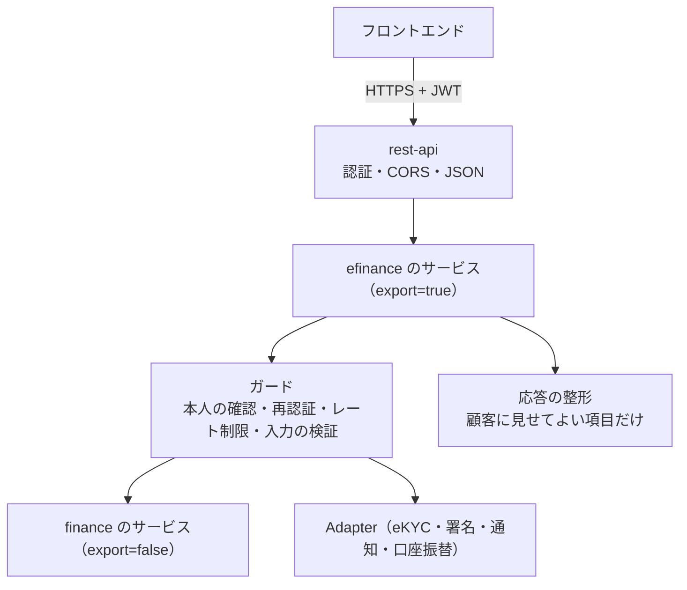

# Apache OFBiz eFinance 仕様書

`REQUIREMENTS_EFINANCE.md` の要件に対する設計。各 STEP の実装後に「実装」「テスト」「検証」を追記する。

> **状態：設計（未着手）**。2026-10-17 作成。efinance プラグインを作るまで `plugins/finance/` に置く。法令（本人確認・書面の電子交付・広告の表示・同意）の要件は、法務の確認を前提とする。

## 進捗

| STEP | 内容 | 状態 |
|------|------|------|
| W0 | 基盤（2 章） | 設計（未着手） |
| W1 | 商品の紹介とシミュレーション（3 章） | 設計（未着手） |
| W2 | Web での申込（4 章） | 設計（未着手） |
| W3 | 本人確認と同意（5 章） | 設計（未着手） |
| W4 | 仮審査と進み具合（6 章） | 設計（未着手） |
| W5 | 電子契約と電子交付（7 章） | 設計（未着手） |
| W6 | マイページ（8 章） | 設計（未着手） |
| W7 | 支払（9 章） | 設計（未着手） |
| W8 | 販売店のポータル（10 章） | 設計（未着手） |
| W9 | 組込み・チャット（10 章） | 設計（未着手） |

---

## 1. 構成

### 1.1 プラグイン

| 項目 | 内容 |
|------|------|
| プラグイン | `plugins/efinance`（コンポーネント名 `efinance`）。顧客向けの画面は持たない（担当者向けの管理画面だけを小さな Web アプリとして持つ。11 章） |
| API | OFBiz の rest-api プラグインが、`plugins/efinance/api/efinance.rest.xml` のリソースと、`export="true"` のサービスを `/rest` で公開する。認証は rest-api の JWT（`Authorization: Bearer`）。OpenAPI の文書は `/docs` |
| パッケージ | `org.apache.ofbiz.efinance.account`（会員・認証・法人アカウント）、`org.apache.ofbiz.efinance.catalog`（商品・シミュレーション）、`org.apache.ofbiz.efinance.application`（申込の下書き・送信）、`org.apache.ofbiz.efinance.kyc`（本人確認・同意）、`org.apache.ofbiz.efinance.contract`（電子契約・交付）、`org.apache.ofbiz.efinance.mypage`（照会・手続き・メッセージ）、`org.apache.ofbiz.efinance.payment`（口座振替）、`org.apache.ofbiz.efinance.adapter`（外部サービスの口）、`org.apache.ofbiz.efinance.security`（権限・不正の検知・記録） |
| 依存 | efinance → finance（公開サービスを `dispatcher.runSync` で呼ぶ。finance の Java のクラスは、共通層の公開の部品（計算・状態の照会）に限って参照する）、OFBiz core、rest-api。ecommerce には依存しない |
| データ | `data/EfinanceTypeData.xml`（seed：状態・同意の種類・通知の種類・顧客向けの段階・権限）、`data/EfinanceDemoData.xml`（demo：公開の商品の設定・文面の版・テスト用の Adapter の設定）、`testdef/data/EfinanceTestData.xml` |

### 1.2 API の層

- efinance のサービスは、すべて次の順に処理する：①認証の確認（会員・有効・ロックなし）②本人の確認（対象の申込・契約が会員のものか、`EfAccessGuard`）③必要なら再認証の確認 ④入力の検証 ⑤finance のサービスの呼出し（**システムの実行ユーザー** `efinance-system` で呼ぶ。顧客の `UserLogin` に finance の権限は付けない）⑥応答の整形 ⑦操作の記録。
- 顧客の `UserLogin` は efinance の権限（`EFINANCE_CUSTOMER`）だけを持つ。

### 1.3 エラーの形

rest-api の応答の形（`statusCode`・`statusDescription`・`errorMessage`）に従い、顧客に見せるメッセージ（多言語のラベル）と、内部の理由のコード（`errorCode`）を分ける。finance のエラーの文面をそのまま顧客に返さない。

---

## 2. STEP W0 — 基盤

### 2.1 エンティティ

| エンティティ | 主な項目 |
|--------------|----------|
| `EfMember` | `partyId`（顧客の `Party`。個人は PERSON、法人の担当者は PERSON で法人に属する）、`userLoginId`、`memberTypeEnumId`（PERSONAL / CORPORATE_USER）、`statusId`（`EFMBR_PENDING`（メールの確認待ち）→ `EFMBR_ACTIVE` → `EFMBR_LOCKED` / `EFMBR_CLOSED`）、メール・電話の確認日、多要素認証の方式、最終ログイン |
| `EfCorporateAccount` | 法人（`Party`、PARTY_GROUP）、管理者の会員、状態 |
| `EfCorporateUser` | 法人 × 会員 × 権限（`EFCORP_APPLY`・`EFCORP_VIEW`・`EFCORP_PAYMENT`・`EFCORP_ADMIN`）× 有効期間 |
| `EfOneTimeCode` | 多要素認証・メールの確認・パスワードの再設定のコード（ハッシュ）、用途、有効期限、試行の回数 |
| `EfRefreshToken` | 更新トークン（ハッシュ）、端末、発行・失効の日時 |
| `EfConsentDocument` / `EfConsent` | 同意の文面（種類・版・言語・有効期間・`Content`）と、会員 × 文面の版の同意（日時・IP・端末・取消） |
| `EfAuditLog` | 操作の記録（会員・操作・対象・結果・IP・端末・日時） |

### 2.2 サービス（API）

| API（サービス） | 認証 | 内容 |
|-----------------|------|------|
| `efRegisterMember` | 不要 | 登録（メールの確認のコードを送る）。パスワードの規則は OFBiz の設定（`security.properties`）を使う |
| `efVerifyEmail` | 不要 | メールの確認 |
| `efLogin` | 不要 | ログイン（パスワード → 多要素認証が要れば `mfaRequired` を返す）。rest-api の認証（`/rest/auth/token`）を使う場合との関係は 2.3 |
| `efVerifyMfa` | 一時トークン | ワンタイムパスワードの確認 → アクセストークン・更新トークン |
| `efRefreshToken` / `efLogout` / `efLogoutAll` | 更新トークン | トークンの更新・失効 |
| `efRequestPasswordReset` / `efResetPassword` | 不要 | パスワードの再設定 |
| `efGetProfile` / `efUpdateProfile` | 要 | 会員の情報（変更は再認証。氏名・住所等の契約に関わる変更は W6 の手続きに回す） |
| `efInviteCorporateUser` / `efUpdateCorporateUser` | 要（法人の管理者） | 法人の担当者の招待・権限 |
| `efAcceptConsent` / `efListConsents` | 要 | 同意 |

### 2.3 認証の方式

- rest-api は OFBiz の `UserLogin` の認証で JWT を発行する（`/rest/auth/token`）。efinance は、多要素認証と会員の状態を確かめるため、自分のログインの API（`efLogin`・`efVerifyMfa`）で認証し、OFBiz の `JWTManager` で同じ形式の JWT を発行する（rest-api の認証のフィルターでそのまま検証できる）。rest-api の `/rest/auth/token` は、顧客の `UserLogin` では使えないようにする（多要素認証を迂回させない。要確認：rest-api の設定で無効にするか、efinance のフィルターで拒否する）。
- アクセストークンの有効期間は短く（例：15 分）、更新トークンで延長する。

---

## 3. STEP W1 — 商品の紹介とシミュレーション

| 種類 | 内容 |
|------|------|
| `EfProductPublication` | 商品（finance の `FinancialProduct`）× 公開の期間 × 表示の順 × 説明（`Content`、多言語）× 対象（個人・法人）× 表示の項目（金利・料率の幅、返済の例、必要な書類、広告の表示の項目） |
| `efListProducts` / `efGetProduct` | 公開の商品（認証不要） |
| `efSimulateLoan` | 金額・期間・返済方法 → 返済予定・総支払額・利息・実質年率（finance の見積の計算の部品 `FinanceInterestCalculator` を使う。保存しない） |
| `efSimulateLease` | 物件の金額・期間 → リース料・総額・消費税（finance の `LeaseCalculator` を使う。商品の料率または利率。保存しない） |

- シミュレーションの結果には「目安であり、審査の結果で変わる」旨の表示の文面（ラベル）を付ける。
- レート制限（IP ごと）をかける。

> finance の計算の部品（`LeaseCalculator` はリース層）を使うため、efinance は finance のローン層・リース層の計算クラスを参照する。finance の層の規則（ローン層とリース層は互いを参照しない）は efinance には適用しないが、efinance からは計算・照会の部品だけを参照し、業務の状態を変える処理は必ずサービスで呼ぶ。

---

## 4. STEP W2 — Web での申込

### 4.1 エンティティ

| エンティティ | 主な項目 |
|--------------|----------|
| `EfApplicationDraft` | 下書き：会員、法人（法人の申込）、商品、申込の種類（LOAN / LEASE）、段階、入力の値（`draftJson`、項目の定義に沿って検証）、状態（`EFDRF_EDITING` → `EFDRF_SUBMITTED` / `EFDRF_EXPIRED` / `EFDRF_WITHDRAWN`）、送信した申込の ID、有効期限、流入元（直接・提携先） |
| `EfDraftDocument` | アップロードした書類（`Content`）、書類の種類、AI の読み取りの依頼（審査 `FinUwAiRequest`）との紐付け |
| `EfApplicationLink` | 送信後の申込（finance の申込 ID・種類）× 会員 × 法人（行単位の権限の判定に使う） |

### 4.2 項目の定義

申込の項目は、商品の種類（個人ローン・法人ローン・個人リース・法人リース）ごとに、段階・項目・型・必須・検証の規則・審査の項目（審査 U1 の `FinCustomerProfile` 等）への対応を seed（`EfFormField`）で持つ。フロントエンドは項目の定義を API（`efGetApplicationForm`）で受け取り、画面を組み立てる。

### 4.3 サービス（API）

| API | 内容 |
|-----|------|
| `efCreateDraft` / `efSaveDraft` / `efGetDraft` / `efListDrafts` / `efWithdrawDraft` | 下書き（段階ごとに保存。保存のたびに検証の結果を返す） |
| `efUploadDocument` / `efDeleteDocument` | 書類（種類・大きさの制限、ウイルスの検査の口 `FileScanAdapter`。簡単な実装は検査なし） |
| `efExtractDocument` | 書類から項目を読み取る（審査 U8 の AI。候補の値を返し、顧客が確認して下書きに入れる） |
| `efLookupAddress` / `efLookupCorporation` | 入力の補助（Adapter） |
| `efSubmitApplication` | 送信：①下書きの全段階の検証 ②同意の確認（必要な同意がすべて最新の版で済んでいるか）③不正の検知（4.4）④finance の申込の作成（`createLoanApplication` / `createLeaseApplication`、希望物件）⑤審査の情報の受渡し（審査 U1 の顧客の情報・決算書・他社の借入の申告・書類）⑥ `EfApplicationLink` ⑦仮審査（W4）⑧通知 |

- 個人の会員の申込者は会員の `Party`。法人の申込者は法人の `Party`（申込の担当者は会員）。
- finance の申込の状態は `LOANAPP_RECEIVED` / `LEASEAPP_RECEIVED` で作られる。提出（`SUBMITTED`）への変更は、担当者が書類を確認してから finance の画面で行う（自動で提出にするかは商品の設定、既定は手動）。

### 4.4 不正の検知（`EfFraudCheck`）

- 規則：同じ端末・IP・電話・住所・口座からの、一定期間の申込の数、仮審査の繰返し、登録から申込までの時間が短すぎる、入力の不整合（郵便番号と住所）など。結果（問題なし・要確認・停止）と当たった規則を記録し、要確認は審査の規則（U3）の確認事項に渡す。
- 端末の識別（フロントエンドが送る端末の ID・User-Agent）と IP を、申込・ログインの記録に残す。

---

## 5. STEP W3 — 本人確認と同意

| エンティティ・API | 内容 |
|-------------------|------|
| `EfKycCheck` | 本人確認：会員（個人）または法人の代表者・取引の担当者、方式（`EFKYC_METHOD`：画像と容貌・IC チップ・書類の郵送 等、犯罪収益移転防止法の方式に対応づける）、提出の画像（`Content`）、状態（`EFKYC_SUBMITTED` → `EFKYC_VERIFIED` / `EFKYC_RESUBMIT` / `EFKYC_REJECTED`）、確認者・確認日、Adapter の結果（外部の ID・判定） |
| `efStartKyc` / `efUploadKycImage` / `efSubmitKyc` / `efGetKycStatus` | 顧客の操作 |
| `reviewEfKycCheck`（担当者、efinance の管理画面） | 手動の確認の結果の記録（簡単な実装の `ManualEkycAdapter`） |
| 審査との連携 | 確認済みになったら審査の外部の情報（U6、`ANTISOCIAL` とは別の種類 `IDENTITY`）に記録する。契約の作成の前に、finance の審査の条件として「本人確認済み」を確かめる（審査 U5 の条件 `FINUWCND_KYC`） |

- 本人確認の記録の保存期間は法令に従う（要確認）。画像の閲覧は担当者の権限で制限する。

---

## 6. STEP W4 — 仮審査と進み具合

### 6.1 仮審査

- `efPreScreen`（送信のとき、または ②の入力の後に任意で）：審査の規則（U3）とスコア（U4）を、下書きの値で評価する（審査の評価の計算クラスを、保存しない形で呼ぶ）。
- 顧客に返すのは目安の区分だけ（`EFPRE_LIKELY` お申込みいただけます／`EFPRE_CONSULT` ご相談ください／`EFPRE_UNLIKELY` お受けできません）と、案内の文面。スコア・当たった規則は返さず、記録だけ残す（`EfPreScreenResult`）。
- 個人の貸付で総量規制（審査 U7）の目安を、申告の値で確かめ、超える場合は「ご相談ください」以下にする（本審査で信用情報の照会により確定する）。

### 6.2 進み具合

| 顧客向けの段階（`EF_STAGE`） | 決め方（finance の状態） |
|------------------------------|--------------------------|
| 受付 | 申込 RECEIVED、書類の不足なし |
| 追加の書類のお願い | 担当者の依頼（`EfDocumentRequest`）が未提出 |
| 審査中 | 申込 SUBMITTED、審査 IN_REVIEW |
| 結果のご連絡 | 審査 APPROVED / REJECTED（否決の理由は返さない。定型の文面） |
| ご契約の手続き | 見積 PRESENTED |
| ご契約済み | 契約 CONTRACTED / ACTIVE |

- `efGetApplicationStatus`：段階・次にしてほしいこと・期限。段階の変化は `EfStageEvent` に記録し、`NotificationAdapter` で知らせる。
- 段階の判定は efinance のバッチ（数分ごと）と、finance のサービスの後の ECA（申込・審査・見積・契約の状態の変化の後に efinance の通知のサービスを呼ぶ）で行う。ECA は efinance の側に定義する（finance は efinance を参照しない）。

### 6.3 追加の書類のお願い

`EfDocumentRequest`（申込・書類の種類・理由・期限・状態）を担当者が efinance の管理画面から作る。顧客は `efListDocumentRequests` / `efSubmitRequestedDocument` で提出する。

---

## 7. STEP W5 — 電子契約と電子交付

| エンティティ・API | 内容 |
|-------------------|------|
| `efGetOffer` | 提示中の見積（金額・期間・返済予定・総支払額・実質年率・手数料・重要事項）と、契約前の書面（PDF） |
| `efAcceptOffer` | 再認証 → 見積の受理（finance `setLoanQuoteStatus` / `setLeaseQuoteStatus` → ACCEPTED） |
| `EfSigningSession` | 署名の手続き：契約書の PDF（finance の帳票）とそのハッシュ、Adapter、状態（`EFSIG_PENDING` → `EFSIG_SIGNED` / `EFSIG_DECLINED` / `EFSIG_EXPIRED`）、署名の日時・IP・端末、署名済みの PDF（`Content`）、タイムスタンプ（将来） |
| `efStartSigning` / `efCompleteSigning` | 再認証 → 署名（簡単な実装 `ClickWrapSignatureAdapter`：内容の確認の表示と同意のチェック、記録）→ 契約の作成（finance `createLoanAgreement` / `createLeaseAgreement`）。L21 の承認が必要な商品は `requestFinanceApproval` で依頼する |
| `EfDeliveredDocument` | 交付した書類（種類：契約前の書面・契約書・重要事項・取引の書面 等、PDF、交付の日時、電子交付の承諾の ID、閲覧の日時）。承諾がない場合は郵送のタスク（finance の作業管理） |
| `efListDocuments` / `efDownloadDocument` | マイページの書類 |

- 契約の作成が失敗した場合（審査の条件・与信枠・見積の状態）は、署名を `EFSIG_PENDING` に戻さず「担当者の確認」にし、顧客には定型の案内を返す。

---

## 8. STEP W6 — マイページ

| API | 内容 |
|-----|------|
| `efListApplications` / `efListContracts` | 自分（法人の権限）の申込・契約 |
| `efGetContract` | 契約の詳細（finance の回収状況 `getLeaseAgreementBalance`・ローンの残高の照会から、顧客に見せる項目だけ）、返済予定・リース料の予定（確定表の現在の revision）、支払の履歴、未払・延滞 |
| `efSimulatePrepayment` / `efRequestPrepayment` | 繰上返済（ローン）：finance の計算の照会でシミュレーション、申込は `EfServiceRequest` として記録し、担当者が確認して finance の繰上返済のサービスを実行する |
| `efRequestModification` | 条件変更の相談（`EfServiceRequest`、担当者が対応） |
| `efRequestExpiryOption` | 満了時の希望（返還・再リース・買取り。リース）。担当者が finance の満了の手続きを行う。満了の 3 か月前に通知 |
| `efRequestProfileChange` | 住所・連絡先・勤務先の変更（再認証、`EfServiceRequest`、担当者の確認の後に `Party` の連絡先へ反映） |
| `efRequestCertificate` | 残高の証明書・支払の証明書（finance の帳票の PDF） |
| `efListMessages` / `efSendMessage` | メッセージ（`CommunicationEvent`、申込・契約に紐付け） |
| `efGetNotificationSettings` / `efUpdateNotificationSettings` | 通知の設定 |

- `EfServiceRequest`：手続きの依頼（種類・対象・内容・状態（受付・対応中・完了・却下）・担当者・結果）。担当者の対応は finance の作業管理のタスクにする（`FINWE_OTHER`）。
- 顧客の操作で finance の業務の状態を直接変える手続きは、最初は作らない（すべて担当者の確認を経る）。将来、自動で実行してよい手続き（例：少額の繰上返済）を商品の設定で許す。

---

## 9. STEP W7 — 支払

| エンティティ・API | 内容 |
|-------------------|------|
| `EfDirectDebitMandate` | 口座振替の依頼：会員・契約（または顧客）、金融機関・支店・口座の種類・番号（暗号化、表示は下 4 桁）・名義、状態（`EFDD_REQUESTED` → `EFDD_REGISTERED` / `EFDD_REJECTED`）、Adapter の結果、開始の予定日 |
| `efRequestDirectDebit` / `efGetDirectDebit` | 顧客の操作（再認証）。簡単な実装 `ManualDirectDebitAdapter`：担当者が金融機関の手続きを行って結果を記録する |
| `efGetPaymentInstructions` | 振込の案内（振込先、契約番号、期日、金額） |
| 入金 | 入金の消込は finance（`receiveLoanPayment` / `receiveLeasePayment`）。口座振替の結果のファイルの取込みは将来（finance の入金のサービスを呼ぶ形で作る） |

- 口座番号の暗号化の方式と鍵の管理は、OFBiz の暗号化の仕組み（`EntityCrypto`、`encrypt="true"` の項目）を使う（要確認）。

---

## 10. STEP W8・W9（概要）

| STEP | 設計の要点 |
|------|------------|
| W8 販売店のポータル | 販売店の会員（`memberTypeEnumId` = DEALER_USER）と販売店の `Party`。顧客の代わりの申込は、顧客の同意（メールのリンクで顧客が同意・本人確認する）を必須にする。販売店は自分が扱った申込の段階だけを見られる |
| W9 組込み | 提携先（`EfPartner`：API の鍵（ハッシュ）・許可する出所（CORS）・利用の範囲・流入元のコード）、流入元の記録（`EfApplicationDraft.sourceEnumId`・`partnerId`）、紹介の手数料の集計 |
| W9 チャット | よくある質問（`Content`）、AI の回答（`AiAssistAdapter`、審査 U8 と同じ記録）、本人の確認の後の状態の照会、担当者への引継ぎ（メッセージ） |

---

## 11. 担当者向けの画面

本人確認の確認、追加の書類のお願い、手続きの依頼（`EfServiceRequest`）の一覧と対応、口座振替の登録の記録、不正の検知の要確認の一覧、会員の照会とロックの解除。

- 画面の定義（`widget/`・コントローラー）は **efinance のプラグインの中** に置き、担当者向けの小さな Web アプリ（例：`/efinanceadmin`、権限 `OFBTOOLS,EFINANCE_ADMIN`）として作る。finance の画面・コードは変えない（finance は efinance を参照しない）。
- 契約・申込の詳細は finance の画面へのリンクで開く。

---

## 12. テストの方針

| 種類 | 内容 |
|------|------|
| サービスの単体テスト | 会員の登録・確認・ログイン・多要素認証・ロック、下書きの保存と検証、送信で finance の申込ができること、本人の確認（他人の申込・契約は見えない・操作できない）、同意の版 |
| 結合テスト（REST） | rest-api 経由の JWT の取得と API の呼出し（OFBiz のテストから HTTP で呼ぶ）、CORS、エラーの形 |
| 流れのテスト | 個人ローン・法人リースで、申込 → 本人確認（手動）→ 仮審査 → 審査の承認（担当者）→ 見積の提示 → 受理 → 署名 → 契約の作成 → マイページの照会 |
| Adapter | 各口のテスト用の実装（決めた結果を返す） |
| 不正の検知 | 規則ごとの判定 |
| finance への影響 | finance の全体テストがそのまま通ること（efinance は finance を変えない） |

---

## 13. 要確認・制約

- **法令**：犯罪収益移転防止法の本人確認の方法と記録の保存、貸金業法・割賦販売法の書面の電子交付の承諾の方法と広告の表示、電子署名法の電子署名の要件（クリックの同意で足りるか）、電子帳簿保存法、個人情報保護法の同意と委託、特定商取引法の適用。法務の確認が必要。
- **rest-api の認証**：顧客の `UserLogin` で rest-api の標準のトークンの発行を使えないようにする方法（設定・フィルター）を、実装の前に rest-api のコードで確かめる。
- **finance の照会の項目**：顧客に見せる残高・予定の項目と、finance の照会サービスの出力の対応を、実装時に確定する（内部の項目を出さない）。
- **口座番号の暗号化と鍵の管理**、アップロードの書類のウイルスの検査の方式。
- **性能・可用性**：顧客向けは常時の稼働が求められる。OFBiz の構成（複数台・セッションを持たない JWT）と、バッチ（段階の判定・通知）の負荷を確認する。
- **フロントエンド**：別のリポジトリで作る。アクセシビリティ・多言語・端末の対応は、フロントエンドの要件として別に定める。
