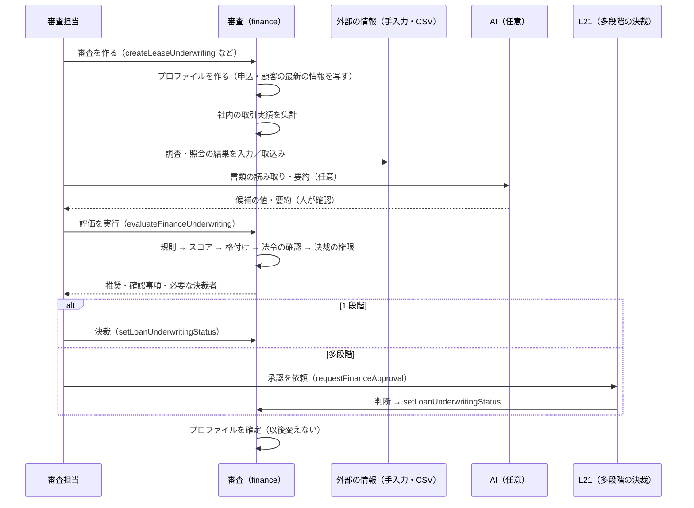

# Apache OFBiz Finance 審査（Underwriting）仕様書

`REQUIREMENTS_UNDERWRITING.md` の要件に対する設計。各 STEP の実装後に「実装」「テスト」「検証」を追記する。

> **状態：設計（未着手）**。2026-10-17 作成。法令（U7）の要件は、貸金業法・割賦販売法とその施行規則・自主規制の最新の内容、および法務・コンプライアンスの確認を前提とする。

## 進捗

| STEP | 内容 | 状態 |
|------|------|------|
| U0 | 基盤（2 章） | 設計（未着手） |
| U1 | 審査の情報（3 章） | 設計（未着手） |
| U2 | 社内の取引実績（4 章） | 設計（未着手） |
| U3 | 規則の判定（5 章） | 設計（未着手） |
| U4 | スコアカードと格付け（6 章） | 設計（未着手） |
| U5 | 決裁（7 章） | 設計（未着手） |
| U6 | 外部の情報（8 章） | 設計（未着手） |
| U7 | 法令の確認（個人）（9 章） | 設計（未着手） |
| U8 | AI の活用（10 章） | 設計（未着手） |
| U9 | 途中の管理（11 章） | 設計（未着手） |

---

## 1. 構成

### 1.1 置き場所と依存

| 項目 | 内容 |
|------|------|
| パッケージ | `org.apache.ofbiz.finance.common.underwriting`（共通層）。ローン層・リース層のクラスは参照しない（AGENTS.md の層の規則） |
| 契約種別ごとの違い | 申込の種類（`applicationTypeId`：LOAN / LEASE）ごとの「申込から金額・期間・商品・申込者を取り出す」処理を `FinanceApplicationAdapter`（新しい共通層のインターフェース）にし、ローン層・リース層が実装する。`finance.properties` の `application.adapter.<種別>=<クラス>` で登録する（`FinanceContractAdapter` と同じ形） |
| 既存との関係 | `LoanUnderwriting`（状態・判断・承認額）と `setLoanUnderwritingStatus` はそのまま使う。承認時の検証（`underwriting.approval.validator.<種別>`）に、審査の判定の確認（U3〜U7）を加える共通の検証サービスを組み合わせる |
| 設定がないとき | 商品に審査の設定（規則・配点表・決裁の権限）がなければ、今まで通り手入力の審査で動く（既存のテストはそのまま通る） |
| データ | seed：`data/FinanceUnderwritingTypeData.xml`（項目の定義・理由のコード・状態・権限）、demo：`data/FinanceUnderwritingDemoData.xml`（配点表・規則・決裁の権限の例）、テスト：`testdef/data/` に追加 |

### 1.2 部品

```java
/** Application facts of one application type (implemented by the loan / lease layers). */
public interface FinanceApplicationAdapter {
    String getApplicationTypeId();                                   // LOAN / LEASE
    FinUwApplicationFacts facts(Delegator delegator, String applicationId) throws GenericEntityException;
    // facts: applicant party, product, currency, requested amount / term, asset types (lease), dealer, purpose
}

/** Source of one kind of external credit information (manual / CSV first; vendor APIs later). */
public interface CreditInfoAdapter {
    String getInfoTypeId();                                          // CORP_CREDIT / PERSONAL_CREDIT / ANTISOCIAL / REGISTRY / ASSET_PRICE
    boolean supportsInquiry();                                       // false for the manual / CSV implementation
    FinUwExternalInfo inquire(FinUwInquiryRequest request) throws CreditInfoException;
}

/** Generative AI assistance (document extraction, summary, memo draft). */
public interface AiAssistAdapter {
    AiResult extract(AiDocument document, String schemaId) throws AiAssistException;
    AiResult summarize(List<AiDocument> documents, String promptId) throws AiAssistException;
    AiResult draftMemo(Map<String, Object> facts, String promptId) throws AiAssistException;
}
```

- 実装の登録：`finance.properties` の `uw.creditinfo.<種類>=<クラス>`（既定は手入力・CSV の `ManualCreditInfoAdapter`）、`uw.ai.adapter=<クラス>`（既定は「無効」の `NoAiAssistAdapter`。汎用の実装は HTTP で JSON を送る `GenericHttpAiAssistAdapter`。接続先は `FinUwAiEndpoint`）。
- 判定・スコア・総量規制・支払可能見込額の計算は、DB を読まない純粋な計算クラス（`FinUwRuleEngine`、`FinUwScorecard`、`FinUwRegulatoryCalculator`）に置く。

### 1.3 審査の流れ



---

## 2. STEP U0 — 基盤

### 2.1 エンティティ

| エンティティ | 主な項目 |
|--------------|----------|
| `FinUwProfile` | `loanUnderwritingId`（1:1）、`applicationTypeId`・`applicationId`、`customerTypeEnumId`（CORP / PERSONAL）、`partyId`、商品・金額・期間・通貨（`FinanceApplicationAdapter` の facts の写し）、`configVersionId`、`evaluatedDate`、推奨（`recommendationEnumId`：AUTO_APPROVE / APPROVE / MANUAL / ESCALATE / REJECT）、`score`・`gradeEnumId`、`requiredAuthorityEnumId`、`regulatoryStatusEnumId`（OK / NG / NOT_APPLICABLE / PENDING）、`finalizedDate`、`overrideReason`（推奨と違う判断の理由） |
| `FinUwConfigVersion` | 設定の版：`configVersionId`、対象（商品または商品の種類）、`fromDate`・`thruDate`、`statusId`（下書き・有効・廃止）、承認者・承認日・変更の理由 |
| seed | 推奨・格付け（`FIN_UW_GRADE`：A〜E、既定）・決裁の権限（`FIN_UW_AUTHORITY`：担当・課長・部長・審査部・役員・委員会）・理由のコード（`FIN_UW_REASON`）・権限（`FINANCE_UW_*`） |

### 2.2 サービス

| サービス | 内容 |
|----------|------|
| `prepareFinanceUnderwritingProfile` | 審査を作ったとき（`createFinanceUnderwriting` の後の ECA ではなく、各層の審査の作成サービスから呼ぶ）にプロファイルを作る。顧客の最新の属性・財務を写す |
| `evaluateFinanceUnderwriting` | 取引実績（U2）→ 規則（U3）→ スコア（U4）→ 法令（U7）→ 決裁の権限（U5）を計算し、プロファイルに保存する。`LOANUW_IN_REVIEW` の間は何度でも実行でき、毎回の結果を `FinUwEvaluation` に履歴として残す |
| `financeValidateUnderwritingEvaluation` | 承認時の検証（共通）：評価が最新か（評価の後に情報が変わっていないか）、推奨が否決でないか（否決なら例外の理由と上位の決裁が必要）、法令の確認が OK か（対象の商品）、条件付き承認の条件が記録されているか、決裁者が権限を持つか。既存の `underwriting.approval.validator.<種別>` の検証の前に必ず呼ぶ |
| `finalizeFinanceUnderwritingProfile` | 承認・否決のときに確定する（`setLoanUnderwritingStatus` から呼ぶ。追加の処理であり、既存の状態遷移の規則は変えない） |

---

## 3. STEP U1 — 審査の情報

### 3.1 エンティティ

| エンティティ | 主な項目 |
|--------------|----------|
| `FinCustomerProfile` | 顧客（`Party`）の最新の属性：法人（法人番号・業種コード・設立年月・資本金・従業員数・上場・許認可・主要取引銀行）、個人（生年月日・職業・勤務先・雇用形態・勤続年数・年収・年収の確認日と書類・住居の種類・家賃・居住年数・世帯の人数）。更新の履歴を残す |
| `FinFinancialStatement` / `FinFinancialStatementItem` | 決算書（顧客 × 決算期 × 単体／連結）と項目（項目のコード × 金額）。項目のコードは seed（売上高・売上原価・販管費・営業利益・経常利益・当期純利益・減価償却費・流動資産・固定資産・総資産・流動負債・有利子負債・純資産 等）。入力の方法（手入力・CSV・AI の読み取り）と確認者 |
| `FinFinancialRatio` | 決算書ごとの財務比率（計算の結果、計算式の版） |
| `FinUwProfileFact` | プロファイルの事実（項目のコード × 値）：審査の時点の属性・財務・比率・案件の情報を、規則・スコアで使う形（キーと値）で写したもの |
| `FinUwDocumentRequirement` / `FinUwDocument` | 商品ごとの必要な書類の定義と、審査ごとの書類（OFBiz の `Content`、受領日・確認者・確認日・有効期限） |
| `FinOtherDebtDeclaration` | 個人・法人の他社の借入の申告（相手・種類・残高・月の返済額・申告日・確認の方法） |

### 3.2 財務比率（計算式の例、seed で定義）

| 比率 | 式 |
|------|----|
| 自己資本比率 | 純資産 ÷ 総資産 |
| 流動比率 | 流動資産 ÷ 流動負債 |
| 売上高経常利益率 | 経常利益 ÷ 売上高 |
| 債務償還年数 | 有利子負債 ÷（経常利益 × (1 − 実効税率) ＋ 減価償却費） |
| インタレスト・カバレッジ・レシオ | （営業利益＋受取利息・配当金）÷ 支払利息 |
| 売上の伸び | 当期の売上高 ÷ 前期の売上高 − 1 |
| 債務超過・連続赤字 | 純資産 < 0、当期純利益 < 0 の連続の期数 |

分母が 0・項目が欠けている場合は「計算不能」とし、規則で扱いを決める。

### 3.3 取込み

`importFinFinancialStatements`（CSV：顧客・決算期・項目のコード・金額）、`importFinCustomerProfiles`（CSV）。行ごとの検証結果を返す。

---

## 4. STEP U2 — 社内の取引実績

| 項目 | 集計の方法 |
|------|------------|
| 対象の取引先 | 申込者、`PartyRelationship` のグループ（親子・関係会社）、代表者、保証人（`LoanGuarantor`、`FinanceContractParty` の保証の役割） |
| 契約 | `FinanceContract`（種別・状態別の件数、最初の契約日 → 取引の年数） |
| 残高 | `FinanceContractHelper.sumExposurePrincipal` と与信枠（`CreditLine`） |
| 延滞 | `LoanDelinquency` 等の延滞の記録：期間別（1 年・3 年・全期間）の回数、最長の延滞日数、現在の延滞の額と日数、最高の延滞区分 |
| 督促・償却・法的措置 | 共通の延滞エンジンの記録 |
| 完済・満了 | 完了の契約の件数と、遅れのない完了の割合 |
| その他 | 中途解約・条件変更・取消（L15a）の回数、前受金・保証金の残高 |

- 結果は `FinUwTrackRecord`（審査 × 取引先 × 項目 → 値）に保存し、プロファイルの事実（`FinUwProfileFact`）にも写す。
- 社内の注意先：`FinCustomerWatch`（取引先・理由のコード・登録日・登録者・有効期間・解除）。

---

## 5. STEP U3 — 規則の判定

### 5.1 エンティティ

| エンティティ | 主な項目 |
|--------------|----------|
| `FinUwRuleSet` | 規則の組（設定の版 × 顧客の区分） |
| `FinUwRule` | 規則：順番、名前、条件（`conditionJson`：項目のコード・比較（=, <>, <, <=, >, >=, IN, 欠損）・値の組と AND/OR）、結果（`resultEnumId`：REJECT / ESCALATE / CONDITION / CHECK / AUTO_APPROVE_ELIGIBLE）、理由のコード、条件付きのときの条件のコード、確認事項の文 |
| `FinUwRuleHit` | 評価ごとの当たった規則と、使った値 |

### 5.2 判定

- `FinUwRuleEngine.evaluate(facts, rules)`：すべての規則を評価し、当たった規則の一覧を返す。
- 推奨：REJECT が 1 つでもあれば REJECT。なければ ESCALATE があれば ESCALATE、CONDITION があれば APPROVE（条件付き）、AUTO_APPROVE_ELIGIBLE だけで、かつ商品の設定で自動の承認が許され、金額が上限以下なら AUTO_APPROVE、それ以外は MANUAL。
- 欠けている項目：規則ごとに「欠損なら当たる／当たらない」を指定する（既定は当たらない＝確認事項を出す）。

---

## 6. STEP U4 — スコアカードと格付け

| エンティティ | 主な項目 |
|--------------|----------|
| `FinUwScorecard` | 配点表（設定の版 × 顧客の区分）、基礎点 |
| `FinUwScorecardItem` | 項目のコード × 値の区分（範囲・列挙）→ 点数。欠損のときの点数 |
| `FinUwGradeBand` | 点数の帯 → 格付け、格付けごとの条件のコード（保証人・保証金・期間の上限）、価格の目安（金利・料率の上乗せ）、自動の承認の可否 |
| `FinUwScoreDetail` | 評価ごとの項目別の点数（説明に使う） |

- スコアは `LoanUnderwriting.creditScore` にも書く（手入力の値と違うときは理由を記録）。
- 帳票：格付け別の件数・承認率・契約後の延滞率（社内の実績）。配点の見直しに使う。

---

## 7. STEP U5 — 決裁

| エンティティ | 主な項目 |
|--------------|----------|
| `FinUwAuthorityRule` | 商品（または種類）× 金額の範囲（今回の額、または顧客の与信の合計）× 格付け × 推奨 → 必要な決裁の権限 |
| `FinUwAuthorityAssignment` | 決裁の権限 × 人（`UserLogin`・`Party`）× 金額の上限 × 有効期間 |
| `FinUwCondition` | 審査の条件（条件のコード・内容・満たしたか・確認者）。契約の作成のときに、すべて満たしているかを確かめる |
| `FinUwDecisionLog` | 決裁の履歴（決裁者・権限・判断・理由・推奨と違うか） |

- 決裁者の確認：`financeValidateUnderwritingEvaluation` で、承認する人が必要な権限を持つかを確かめる。持たない場合は L21 の承認ワークフローで上位の決裁者に依頼する（操作 `FINAPROP_UW_DECISION`、方針で必要な権限ごとに BPM のプロセスを選ぶ）。
- 契約の作成（`createLoanAgreement` / `createLeaseAgreement`）の前提の確認に、審査の条件（`FinUwCondition`）がすべて満たされていることを加える（各層の契約の作成から共通の確認サービス `financeValidateUnderwritingConditions` を呼ぶ）。

---

## 8. STEP U6 — 外部の情報

| エンティティ | 主な項目 |
|--------------|----------|
| `FinUwExternalInfo` | 情報の種類（CORP_CREDIT / PERSONAL_CREDIT / ANTISOCIAL / REGISTRY / ASSET_PRICE）、取引先、出所（調査会社・機関の名前）、取得の方法（MANUAL / CSV / API）、取得日・有効期限、費用、取得者、主要な値（`FinUwExternalInfoItem`：評点・業績・照合の結果 等）、原本（`Content`）、審査との紐付け |
| `FinUwInquiryPolicy` | 照会の条件：情報の種類 × 商品 × 金額の範囲 × 新規／既存 → 照会が必須／任意／不要 |

- 規則（U3）で「必須の情報がない・有効期限切れ」を確認事項または否決にできる。
- 反社チェックの結果「該当」は否決の規則（seed の既定の規則）にする。照合の記録は、取引先（`Party`）単位でも残す（定期的な照合に使う）。

---

## 9. STEP U7 — 法令の確認（個人）

### 9.1 商品の設定

`FinancialProductRegulation`（商品 × 規制の種類）：`MONEYLENDING`（貸金業法の対象の貸付）、`INSTALLMENT_INDIVIDUAL`（個別信用購入あっせん）、`INSTALLMENT_COMPREHENSIVE`（包括信用購入あっせん）、`NONE`。総量規制の除外・例外の区分を申込で選べるか。個人リースの扱いは法務の確認で決める（`NONE` か `INSTALLMENT_*` か）。

### 9.2 記録

| エンティティ | 主な項目 |
|--------------|----------|
| `FinCreditBureauConsent` | 同意：取引先・機関・目的（照会・登録）・同意の日・書類（`Content`）・有効範囲 |
| `FinCreditBureauInquiry` | 照会：機関・照会日・目的・同意の ID・照会者・結果の要約（他社の借入の件数・残高・延滞の有無・異動の情報）・原本 |
| `FinCreditBureauRegistration` | 登録の予定と記録：契約・登録の種類（契約・返済の状況・完済・延滞）・期限・登録日（最初は登録用の CSV の出力 `exportFinCreditBureauRegistrations`） |
| `FinRegulatoryCheck` | 審査ごとの確認の結果：規制の種類、年収等・その確認の書類、他社の残高、自社の残高、今回の額、上限（年収等 × 1/3）、除外・例外の区分、支払可能見込額の計算の明細、判定（OK / NG）、計算の版 |

### 9.3 計算（`FinUwRegulatoryCalculator`）

- **総量規制**：上限 ＝ 年収等 × 1/3。判定 ＝（自社の残高（除外の貸付を除く）＋ 他社の残高（信用情報の照会の結果）＋ 今回の額（除外・例外の区分による））≤ 上限。収入の証明が必要な条件（自社の貸付の額・合計の額の基準）を設定で持ち、満たさない場合は書類の不足として NG。
- **支払可能見込額**：（年収 − 生活維持費（世帯の人数・住居の有無の表、seed）− 他のクレジットの年間の支払の見込み）。今回の年間の支払の額と比べる（包括は上限の額の算定に使う）。
- 対象の商品で、照会の記録がない、または判定が NG の審査は、`financeValidateUnderwritingEvaluation` で承認できない。

> 計算式・基準の額・生活維持費の表・除外と例外の範囲は、法令・内閣府令・経済産業省令・自主規制規則の最新の内容で確認し、seed の値を合わせる。本書の式は設計の枠組みであり、法令の解釈ではない。

---

## 10. STEP U8 — AI の活用

### 10.1 接続先と記録

| エンティティ | 主な項目 |
|--------------|----------|
| `FinUwAiEndpoint` | 接続先：アダプター、URL、モデル名、認証のプロパティ名（秘密は DB に置かない）、送ってよい情報の区分（法人・個人・書類）、データの保存場所（国・地域）、学習に使わない設定の確認日、委託の契約の確認日、費用の単価 |
| `FinUwAiPrompt` | 指示文の版（用途：抽出・要約・稟議の下書き・異常の検知、指示文、出力の形式） |
| `FinUwAiRequest` | 依頼の記録：審査・用途・接続先・指示文の版・入力の要約とハッシュ（入力の書類の ID）・出力・確からしさ・費用・日時・依頼者、人の確認（採用・修正・不採用、確認者） |

### 10.2 機能

| 機能 | 処理 |
|------|------|
| 書類の読み取り | 書類（`Content`）を送り、項目の定義（`schemaId`：決算書・源泉徴収票・登記事項 等）に沿った値を受け取る。値を `FinFinancialStatementItem` 等の **候補** として保存し、人が確認したものだけを確定する |
| 要約 | 調査報告書・ニュース等（人が添付・指定したもの）を要約し、懸念点（出典の位置つき）を一覧にする |
| 稟議の下書き | プロファイルの事実・規則の結果・スコア・取引実績から、稟議書の下書きを作る。確定版は担当者が編集したものを `FinUwDocument`（稟議書）として保存する |
| 異常の検知 | 規則で表せない不整合を AI に指摘させる（警告のみ）。重複する連絡先・口座の検知は AI を使わず、規則（U3）と集計で行う |
| 機械学習のスコア | 実績が十分に貯まってから、Python のバッチ（ALM の `SPEC_ALM.md` 10 章と同じファイル連携）でモデルを作り、推論の結果を参考のスコアとして `FinUwProfile` に記録する。モデルの版・学習のデータの期間・精度（AUC 等）・使った項目を `FinUwModelVersion` に残し、使ってはいけない項目を除く。格付け（U4）は当面スコアカードで決め、機械学習のスコアは参考に表示する |

### 10.3 送る情報の制御

- 用途ごとに送る項目を決め（`FinUwAiPrompt` の定義）、それ以外は送らない。マイナンバー・口座番号の全桁・信用情報機関の照会の結果の原本は送らない（信用情報の目的外利用にあたるおそれがあるため。要確認）。
- 個人の情報を送る用途は、接続先の「送ってよい情報の区分」に個人が含まれる場合だけ。
- AI の出力は判断の根拠にしない（根拠は元の書類・規則・スコア）。否決の理由のコードは規則から決める。

---

## 11. STEP U9 — 途中の管理

| エンティティ・サービス | 内容 |
|------------------------|------|
| `FinCustomerReview` | 見直しの予定と結果（顧客・種類（決算の更新・年次・警告による臨時）・予定日・実施日・結果・新しい格付け） |
| `FinCustomerAlert` | 警告（顧客・種類・発生日・内容・状態（未対応・対応中・完了）・対応の記録） |
| `runFinanceCustomerReviewBatch` | 見直しの予定の作成（決算月から一定の月数の後、与信の合計が基準以上の顧客の年次）と、作業（WorkEffort）のタスク化（顧客 × 種類 × 予定日ごとに 1 件） |
| `runFinanceCustomerAlertBatch` | 延滞の発生・区分の上昇、外部の評点の低下（取り込んだもの）、財務比率の悪化（新しい決算書）、残高の増加、注意先の登録を警告にする |

見直しで格付けが変わったら、与信枠（`CreditLine`）の見直しを既存のサービスで行う（自動では変えない）。

---

## 12. テストの方針

| 種類 | 内容 |
|------|------|
| 計算の単体テスト | 財務比率（欠損・0 割り）、規則の判定（AND/OR、欠損、推奨の決め方）、配点と格付け、総量規制と支払可能見込額（境界の値） |
| 審査の流れ | ローン・リースの審査で、プロファイルの作成 → 評価 → 承認・否決 → 確定（確定後の変更不可）、推奨が否決のときの例外の承認、決裁の権限、条件付き承認と契約の作成の確認 |
| 取引実績 | 延滞・償却・完済のある顧客、グループ・代表者・保証人の集計 |
| 法令 | 対象の商品で照会の記録がないと承認できない、総量規制の超過で NG、除外の区分、対象外の商品は確認しない |
| AI | `StubAiAssistAdapter`（決めた値を返す）で、候補の保存・人の確認・記録。外部にはつながない |
| 既存の動作 | 審査の設定がない商品で、既存の全体テストがそのまま通ること |

---

## 13. 要確認・制約

- **法令**：貸金業法・割賦販売法の対象の判定（特に個人リース）、総量規制の除外・例外の範囲と収入の証明の基準、支払可能見込額の計算（生活維持費の表）、信用情報の照会・登録の要件と、信用情報の目的外利用の禁止の範囲は、法務・コンプライアンスの確認が必要。指定信用情報機関との接続は、各機関の会員の要件と接続の仕様に従う。
- **個人情報**：審査に使ってはいけない項目・機微な情報（要配慮個人情報）の扱い、外部の AI サービスへの提供（委託）の条件、保存期間は、個人情報保護の方針と法務の確認が必要。
- **外部の情報の利用条件**：信用調査の報告書の再利用・保存・AI への送信が、調査会社の利用規約で許されるかを確認する。
- **スコアの妥当性**：配点表は社内の実績で定期的に検証する。機械学習のスコアは、データが十分に貯まるまで使わない。
- **説明の責任**：否決の理由は、規則の理由のコードと人の判断で説明できるようにする（AI の出力を理由にしない）。
